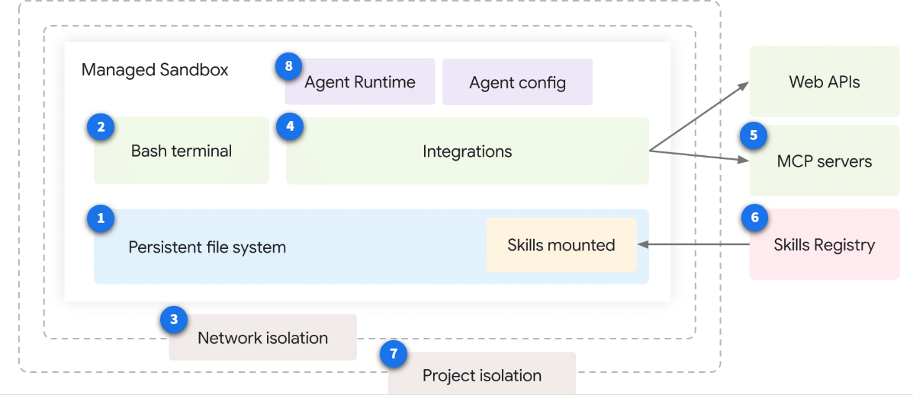
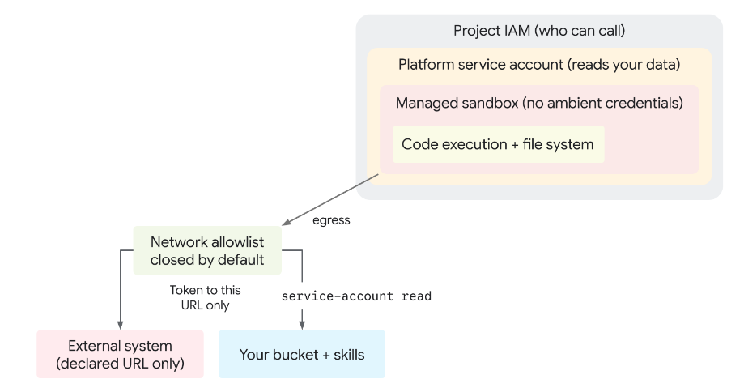

# Build with the Managed Agents API on Gemini platform

## The need for an Agent in a sandbox

In this lesson, you'll learn why a real business task demands secure infrastructure, when to choose a managed runtime over a developer framework, and what the platform's secure sandbox gives you.

### The hero task and the infrastructure it demands

Let's use an example scenario to learn the various concepts in this course. Imagine a category manager at Cymbal Retail asks:

> _"Umbrella sales dropped 18% last quarter in the Northeast. Pull the Q3 sales, find the five worst-declining products, check current inventory, and tell me whether it's a demand problem or a stock problem."_

Answering it means reading data from storage, running an analysis over it, and checking a live inventory system, each step depending on the one before.

To do that work, an agent needs real infrastructure:

* Somewhere to run code
* Access to Cymbal's data
* A way to reach a live inventory system
* Credentials to use it

For an enterprise, each of these requirements immediately raises security questions: Where does the data sit? What can the agent touch? And what can it reach on the network?

This is the exact task you'll build an agent to solve in this course—and it is the primary reason the platform starts from secured infrastructure rather than from code.

### From a developer framework to a managed runtime

When choosing how to build your AI applications, the decision largely depends on your starting point and organizational priorities:

| Approach | How it works | Enterprise priority | Choose when |
| :--- | :--- | :--- | :--- |
| **Code-first approach** *(Developer frameworks)* | You start with code using frameworks such as the ADK, building the application first and considering infrastructure later. | Offers full flexibility, allowing you to run and deploy the agent anywhere. | You want full control of the runtime and the freedom to deploy anywhere. |
| **Infrastructure-first approach** *(Managed Agents API)* | Inverts the order by starting with a standard, isolated Linux sandbox, allowing you to add the agent's logic on top. | Focuses on security first, requiring a secure environment to limit actions and access. Within this fully managed execution container, custom agents can reason, plan workflows, execute bash commands, and read or write files out-of-the-box. | You want a secure, isolated foundation and would rather add your agent's logic on top than build and operate that infrastructure yourself. |

| Approach | How it works | Enterprise priority | Choose when |
| :--- | :--- | :--- | :--- |
| **Code-first approach** *(Developer frameworks)* | You start with code using frameworks such as the ADK, building the application first and considering infrastructure later. | Offers full flexibility, allowing you to run and deploy the agent anywhere. | You want full control of the runtime and the freedom to deploy anywhere. |
| **Infrastructure-first approach** *(Managed Agents API)* | Inverts the order by starting with a standard, isolated Linux sandbox, allowing you to add the agent's logic on top. | Focuses on security first, requiring a secure environment to limit actions and access. Within this fully managed execution container, custom agents can reason, plan workflows, execute bash commands, and read or write files out-of-the-box. | You want a secure, isolated foundation and would rather add your agent's logic on top than build and operate that infrastructure yourself. |

### What the sandbox provides

Every sandbox environment provides the following core systems and controls:

1. **Persistent File System:** Securely persists files, agent logic, and execution state across multi-turn interactions.
2. **Bash Terminal:** Provides a secure environment for executing terminal commands, running custom scripts, and processing local files.
3. **Network Isolation:** You can explicitly declare a network allowlist to let the agent access public internet resources or download external libraries.
4. **Extensible Integrations:** Supports importing custom capabilities dynamically, including standard web APIs, Model Context Protocol (MCP) servers.
Supports importing custom capabilities dynamically, including standard web APIs, Model Context Protocol (MCP) servers.
5. **MCP credentials scoping:** Header configurations for MCP servers, which contain backend authentication tokens, are transmitted only when accessing the specific MCP endpoints defined in your configuration.
Header configurations for MCP servers, which contain backend authentication tokens, are transmitted only when accessing the specific MCP endpoints defined in your configuration.
6. **Data scoping for Cloud Storage and Skill Registry mountsData scoping for Cloud Storage and Skill Registry mounts:** When you attach external data sources from Google Cloud Storage or Skill Registry, the environment is provided with downscoped authorization tokens designed to access only the specific directories or skills specified in the agent configurations.
7. **Project access:** To run an interaction, a caller needs the right Identity and Access Management role on the project: the aiplatform.user(opens in a new tab) role to run interactions, and the aiplatform.admin(opens in a new tab) role to create, update, or delete agents.
8. **Preloaded toolchain:** The sandbox ships with Python 3.11 (including pandas, numpy, and the google-genai SDK), Node 20, and common command-line tools, so the agent can analyze data with no setup. Any packages it installs at run time with pip or npm persist in the environment.

### The security boundary

The following diagram illustrates the security boundary. Project IAM controls who can call, while the platform service account reads your data on your behalf using a downscoped token. Meanwhile, the sandbox runs without its own credentials or network egress until you explicitly open it.

The following standard parameters govern the sandbox execution and lifecycle:

1. **Sandbox environment:** Agents operate within a fully managed sandbox environment, utilizing the Antigravity harness for orchestration.
2. **Sandbox time to live (TTL):** The sandbox environment has a standard time to live (TTL) of 7 days. Each new interaction automatically resets this timer to ensure active agents remain available.
3. **Agent configuration persistence:** The backend persistently stores agent configurations, which remain until an explicit DELETE request is sent to the Agents API.
4. **Agent collaboration:** Multiple agents can share the same environment when the same env_id is provided during interaction.

## Interaction with the agent in a sandbox

In this lesson, you'll learn how the platform splits into a control plane and a data plane, and what it runs for you versus what you provide.

### The two planes: Control and data

There are two distinct APIs that divide the interaction with the agent.

The Agents API, which is responsible for creating and configuring the agent, and the Interactions API, which is responsible for managing the agent at runtime in a conversation:

#### Agents API

Flow diagram: A User sends agent config to the Agents API, creating a stored, reusable agent config.

The Agents API is the control plane. You use it to define an agent once, as a durable cloud resource with a name.

The definition holds the agent's persona, its tools, and its environment. It persists until you delete it, the way a virtual machine or a storage bucket persists. You create, read, update, and delete agents here.

# Control plane: define the agent once.
client.agents.create(id="cymbal-merch-analyst", base_agent=..., system_instruction=...)

Creating an agent doesn't return the agent immediately. It returns a long-running operation (LRO), a handle to work the platform is doing in the background.

You poll that handle until it reports done, then read the finished agent. Long-running operations appear whenever the platform performs complex tasks, so it helps to recognize the pattern early.

Interactions API

Flow diagram: User sends request to Interactions API, which retrieves config for Harness + Runtime to output a {Response}.

The Interactions API is the data plane. You use it to run the agent. Each interaction references an agent by name, binds an environment, and drives the reason-act loop to completion.

An interaction is ephemeral: It exists for one run. So you define an agent once on the control plane, then run it many times on the data plane. In code, those are two different calls against the same named agent:

# Data plane: run it, as often as you like.
client.interactions.create(agent="cymbal-merch-analyst", input="Umbrella sales dropped 18%...")
What the platform runs for you

Executing the reason-act loop requires underlying infrastructure. Rather than building it yourself, the platform automatically provisions and manages the orchestrator, secure environment, and access controls on your behalf.

Click each + button to expand the items and learn more about what the platform runs for you.

Orchestrator
An orchestrator is essential for managing the steps of the reason-act loop and determining when to halt the process.

It ensures seamless coordination and decision-making throughout the workflow.

Secure Sandbox
A secure, stateful sandbox is necessary to execute code and store intermediate files safely.

This environment provides isolation and security for the operations performed by the agent.

Credential Management
Proper methods are required to securely provide credentials to the systems accessed by the agent.

This prevents unauthorized access and ensures the confidentiality of sensitive information.

Network Control
Controlling the agent's network access is crucial to limit its reach and ensure security.

Implementing restrictions helps mitigate potential risks and unauthorized activities.

Combining these manageable components forms a comprehensive platform.

The Managed Agents API: Structure and functionality

The Managed Agents API draws a clean boundary around your agent's workload.

•
You provide the intent: You supply the system instructions (the persona and rules), the tools the agent is allowed to use, and the bounds of its environment (the data and network access it is allowed).

•
The platform provides the runtime: The platform provisions and tears down the sandbox, runs the reason-act loop, manages state, and dispatches each tool call.

The practical effect is that answering a complex business question—like the Cymbal Retail scenario—becomes a matter of configuration, not infrastructure. You describe the agent and the data it can see, and the platform runs the loop that reads, computes, checks inventory, and decides.

The following diagram illustrates this capability stack, showing how your configured intent sits on top of the managed platform runtime.

Capability stack diagram showing user intent above the boundary and the managed platform runtime below it.

Diagram: the capability stack. You provide the intent at the top; the platform runs everything below the boundary.Interaction with the agent in a sandbox
In this lesson, you'll learn how the platform splits into a control plane and a data plane, and what it runs for you versus what you provide.

The two planes: Control and data

There are two distinct APIs that divide the interaction with the agent.

The Agents API, which is responsible for creating and configuring the agent, and the Interactions API, which is responsible for managing the agent at runtime in a conversation:

Agents API

Flow diagram: A User sends agent config to the Agents API, creating a stored, reusable agent config.

The Agents API is the control plane. You use it to define an agent once, as a durable cloud resource with a name.

The definition holds the agent's persona, its tools, and its environment. It persists until you delete it, the way a virtual machine or a storage bucket persists. You create, read, update, and delete agents here.

# Control plane: define the agent once.
client.agents.create(id="cymbal-merch-analyst", base_agent=..., system_instruction=...)

Creating an agent doesn't return the agent immediately. It returns a long-running operation (LRO), a handle to work the platform is doing in the background.

You poll that handle until it reports done, then read the finished agent. Long-running operations appear whenever the platform performs complex tasks, so it helps to recognize the pattern early.

Interactions API

Flow diagram: User sends request to Interactions API, which retrieves config for Harness + Runtime to output a {Response}.

The Interactions API is the data plane. You use it to run the agent. Each interaction references an agent by name, binds an environment, and drives the reason-act loop to completion.

An interaction is ephemeral: It exists for one run. So you define an agent once on the control plane, then run it many times on the data plane. In code, those are two different calls against the same named agent:

# Data plane: run it, as often as you like.
client.interactions.create(agent="cymbal-merch-analyst", input="Umbrella sales dropped 18%...")
What the platform runs for you

Executing the reason-act loop requires underlying infrastructure. Rather than building it yourself, the platform automatically provisions and manages the orchestrator, secure environment, and access controls on your behalf.

Click each + button to expand the items and learn more about what the platform runs for you.

Orchestrator
An orchestrator is essential for managing the steps of the reason-act loop and determining when to halt the process.

It ensures seamless coordination and decision-making throughout the workflow.

Secure Sandbox
A secure, stateful sandbox is necessary to execute code and store intermediate files safely.

This environment provides isolation and security for the operations performed by the agent.

Credential Management
Proper methods are required to securely provide credentials to the systems accessed by the agent.

This prevents unauthorized access and ensures the confidentiality of sensitive information.

Network Control
Controlling the agent's network access is crucial to limit its reach and ensure security.

Implementing restrictions helps mitigate potential risks and unauthorized activities.

Combining these manageable components forms a comprehensive platform.

The Managed Agents API: Structure and functionality

The Managed Agents API draws a clean boundary around your agent's workload.

•
You provide the intent: You supply the system instructions (the persona and rules), the tools the agent is allowed to use, and the bounds of its environment (the data and network access it is allowed).

•
The platform provides the runtime: The platform provisions and tears down the sandbox, runs the reason-act loop, manages state, and dispatches each tool call.

The practical effect is that answering a complex business question—like the Cymbal Retail scenario—becomes a matter of configuration, not infrastructure. You describe the agent and the data it can see, and the platform runs the loop that reads, computes, checks inventory, and decides.

The following diagram illustrates this capability stack, showing how your configured intent sits on top of the managed platform runtime.

Capability stack diagram showing user intent above the boundary and the managed platform runtime below it.

Diagram: the capability stack. You provide the intent at the top; the platform runs everything below the boundary.

