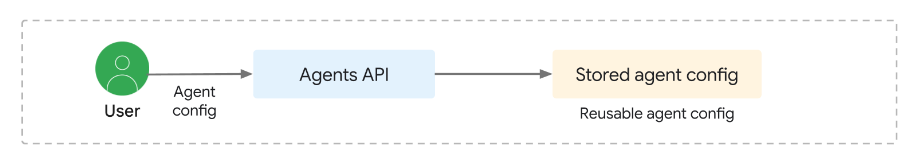
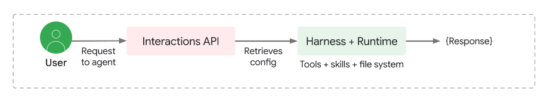
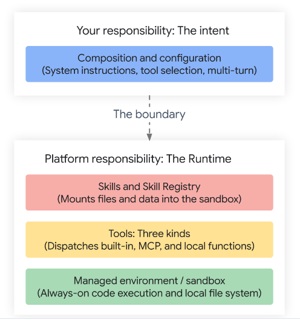
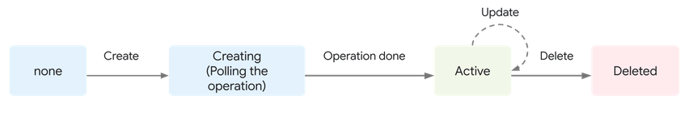
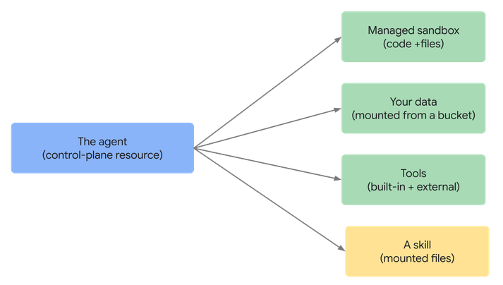
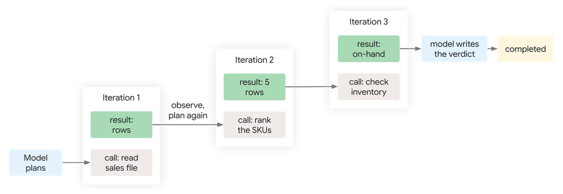
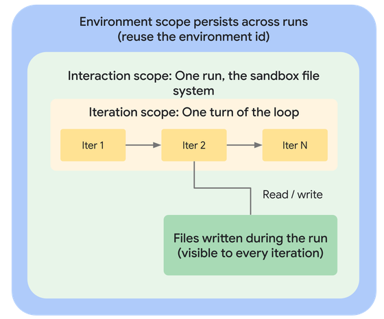
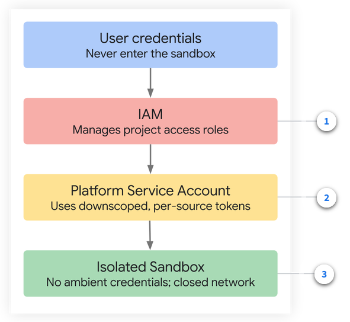

<link rel="stylesheet" href="./tabs.css">

# Build with the Managed Agents API on Gemini platform

## The Managed Agent Model

### The need for an agent in a sandbox

In this lesson, you'll learn why a real business task demands secure infrastructure, when to choose a managed runtime over a developer framework, and what the platform's secure sandbox gives you.

#### The hero task and the infrastructure it demands

Let's use an example scenario to learn the various concepts in this course. Imagine a category manager at Cymbal Retail asks:

> _"Umbrella sales dropped 18% last quarter in the Northeast. Pull the Q3 sales, find the five worst-declining products, check current inventory, and tell me whether it's a demand problem or a stock problem."_

Answering it means reading data from storage, running an analysis over it, and checking a live inventory system, each step depending on the one before.

To do that work, an agent needs real infrastructure:

* Somewhere to run code
* Access to Cymbal's data
* A way to reach a live inventory system
* Credentials to use it

For an enterprise, each of these requirements immediately raises security questions: Where does the data sit? What can the agent touch? And what can it reach on the network?

This is the exact task you'll build an agent to solve in this course—and it is the primary reason the platform starts from secured infrastructure rather than from code.

#### From a developer framework to a managed runtime

When choosing how to build your AI applications, the decision largely depends on your starting point and organizational priorities:

| Approach | How it works | Enterprise priority | Choose when |
| :--- | :--- | :--- | :--- |
| **Code-first approach**<br>*(Developer frameworks)* | You start with code using frameworks such as the ADK, building the application first and considering infrastructure later. | Offers full flexibility, allowing you to run and deploy the agent anywhere. | You want full control of the runtime and the freedom to deploy anywhere. |
| **Infrastructure-first approach**<br>*(Managed Agents API)* | Inverts the order by starting with a standard, isolated Linux sandbox, allowing you to add the agent's logic on top. | Focuses on security first, requiring a secure environment to limit actions and access. Within this fully managed execution container, custom agents can reason, plan workflows, execute bash commands, and read or write files out-of-the-box. | You want a secure, isolated foundation and would rather add your agent's logic on top than build and operate that infrastructure yourself. |

#### What the sandbox provides

Every sandbox environment provides the following core systems and controls:


1. **Persistent File System:** Securely persists files, agent logic, and execution state across multi-turn interactions.
2. **Bash Terminal:** Provides a secure environment for executing terminal commands, running custom scripts, and processing local files.
3. **Network Isolation:** You can explicitly declare a network allowlist to let the agent access public internet resources or download external libraries.
4. **Extensible Integrations:** Supports importing custom capabilities dynamically, including standard web APIs, Model Context Protocol (MCP) servers.
5. **MCP credentials scoping:** Header configurations for MCP servers, which contain backend authentication tokens, are transmitted only when accessing the specific MCP endpoints defined in your configuration.
6. **Data scoping for Cloud Storage and Skill Registry mountsData scoping for Cloud Storage and Skill Registry mounts:** When you attach external data sources from Google Cloud Storage or Skill Registry, the environment is provided with downscoped authorization tokens designed to access only the specific directories or skills specified in the agent configurations.
7. **Project access:** To run an interaction, a caller needs the right Identity and Access Management role on the project: the aiplatform.user(opens in a new tab) role to run interactions, and the aiplatform.admin(opens in a new tab) role to create, update, or delete agents.
8. **Preloaded toolchain:** The sandbox ships with Python 3.11 (including pandas, numpy, and the google-genai SDK), Node 20, and common command-line tools, so the agent can analyze data with no setup. Any packages it installs at run time with pip or npm persist in the environment.

#### The security boundary

The following diagram illustrates the security boundary. Project IAM controls who can call, while the platform service account reads your data on your behalf using a downscoped token. Meanwhile, the sandbox runs without its own credentials or network egress until you explicitly open it.


The following standard parameters govern the sandbox execution and lifecycle:

1. **Sandbox environment:** Agents operate within a fully managed sandbox environment, utilizing the Antigravity harness for orchestration.
2. **Sandbox time to live (TTL):** The sandbox environment has a standard time to live (TTL) of 7 days. Each new interaction automatically resets this timer to ensure active agents remain available.
3. **Agent configuration persistence:** The backend persistently stores agent configurations, which remain until an explicit DELETE request is sent to the Agents API.
4. **Agent collaboration:** Multiple agents can share the same environment when the same env_id is provided during interaction.

### Interaction with the agent in a sandbox

In this lesson, you'll learn how the platform splits into a control plane and a data plane, and what it runs for you versus what you provide.

#### The two planes: Control and data

There are two distinct APIs that divide the interaction with the agent.

The Agents API, which is responsible for creating and configuring the agent, and the Interactions API, which is responsible for managing the agent at runtime in a conversation:

##### Agents API



The **Agents API** is the control plane. You use it to define an agent once, as a durable cloud resource with a name.

The definition holds the agent's persona, its tools, and its environment. It persists until you delete it, the way a virtual machine or a storage bucket persists. You create, read, update, and delete agents here.

```bash
# Control plane: define the agent once.
client.agents.create(id="cymbal-merch-analyst", base_agent=..., system_instruction=...)
```

Creating an agent doesn't return the agent immediately. It returns a long-running operation (LRO), a handle to work the platform is doing in the background.

You poll that handle until it reports done, then read the finished agent. Long-running operations appear whenever the platform performs complex tasks, so it helps to recognize the pattern early.

##### Interactions API



The Interactions API is the data plane. You use it to run the agent. Each interaction references an agent by name, binds an environment, and drives the reason-act loop to completion.

An interaction is ephemeral: It exists for one run. So you define an agent once on the control plane, then run it many times on the data plane. In code, those are two different calls against the same named agent:

```bash
# Data plane: run it, as often as you like.
client.interactions.create(agent="cymbal-merch-analyst", input="Umbrella sales dropped 18%...")
```

#### What the platform runs for you

Executing the **reason-act loop** requires underlying infrastructure. Rather than building it yourself, the platform automatically provisions and manages the orchestrator, secure environment, and access controls on your behalf.

**Orchestrator**
An orchestrator is essential for managing the steps of the reason-act loop and determining when to halt the process. It ensures seamless coordination and decision-making throughout the workflow.

**Secure Sandbox**

A secure, stateful sandbox is necessary to execute code and store intermediate files safely. This environment provides isolation and security for the operations performed by the agent.

**Credential Management**

Proper methods are required to securely provide credentials to the systems accessed by the agent. This prevents unauthorized access and ensures the confidentiality of sensitive information.

**Network Control**

Controlling the agent's network access is crucial to limit its reach and ensure security. Implementing restrictions helps mitigate potential risks and unauthorized activities.

Combining these manageable components forms a comprehensive platform.

#### The Managed Agents API: Structure and functionality

The Managed Agents API draws a clean boundary around your agent's workload.

* **You provide the intent:** You supply the system instructions (the persona and rules), the tools the agent is allowed to use, and the bounds of its environment (the data and network access it is allowed).
* **The platform provides the runtime:** The platform provisions and tears down the sandbox, runs the reason-act loop, manages state, and dispatches each tool call.

The practical effect is that answering a complex business question—like the Cymbal Retail scenario—becomes a matter of configuration, not infrastructure. You describe the agent and the data it can see, and the platform runs the loop that reads, computes, checks inventory, and decides.

The following diagram illustrates this capability stack, showing how your configured intent sits on top of the managed platform runtime.



**Diagram:** the capability stack. You provide the intent at the top; the platform runs everything below the boundary.

## Build the Agent with the Agents API

### Defining the agent: Configuration, environment, and data

In this lesson, you’ll learn how to define an agent on the control plane as a durable resource.

This definition includes setting up the agent's persona and rules using system_instruction, defining its isolated execution environment using base_environment, and attaching necessary data from a Cloud Storage source so the agent has a workspace and files to process.

#### Define the agent and create it

An agent definition is a short collection of fields:

* `id`: Names the resource. It is the one field you cannot change later, because it becomes the resource name.
* `base_agent`: Selects the platform's foundation agent to run on.
* `description`: An optional text description of the agent.
* `system_instruction`: Gives the agent its persona and rules.
* `tools`: Defines the tools the agent may use.
* `base_environment`: Bounds its runtime.

To create the agent, you pass these fields to the API:

```python
agent = client.agents.create(
    id="cymbal-merch-analyst",
    base_agent="antigravity-preview-05-2026",
    system_instruction="You are the Cymbal merchandising analyst...",
)
# The SDK handles the operation and returns the created agent directly.
```

#### Creation and the LRO pattern

Creating the agent follows the long-running operation pattern, where create returns an operation handle you poll until it finishes.

<div class="md-tabs">
  <input type="radio" name="lro-pattern" id="tab-sdk" checked>
  <label for="tab-sdk">Using the SDK</label>
  <input type="radio" name="lro-pattern" id="tab-rest">
  <label for="tab-rest">Using REST</label>
  <div class="tab-panel">
    <p>The SDK does this polling for you and returns the created agent directly, so you don't write the loop by hand.</p>
  </div>
  <div class="tab-panel">
    <p>Over REST, you poll the operation yourself. You call create, and the platform hands back an operation, not the agent. You poll until it reports done, then read the agent from the result. Always check for an error, because an operation can report done and still carry an error instead of an agent.</p>
  </div>
</div>

##### The agent lifecycle

Once created, the agent is a normal cloud resource with a full lifecycle. You can read it, list the agents in a project, update its mutable fields, and delete it when you're done. The definition persists until you delete it, separate from any run.



#### The execution environment

The agent needs somewhere to run, and you attach that with its base_environment. The agent definition establishes the environment, every interaction inherits the same sandbox unless a particular run overrides it.

The environment configuration consists of three core components:

```python
base_environment = {
    "type": "remote",                              # a managed, isolated sandbox
    "sources": [],                                 # what to mount (added next)
    "network": {"allowlist": [{"domain": "*"}]},   # open for dev; tighten for prod
}
```

* `type`: Setting the environment type to **remote** requests a managed, isolated Linux container. The platform provisions it lazily, at the first interaction, rather than at create time, so defining the agent is cheap. Inside that container, the agent can run code and read and write files from the start.
* `sources`: The sources list says what to mount into the sandbox. Only two source types are valid: a Cloud Storage bucket, or a skill from the registry.
* `network`: The network allowlist controls what network destinations the sandbox may reach. It's closed by default. During development you can open it fully, and in production you tighten it to the specific domains the agent needs.

#### Mount your data

To give the agent your data, you add a Cloud Storage source to the environment. A source is just three fields: `type`, `source`, and `target`. It names the bucket and a target path to mount it at, conventionally `/.agent/data`.

```json
{"type": "gcs", "source": "gs://my-bucket", "target": "/.agent/data"}
```

Once mounted, your files appear in the sandbox as ordinary files. The agent reads them with its file system tool and processes them with code execution, for example by running a data-analysis library over a set of sales records.

The detail that's easy to miss is access. The sandbox doesn't read your private bucket using your personal account level credentials. Instead, the platform reads the bucket as its per-project service account (P4SA). You must grant that service account read access on the bucket.

> [!Note] 
>If you skip the service-account grant, the agent still creates successfully and the mount still appears, but the read fails at run time as a file-not-found error inside the interaction. That makes it a confusing failure to debug after the fact, so grant the access when you mount the bucket.


### Extend agent capabilities with tools and skills

In this lesson, you’ll learn how to extend your agent's capabilities by providing it with external actions and reusable procedures.

You’ll learn how to differentiate between tools, which are actions the agent can choose to take, and skills, which are mounted directories of files and scripts that extend the agent's logic, like report templates or reusable procedures.

You’ll also cover the three distinct kinds of tools including built-in and external systems using the Model Context Protocol (MCP) and how to package and mount skills from the Skill Registry.

#### Give the agent tools

Tools are the actions the agent can choose to take while it runs in the reasoning loop. There are three distinct kinds of tools, and it helps to keep them separate. You decide which tools to offer; the model decides which to use, with what arguments, and in what order.


1. **Built-in tools** run inside the managed sandbox:

    * **Always-on:** Code execution and the file system are always on, allowing the agent to run code and read files with no setup.
    * **Opt-in:** Web search and reading a web page must be explicitly included in your tool list. When search tools run, their citations come back in a separate annotations block—a distinct section of the response listing sources to provide clean provenance for a decision.

2. **External systems** connect through the **Model Context Protocol (MCP)**, an open standard for exposing tools to a model.

    * You declare an MCP connection on the agent using the tool type `mcp_server`, a name, and a URL.
    * Because authentication tokens expire, you keep them out of the durable definition. Instead, you supply a fresh token at runtime via the interaction-time form of the connection.

3. **Local functions** Local functions are functions defined directly in your own application code.

    * You pass a function to the SDK, the model asks you to run it, you execute it in your own process, and you return the result on the next turn.
    * Use this approach when the logic must stay in your code rather than inside the sandbox or a remote service.

Each tool is a small entry in the agent's tools list:

```python
tools = [
    {"type": "code_execution"},   # always on
    {"type": "filesystem"},       # always on
    {"type": "google_search"},    # opt-in
    {
        "type": "mcp_server", 
        "name": "inventory", 
        "url": "https://mcp.example/inventory"
    },
]
```

#### Give the agent skills

While tools represent actions, a **skill** is a folder of files and scripts that the agent reads and runs, such as a report template or a reusable procedure.

<div class="md-tabs">
  <input type="radio" name="skill-tabs" id="tab-skill-structure" checked>
  <label for="tab-skill-structure">Structure</label>
  <input type="radio" name="skill-tabs" id="tab-skill-publishing">
  <label for="tab-skill-publishing">Publishing</label>
  <input type="radio" name="skill-tabs" id="tab-skill-regional">
  <label for="tab-skill-regional">The Regional Surface</label>
  <div class="tab-panel">
    <p>A skill is a directory anchored by a required file named <strong>SKILL.md</strong>, with optional scripts, references, and assets alongside it.</p>
  </div>
  <div class="tab-panel">
    <p>To publish a skill, you package the directory, encode it, and create it in the Skill Registry.</p>
  </div>
  <div class="tab-panel">
    <p>The registry is the one regional surface in this API. Agents and interactions live in the global location, but skills live in a specific region. Because skill creation is a long-running operation, you poll it to completion just as you do for agents.</p>
  </div>
</div>

#### Mount a skill

Before you mount a skill, you first need to find it and manage its version:

<div class="md-tabs">
  <input type="radio" name="mount-skills-tabs" id="tab-find-skills" checked>
  <label for="tab-find-skills">Finding Skills</label>
  <input type="radio" name="mount-skills-tabs" id="tab-mount-skills">
  <label for="tab-mount-skills">Mounting Skills</label>
  <input type="radio" name="mount-skills-tabs" id="tab-version-mgmt">
  <label for="tab-version-mgmt">Version Management</label>
  <div class="tab-panel">
    <p>The registry supports search functionality, allowing you to describe your requirements and receive ranked matches. Additionally, it provides a listing of all available skills within the project and region.</p>
  </div>
  <div class="tab-panel">
    <p>To mount a skill, you add a skill-registry source to the agent's environment. This is done at a target location, such as <code>/.agent/skills</code>, ensuring the skill is accessible to the agent.</p>
  </div>
  <div class="tab-panel">
    <p>Skills are versioned, with every creation or update generating a new version. You reference these versions using a <code>skill_versions path</code>. In production, you pin a specific version so a skill update can't silently change the agent's behavior. During development, you let it track the latest version.</p>
  </div>
</div>

Once you have configured your environment, mounted your data, selected your tools, and attached your skills, your agent definition is fully assembled on the control plane.

The following diagram illustrates how all of these disparate pieces are linked together into a single, durable resource before a single interaction ever runs.



## Run and Operate the Agent

### Execute the Agent and Handle Results

In this lesson, you'll learn how to run your assembled agent on the platform's data plane, starting with the difference between synchronous model runs and required background agent runs.

You'll then explore the reason-act loop, how to watch its stream of steps, and how to get reliable, typed, machine-readable results from the agent's final output.

#### Run the agent in the background

An agent run is asynchronous. Because an agent task can take minutes to complete (for example, while running a data analysis), a synchronous connection held open for that long would drop.

* The platform requires the background path; if you forget the background flag on an agent run, the platform rejects the call.
* The call returns immediately with a status of in-progress and an identifier. You poll this identifier until the status becomes completed.

Two choices matter when you start a run:

<div class="md-tabs">
  <input type="radio" name="mount-skills-tabs-1" id="tab-find-skills-1-1" checked>
  <label for="tab-find-skills-1-1">Capture the Identifier</label>
  <input type="radio" name="mount-skills-tabs-1" id="tab-mount-skills-1-2">
  <label for="tab-mount-skills-1-2">Store the interaction</label>
    <div class="tab-panel">
    <p>The call returns an identifier, which is your only handle to the asynchronous run.</p>
  </div>
  <div class="tab-panel">
    <p>Storing the interaction makes the run retrievable by the identifier later. It also lets you chain the run into a multi-turn conversation, which the rest of this lesson relies </p>
  </div>
</div>

Here's how you start a background run and capture its identifier:

```python
run = client.interactions.create(agent=AGENT, input=task, background=True, store=True)
run_id = run.id          # your handle to the asynchronous run
```

### The reason-act loop and its events

Internally, every interaction you store is made up of a sequence of steps, and each step has a specific type:

* **model-output step:** The agent reasoning and planning its next move.
* **function-call step:** The agent choosing one tool and its arguments.
* **function-result step:** The platform running that tool and feeding the output back into the agent's context. This "observe" step is exactly what makes this an agent and not a fixed pipeline.

The loop repeats—think, act, observe—until the task is resolved. The agent reads the sales file, runs a ranking computation, checks live inventory for the worst SKUs, classifies each one, and creates the final verdict. You constrain which tools are available; the model owns the order it uses them in.

Here's a visual representation of how the reason-act loop resolves a task:
Flowchart of a reason act loop showing a model planning, calling tools, reading results, and repeating until completed.



The loop ends with the agent's final answer, which is the last model-output step that actually contains text. Reading the answer requires caution, because the run can end with an empty step. Scan backward for the last non-empty one rather than trusting the final step without verification.

Here's how you safely scan backward through the steps to extract the final answer:

```python
for step in reversed(run.steps):
    if step.type == "model_output" and step.content and step.content[0].text:
        answer = step.content[0].text
        break
```

##### Stream the run

Rather than waiting for the entire run to finish, you can watch the reason-act loop unfold in real time by streaming the run. Streaming returns server-sent events, a simple stream of messages the platform pushes as work happens:

* The run opens with a created event that carries the identifier.
* Each step brings a start event, then delta events that stream the content, then a stop event.
* A final completed event ends the stream.

A single consumer function can handle every event type, which is the one piece of streaming code you reuse everywhere.

#### Reliable, typed results

Because an agent run executes on the platform, not on your machine, it survives a dropped connection. The work continues server-side whether or not you're still connected. If you stored the interaction, nothing is lost when a laptop sleeps or a proxy cuts the stream.

You have two ways to finish: Poll the run by its identifier until it reports completed, or reconnect the stream and re-attach to the same events. The pattern you ship in production tries the live stream first and falls back to polling on any drop, because the run never stopped.

##### Machine-readable output

By default the agent returns prose, which a person can read but another system can't easily consume. When you pass a `response_format` (a typed schema for the output), the platform constrains the final answer to valid structured data that matches your schema. You parse it directly into typed fields, so the verdict can drive a dashboard instead of sitting in a paragraph.

Here's how you enforce a typed schema by passing a response format to the run:

```python
client.interactions.create(
    agent=AGENT, input=task, background=True, store=True,
    response_format=DeclineReport,   # a typed schema for the output
)
```

##### Tracking usage

When you stream the run, its completed event carries a usage block: The total tokens it consumed, broken out by input and output. It also includes a count of thought tokens, which measures how much the agent reasoned. This usage is attached to the streaming completed event, not the polled run, so capture it from the stream. On long investigations, watch the thought-token count, because it's a direct signal of cost.

### State across turns and blueprints

In this lesson, you'll learn how to maintain state across multiple turns by reusing the conversation and workspace environment. You'll also discover how to leverage a single agent definition to create a family of reusable blueprints by modifying its sources and tools.

#### Maintain state across turns

By default, each interaction starts completely new with a fresh conversation and an empty sandbox (the isolated file system the agent works in). To continue a conversation and keep the same workspace, you pass two independent handles on the next run:

**Continue the conversation:**  You pass the previous interaction's identifier so the agent regains the dialogue so far, including earlier verdicts and found SKUs.

**Reuse the workspace:** You pass back the environment identifier captured from the first run so the agent re-attaches to the same sandbox. The mounted data, skills, and any intermediate files remain intact.

Here's how you pass both independent handles to continue the conversation and reuse the workspace:

```python
client.interactions.create(
    agent=AGENT, 
    input=followup,
    previous_interaction_id=prev_id,   # continue the conversation
    environment=env_id,                # reuse the same workspace
    background=True, 
    store=True,
)
```

> [!Note] 
> The classic multi-turn mistake is to pass a fresh environment routinely on the second turn. That gives the agent a new, empty sandbox, discards the first turn's work, and pays the cost of provisioning again. To continue work, reuse the captured environment identifier rather than requesting a new environment.

#### The three state scopes

To manage state effectively, it helps to understand the three distinct scopes where state persists:

<div class="md-tabs">
  <input type="radio" name="mount-skills-tabs-2" id="tab-find-skills-2-1" checked>
  <label for="tab-find-skills-2-1">Iteration Scope</label>
  <input type="radio" name="mount-skills-tabs-2" id="tab-mount-skills-2-2">
  <label for="tab-mount-skills-2-2">Interaction Scope</label>
  <input type="radio" name="mount-skills-tabs-2" id="tab-mount-skills-2-3">
  <label for="tab-mount-skills-2-3">Environment Scope</label>
  <div class="tab-panel">
    <p>The agent's working context for a single turn of the loop, which is transient and resets with each iteration.</p>
  </div>
  <div class="tab-panel">
    <p>The sandbox file system used during a single run, where files written in one step are accessible in subsequent steps of the same run.</p>
  </div>
  <div class="tab-panel">
    <p>The outer workspace that persists across multiple runs, but only when the environment identifier is explicitly reused.</p>
  </div>
</div>

Here's a diagram showing how these three nested state scopes relate to one another:



#### One codebase, many blueprints

Once you've assembled one agent, you've effectively built a group of related agents. The body of the definition—the identifier, base agent, description, and instruction—stays constant. Only two fields move: The sources you mount and the tools you offer.

From modifying just those two fields, you get several reusable blueprints:

* An agent grounded on your stored data.
* An agent driven by a single packaged skill.
* An agent integrated with a live external system.
* An agent that mounts a whole library of skills.
* A composite that combines all of them.

> [!Note]
> There's no special composite setting; composition is just longer sources and tools lists. So the design question becomes simple: What does this agent need to reach?

### Secure and harden for production

In this lesson, you'll learn the security model the platform enforces, how its design keeps your data and credentials contained, and how to harden an agent for production. For an advanced engineer, this is the material that lets you understand and explain the platform's security posture with confidence.

#### The security model

The platform's security model rests on one core idea: your personal credentials never enter the sandbox where the agent runs code.

Three layers enforce this containment:



| No | Role |
| :-- | :-- |
| **1** | Project access is managed through IAM, which defines two key personas. A caller requires the aiplatform.user role to execute interactions and the `aiplatform.admin` role to create, update, or delete agents. | 
| **2** | When an agent accesses your data or utilizes a skill, it operates through a per-project service account. This account uses a downscoped token limited to the specific source, ensuring your credentials are never duplicated into the sandbox environment.|
| **3** | The containerized environment operates without ambient or privileged credentials, and network egress is disabled by default. This containment covers external systems too; when you attach an MCP connection with an authentication header, the platform sends it only to the declared endpoint, never to other hosts.|

#### How the platform contains your data

> [!Note]
> A natural question when deploying enterprise applications is: "If the agent runs code, what stops it from leaking our data?"

The design answers that on several fronts:

1. **No ambient credentials:** The sandbox holds no standing access to your project, so code running inside it cannot reach buckets, repositories, or files you didn't explicitly mount.

2. **Downscoped, per-source tokens:** Each mounted bucket or skill is read with a token limited to that one source, meaning mounting one bucket gives no path to another.

3. **Closed egress by default:** The network allowlist starts empty, so even if code attempts to send data out, it has nowhere to send it until you approve specific domains.

4. **Scoped tool credentials:** An MCP authentication header travels only to its explicitly declared endpoint.

5. **Explicit data paths:** Data leaves the sandbox only through paths you have explicitly opened, ensuring a secure posture when evaluating the risks of running agents against sensitive data.

#### Harden for production

Hardening the agent for production means actively enforcing the platform's isolated security model by locking down network access. You replace the wide-open development allowlist with an explicit list of the domains the agent actually needs, applied as an update to the agent's environment.

Updating an agent is REST-only, so you send a PATCH request that resends the base_environment with the narrowed allowlist.

Here's how you structure the PATCH request to update the network allowlist:

```python
PATCH .../agents/cymbal-merch-analyst?update_mask=base_environment
{
  "name": "cymbal-merch-analyst",
  "base_environment": {
    "type": "remote",
    "sources": [ ... ],                                  # resend the existing sources
    "network": {
        "allowlist": [{"domain": "*.cymbal.example"}]}   # prev was [{"domain": "*"}]
  }
}
```

> [!Note]
> Domain-level allowlisting is the production goal, but the current release accepts only `{"domain": "*"}` and rejects specific hosts with an `INVALID_ARGUMENT` error. Learn the pattern now, but expect that response until fine-grained allowlisting ships.

Finally, you must design around the platform's limits, such as identifier length and the page size for listing. And you operate defensively:

* **Rely on the result accessor:** This is the call that returns the run's output and raises an error instead of a half-formed object when creation fails.
* **Log the usage block:** Capture this from each run as cost and latency telemetry.
* **Keep the parsed stream of steps:** Use this as an execution log. That execution log is what answers the question "why did the agent decide this?", because it shows the exact tool results the agent saw before its final answer.

You've now traced an agent from an idea to a hardened, multi-turn deployment. In the lab, you'll build and run one end to end. 

