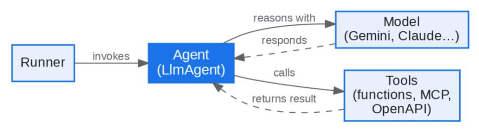
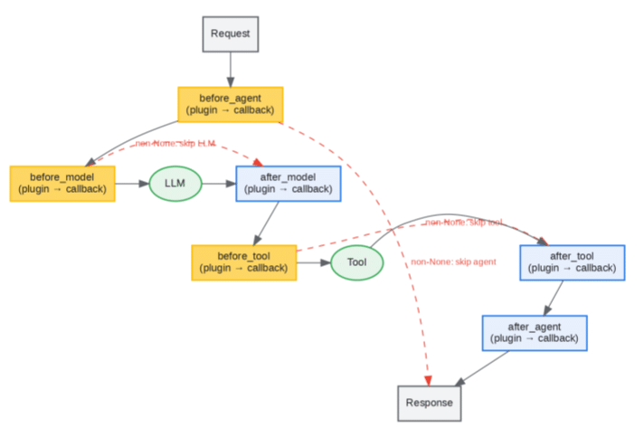

<link rel="stylesheet" href="./tabs.css">

# Build Agents with the Agent Development Kit

## Introduction

In this course, you'll learn to use the Agent Development Kit (ADK) in Gemini platform to build systems where multiple AI agents collaborate on complex tasks.

You'll start with the ADK agent model, including how ADK represents agents, tools, and runners, and how a single agent is configured and run. You'll then make tools the model can call, persist session state across agents, and instrument the execution lifecycle with callbacks and plugins.

Next, you'll orchestrate multiple agents using ADK's template workflow agents and graph-based workflows, and ground them in enterprise data through multi-source retrieval and MCP integrations.

Finally, you'll deploy a multi-agent system to Agent Runtime as a managed service and register and share it through Gemini so users across an organization can reach it.

In this course, you'll learn to:

* *Describe the ADK agent model, including Agent configuration, tools, and the runner.
* Explain how ADK builds tool schemas, how session state persists across agents, and how callbacks and plugins instrument agent behavior.
* Build multi-agent workflows using ADK's template workflow agents and ADK 2.0's graph-based and collaborative workflows.
* Ground agents in enterprise data using ADK's grounding tools, multi-source retrieval, and external MCP integrations.
* Deploy a multi-agent system to Agent Runtime and register and share it through Gemini.

## Agents, tools, and runners: The ADK model

### What ADK is and where it fits

ADK is Google's open-source framework for building, debugging, evaluating and deploying AI agents at enterprise scale. It provides a structured, production-grade layer over the model APIs. This allows you to focus on designing agent behavior, rather than wiring up boilerplate.

ADK supports Python, TypeScript, Go, Java, and Kotlin. Feature availability varies across languages, and Python is the most complete implementation. It's model-agnostic, meaning that you can point it at Gemini, Claude, Ollama, or any provider supported by LiteLLM (an open-source library that provides a unified interface to dozens of model providers). You can swap models without rewriting your agent logic.

The key distinction from calling a model API directly is orchestration. When you call a model API directly, you handle context assembly, tool dispatch, retry logic, and state management yourself. ADK handles that infrastructure, so your code expresses what an agent does, not how the runtime manages it.


<div class="md-tabs">
  <input type="radio" name="adk-capabilities" id="tab-adk-capab-1" checked>
  <label for="tab-adk-capab-1">Managed Tool Orchestration</label>
  <input type="radio" name="adk-capabilities" id="tab-adk-capab-2">
  <label for="tab-adk-capab-2">Multi-Step Workflows</label>
  <input type="radio" name="adk-capabilities" id="tab-adk-capab-3">
  <label for="tab-adk-capab-3">Multi-Agent Collaboration</label>
  <input type="radio" name="adk-capabilities" id="tab-adk-capab-4">
  <label for="tab-adk-capab-4">Production Operations</label>  
  <div class="tab-panel">  
    <p>The agent relies on external functions, requiring automatic schema generation from Python signatures, access to shared session state via <code>ToolContext</code>, or integrations with MCP and OpenAPI servers.</p>
  </div>
  <div class="tab-panel">
    <p>The system executes a sequence of decisions or transformations that don't fit in a single prompt.</p>
  </div>
  <div class="tab-panel">
    <p>Specialized agents work together on a larger problem.</p>
  </div>
  <div class="tab-panel">
    <p>The system handles observability, evaluation, and deployment at scale.</p>
  </div>
</div>

To illustrate these technical requirements, consider a production-grade customer support system configured to manage billing anomalies, order tracking, and returns. This domain exemplifies the core operational challenges of the framework through several key patterns:

<div class="md-tabs">
  <input type="radio" name="tech-challenges" id="tab-tech-challenge-1" checked>
  <label for="tab-tech-challenge-1">Specialist Agent Tooling</label>
  <input type="radio" name="tech-challenges" id="tab-tech-challenge-2">
  <label for="tab-tech-challenge-2">Multi-Step Reasoning</label>
  <input type="radio" name="tech-challenges" id="tab-tech-challenge-3">
  <label for="tab-tech-challenge-3">Orchestration &amp; Collaboration</label>
  <input type="radio" name="tech-challenges" id="tab-tech-challenge-4">
  <label for="tab-tech-challenge-4">Production Reliability</label>  
  <div class="tab-panel">  
    <p>Dedicated micro-agents utilize specialized tools and APIs to query and mutation-test backend systems.</p>
  </div>
  <div class="tab-panel">
    <p>Incoming customer requests are complex and require sequential, multi-layered reasoning steps to resolve.</p>
  </div>
  <div class="tab-panel">
    <p>Multiple specialist agents operate autonomously under the governance of a centralized coordinator agent.</p>
  </div>
  <div class="tab-panel">
    <p>The entire architecture is engineered to execute deterministically, reliably, and at scale within a production environment.</p>
  </div>
</div>

> [!Note]
> All subsequent examples and architectural patterns in this module will be contextualized within this **customer support domain**.

### ADK's key concepts and components

ADK organizes everything around four core components: **Agents**, **Models**, **Tools**, and the **Runner**. Understanding how they relate to each other is the foundation for everything else in this course.


1. **Agents:** Agents are autonomous units of work that receive a task, decide what actions to take, optionally use tools, and return a result. ADK's primary agent type is `Agent` (also called `LlmAgent`), which uses a language model as its reasoning engine.

    ADK also provides workflow agent types that orchestrate other agents without a model making the orchestration decision. `SequentialAgent` runs sub-agents one after another, `ParallelAgent` runs them concurrently, and `LoopAgent` repeats a sub-agent until a condition is met.
2. **Models:** Models are the language models that power agent reasoning. You specify a model by its identifier string, and ADK handles the API calls, token management, and response parsing. You can set a model per agent, so different agents in the same system can use different models based on cost or capability.
3. **Tools:** Tools extend what an agent can do. A tool is any Python function you pass to an agent's `tools` list. **ADK uses the function's name, docstring, and parameter types to build the tool schema**. The model reads that schema to know when and how to call the tool.

    ADK also supports advanced integrations like OpenAPI and Model Context Protocol (MCP) tools, which you will explore later in this course
4. **The runner:** The runner ties it all together. When you call `adk run` or `adk web`, ADK instantiates a Local runner. This runner manages the event loop, routes user messages to the correct agent, dispatches tool calls, and streams results back. When you are ready for production, this exact same runner sits behind the API server you deploy to **Cloud Run** or **GKE** (Google Kubernetes Engine).

The following diagram illustrates how these four components connect. The agent sits at the center. It draws on a model for reasoning, calls tools for action, and is invoked and managed by the runner.



### Configuring a simple agent

An `Agent` in ADK requires three things to work: A `name`, A `model`, and an `instruction`. Everything else is optional but shapes how the agent behaves in a multi-agent system.

Here's a minimal billing agent:

```python
from google.adk import Agent

# Placeholder function representing a tool
def lookup_account(account_id: str):
    """Retrieves the current balance and status for a given billing account.

    Args:
        account_id: The unique identifier for the customer account.
    Returns:
        dict: The account details, or an error status if not found.
    """
    return query_billing_database(account_id)

billing_agent = Agent(
    name="billing_agent",
    model="gemini-flash-latest",
    instruction="You are a billing specialist. Answer questions about account balances, payment history, and invoices.",
    tools=[lookup_account],
)
```

In this example, `lookup_account` is a Python function that queries a billing database.

* The `name` must be a unique string identifier. In a multi-agent system, the `name` is how a coordinator agent refers to this specialist when delegating tasks, so choose names that describe the agent's role.
* The `model` is the model identifier string. ADK resolves it to the correct API endpoint. Throughout this course, code examples use the `"gemini-flash-latest"` identifier string. This introduces an important operational best practice: **Future-proofing via model aliases**. Model identifier strings are intrinsically version-specific. Rather than pinning code snippets to a static version (such as `gemini-2.5-flash`), using the `"latest"` alias ensures the system automatically resolves to the current recommended Flash model.
* The `instruction` is the **most important parameter**. It's the _system prompt_ that defines the agent's persona, its scope, its constraints, and any guidance for tool use. A well-written instruction keeps the agent on task and prevents it from attempting things outside its responsibility. Keep it specific. An agent that knows exactly what it handles, and what it doesn't, behaves more reliably than one with a broad, open-ended instruction.

Three additional parameters are worth knowing for multi-agent work:

* The `description` is a concise summary of what the agent does. **In a multi-agent system, a coordinator reads the description to decide which specialist to route a task to**. If you plan to use this agent as a sub-agent, write the description as a single sentence that clearly states the agent's scope.
* The `tools` list contains the functions the agent can call. **ADK wraps each function automatically, using its docstring and type hints as the tool schema**. The model reads that schema to know when and how to invoke the tool. **Unlike the model API, you don't have to write the schema in the ADK. Just write the docstring completely and correctly. ADK handles the rest!**
* The `output_key` is an optional string. When set, **ADK writes the agent's final response into session state under that key, making it available to downstream agents in a workflow**. For example, setting `output_key="billing_response"` lets a downstream aggregator agent read the billing result without the coordinator needing to pass it explicitly.

```python
billing_agent = Agent(
    name="billing_agent",
    model="gemini-flash-latest",
    description="Answers billing and payment questions.",
    instruction="...",
    tools=[lookup_account, list_invoices],
    output_key="billing_response",
)
```

> [!Note]
> While the example above uses `output_key` to save a text response, **you can instead use the `output_schema` parameter to enforce a structured JSON output format**. However, `output_schema` is incompatible with tools on some models; check the model-specific documentation before combining them in a single agent.

### Running your first agent

ADK ships with a CLI that handles the full development loop: Scaffold, run, inspect, and iterate.

**You start a new project with `adk create my_agent`** (replace `my_agent` with your agent's name). This scaffolds a directory (named `my_agent`) with `agent.py`, `init.py`, and a `.env` file for your API key. Open `agent.py` and define your agent as `root_agent`. ADK's runner discovers your agent by looking for a module-level variable _named exactly `root_agent`_; using any other name means the runner won't find it and will error on startup.

> [!Note]
> In a single-agent example, name your sole agent `root_agent`. For a multi-agent workflow, name the _primary agent_ (sometimes called orchestrator agent) `root_agent`.

To interact with the agent in a terminal session, use `adk run my_agent`. This opens a REPL where you type messages and see responses inline, including which tools were called and what they returned.

For a richer development experience, `adk web` launches a browser interface at `http://localhost:8000`. It gives you a chat panel on the left and a trace view on the right (**NOTE:** layout could change in future versions of ADK). The trace view shows each step of the agent's reasoning: which model calls were made, which tools were invoked, what each tool returned, and how the agent arrived at its final response. It's the fastest way to validate that your instruction and tools are producing the behavior you expect.

When you're ready to expose the agent as a REST API, `adk api_server` starts an HTTP server that accepts user messages and streams agent responses, using the same runner that powers both terminal and browser modes.

**The development loop is:** Write the agent, run `adk web`, send a test message, read the trace, adjust the instruction or tools, and repeat. Most agent behavior issues (incorrect tool selection, off-topic responses, missing context) are visible in the trace view within the first few test messages.


## ADK tools, context, and state

In this lesson, you'll learn how the Agent Development Kit (ADK) converts Python functions into tools the model can call. You'll discover how those tools reach into session state and influence agent flow. You'll also learn to observe and control the agent execution lifecycle using **callbacks** and **plugins**.

Tools are building blocks, such as any Python function you pass to the tools list. This lesson covers the mechanics behind that. You'll explore what makes the model select one tool over another, and what a tool can do beyond returning a value. You'll also discover how agents share data across a multi-step workflow without a coordinator passing it explicitly, and how to instrument the whole system without touching its core logic.

### Building tools the model can use

**When you pass a Python function to an agent's tools list, ADK inspects its signature to build a JSON schema**. The model receives that schema alongside the agent's instruction and uses it to know what tools are available, when to call each one, and what arguments to pass. **Defining the schema correctly ensures reliable tool use**.

Three elements define schema quality:

1. **The function name:** The function name becomes the tool name. Use specific, descriptive function names. `lookup_account` tells the model exactly what the function does; `get_data` does not.
2. **The docstring:** The docstring **is your most important element**. It's the model's only guide to when and why to call your tool. Describe the tool's purpose, what each parameter expects, and how to interpret the return value, including error cases. If the tool returns `{"status": "error"}` when an account doesn't exist, say so explicitly. **A vague docstring produces unreliable tool selection; a precise one keeps the model on task.**
3. **Type hints:** Type hints on all parameters and the return type to sharpen the schema the model uses to construct arguments. **Omitting them produces a weaker schema and less consistent invocations**.

The following example demonstrates how a specific function name, a detailed docstring, and proper type hints come together to form a high-quality tool schema:

```python
def get_account_balance(account_id: str) -> dict:
    """Returns the current balance for the given account.

    Args:
        account_id: The unique identifier for the customer account.
    Returns:
        dict: 'balance' (float) on success, or 'error' (str) if not found.
    """
    # .... implementation omitted for brevity
```

**If your function accepts a `ToolContext` parameter (covered later), don't document it in the docstring**. ADK injects it automatically and it isn't part of the schema the model sees.

Agent instructions also encode inter-tool dependencies. The model has no implicit awareness of sequencing. It only knows what the docstrings say. **When one tool's output must feed another's input, state that dependency explicitly in the instruction.** For example: `"Use lookup_account first; if the account is active, call fetch_transactions with the returned account ID."`

**ADK also supports MCP tools and OpenAPI tools**. MCP tools connect an agent to any server implementing the Model Context Protocol and expose its capabilities as callable tools. OpenAPI tools generate one tool for each endpoint in an OpenAPI specification. Both integrate through the same tools list.

### ToolContext: State, flow, and artifacts

When a tool needs to do more than compute and return a value, add a `ToolContext` parameter to its signature. **ADK injects the object automatically at invocation time.** Because it's injected, it's invisible to the model and not part of the schema, so _don't include it in the docstring_. 

`ToolContext` provides a tool with four capabilities:

1. **State access:** `tool_context.state` is a read-write view of session state. **A tool can read data set earlier in the conversation and write values that downstream agents will pick up**. Because that state is written by your application (not by the LLM), it's trustworthy for authorization checks and policy flags the model shouldn't be able to forge.

    ```python
    def fetch_account(account_id: str, tool_context: ToolContext) -> dict:     

        """Returns account data for the authenticated user."""     

        # session_user_id is set by the app at session start, not supplied by the LLM     

        authorized_id = tool_context.state.get("session_user_id")     

        if account_id != authorized_id:         

                return {"error": "Access denied."}     

        return lookup_account(account_id)
    ```
2. **Flow control:** 
    * `tool_context.actions` lets a tool signal what should happen next.
    * Setting `tool_context.actions.transfer_to_agent = "agent_name"` hands the conversation to another agent.
    * Setting `tool_context.actions.escalate = True` passes control up to the parent agent in a multi-agent hierarchy.
    * Setting `tool_context.actions.skip_summarization = True` tells ADK to pass the tool's raw output directly to the model without summarizing it first.
    * Use this to ensure the model reasons over the full, high-fidelity result.
3. **Artifacts:** Artifacts are **named binary objects stored in the session.** Keeping large data in artifacts rather than in the return value or in state prevents the event payload from bloating the context window.

    For large data (documents, images, query result sets), use `tool_context.load_artifact(name)` and `tool_context.save_artifact(name, data)`.
4. **Authentication:** For tools that call authenticated external APIs, `tool_context.request_credential(auth_config)` initiates an authentication flow, and `tool_context.get_auth_response()` retrieves the credentials once provided.

### Session state and multi-agent coordination

**Session state is the shared scratchpad that persists across an entire conversation. It's a key-value store with string keys and serializable values** (strings, numbers, booleans, lists, dicts). Every agent, tool, and callback in a session can read and write it through ADK.

1. **State prefixes control scope**

    Four prefixes determine where a value lives and how long it lasts:

    * **Session-scoped (no prefix):** Visible to all agents in this conversation, but not in others.
    * **User-scoped (user:):** Persists across all sessions for a given user; use this for preferences and profile data.
    * **App-scoped (app:):** Shared across all users of the application; for global config or shared templates.
    * **Invocation-scoped (temp:):** shared across all agents and tools in the same invocation but cleared when the invocation ends. Use it for intermediate data you don't need to persist.

2. **Reading state in agent instructions:** ADK substitutes `{key}` references in an agent's instruction string with the matching value from session state before sending the instruction to the model.

    This is the clean way to personalize an agent's behavior from context set earlier in the conversation. Use {key?} for keys that may not exist yet.

    ```python
    support_agent = Agent(     

            name="support_agent",       

            model="gemini-flash-latest",     

            instruction="You're helping {user:name}. Their preferred language is {user:language?}.",

    )
    ```
3. **Writing state safely:**

    ADK tracks state changes as part of the event history. This is what makes persistence work across `InMemorySessionService`, `DatabaseSessionService`, and `VertexAiSessionService`. Two patterns are safe for writing:

    * `output_key` on an agent writes the agent's final text response to state automatically. It's the simplest coordination pattern for passing an agent's result to a downstream step.

    * Direct assignment through `tool_context.state` in a tool, or `callback_context.state` in a callback. ADK captures these changes in the event's state delta.

    Never write directly to `session.state` outside these managed contexts. Doing so bypasses event tracking, breaks persistence with database-backed session services, and isn't thread-safe when agents run in parallel.
4. **State as a coordination mechanism**

    When a `SequentialAgent` or `ParallelAgent` runs sub-agents, they all share the same invocation and therefore the same `temp:` state. Non-temp state is visible across the entire session. The `output_key` pattern is how specialist agents hand off results to the next step without a coordinator passing data explicitly. An upstream agent writes its result under a known key, and a downstream agent reads it from its instruction template or from a tool.

    **In a multi-agent pipeline, the state schema is an implicit contract between every agent that reads or writes it**. A `key` renamed in one agent silently breaks every other agent that depends on it. Define key names, prefixes, and value shapes in a shared constant module and import it everywhere.

### Callbacks and plugins

Callbacks and plugins let you observe and intercept agent behavior at predefined execution points without modifying the agent or tool code itself.

Callbacks are functions you register on an agent at creation time. ADK calls them at six lifecycle checkpoints, organized as three before/after pairs: Around the agent run, around each model call, and around each tool call.

Each callback receives a `context` object with the current session state and agent metadata. Return `None` to let execution proceed normally; return a value to short-circuit the next step and use your return as its result.

```python
def block_restricted(
    callback_context: CallbackContext, 
    llm_request: LlmRequest
):
    last = llm_request.contents[-1].parts[0].text if llm_request.contents else ""
    if "RESTRICTED" in last.upper():
        return LlmResponse(content=types.Content(role="model",
            parts=[types.Part(text="That request can't be processed.")]))
    return None

agent = Agent(
    name="guarded_agent",
    model="gemini-flash-latest",
    instruction="...",
    before_model_callback=block_restricted,
)
```

Each callback pair has a natural use case:

<div class="md-tabs">
  <input type="radio" name="tech-challenges" id="tab-tech-challng-1" checked>
  <label for="tab-tech-challng-1">Model Callbacks</label>
  <input type="radio" name="tech-challenges" id="tab-tech-challng-2">
  <label for="tab-tech-challng-2">Tool Callbacks</label>
  <input type="radio" name="tech-challenges" id="tab-tech-challng-3">
  <label for="tab-tech-challng-3">Agent Callbacks</label>
  <div class="tab-panel">  
    <p>The <code>before_model_callback</code> and <code>after_model_callback</code> are designed for tasks such as setting input guardrails, modifying prompts, and filtering responses.</p>
  </div>
  <div class="tab-panel">
    <p>The <code>before_tool_callback</code> and <code>after_tool_callback</code> are utilized for validating arguments and processing outputs.</p>
  </div>
  <div class="tab-panel">
    <p>The <code>before_agent_callback</code> and <code>after_agent_callback</code> manage access control and enhance responses at the agent boundary.</p>
  </div>
</div>

Plugins also receive hooks that agent callbacks don't: On every incoming user message, at run start, and when a model or tool call raises an error. The error hooks let you intercept a failure and return a synthetic response, or return None to re-raise and let the retry system handle it.

The following diagram illustrates the sequential flow through one agent execution turn, showing six callback checkpoints as blue intercept nodes. Plugin callbacks (orange) appear before each corresponding agent callback. The dashed arrows show short-circuit paths that skip the next step when a callback returns a non-None value.



Plugins extend the same model but register at the runner level. A plugin extends BasePlugin and implements whichever callback methods it needs. Once registered on the runner, its callbacks apply to every agent, tool, and model call that runner manages. Plugin callbacks run before the corresponding agent-level callbacks, and if a plugin returns a non-None value at a checkpoint, the agent-level callback is skipped.

```python
class LoggingPlugin(BasePlugin):
    def __init__(self):
        super().__init__(name="logging")

    async def before_tool_callback(self, *, tool, tool_args, tool_context):
        print(f"[{tool.name}] called with {tool_args}")

runner = InMemoryRunner(
    agent=root_agent, 
    app_name="my_app",
    plugins=[LoggingPlugin()]
)
```

* Use callbacks for logic specific to a single agent.
* Use plugins for cross-cutting concerns (logging, safety guardrails, monitoring, caching) that should apply uniformly across your whole system.

> [!Note]
>
> Plugins are initialized once and shared across all invocations. Instance variables accumulate over the full application lifetime, not per session. If a plugin holds counters or buffers, that isolation boundary matters.

## Multi-agent orchestration: Template workflows and ADK 2.0

In this lesson, you'll discover why breaking a task across multiple specialized agents reduces complexity, and how to coordinate those agents using the Agent Development Kit (ADK) orchestration tools. 

ADK gives you two sets of tools: Template workflow agents for well-defined sequential, parallel, and iterative patterns, and ADK 2.0's graph-based and collaborative workflow APIs for workflows that need conditional routing, non-linear flow, or mixed AI-and-code execution. You'll explore both toolsets, starting with multi-agent systems and moving through the complete ADK 2.0 orchestration toolkit.

<< Continue from here >>