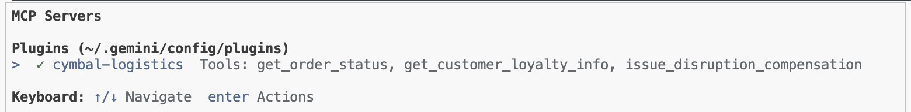

# Challenge Lab-Accelerate Development with Antigravity

## Overview

In a challenge lab you’re given a scenario and a set of tasks. Instead of following step-by-step instructions, you will use the skills learned from the labs in the quest to figure out how to complete the tasks on your own! An automated scoring system (shown on this page) will provide feedback on whether you have completed your tasks correctly.

When you take a challenge lab, you will not be taught new Google Cloud concepts. You are expected to extend your learned skills, like changing default values and reading and researching error messages to fix your own mistakes.

To score 100% you must successfully complete all tasks within the time period!

## Topics tested

In this challenge, you will test your skills on:

* Connect an external data source to Antigravity using an MCP server.
* Create agent skills and declarative workspace rules.
* Scaffold agent deployment boilerplate using the `google-agents-cli`.
* Deploy an agent to `Agent Runtime`.

## Useful Resources

To complete this challenge, you may need to reference the official documentation:

* [Antigravity Getting Started](https://antigravity.google/docs/getting-started)
* [Antigravity Model Context Protocol (MCP)](https://antigravity.google/docs/mcp)
* [Antigravity Skills](https://antigravity.google/docs/skills)
* [Antigravity Rules](https://antigravity.google/docs/rules)
* [Agents CLI Hands-on Tutorial](https://google.github.io/agents-cli/guide/hands-on-tutorial/)

## Setup and requirements

**Before you click the Start Lab button**

Read these instructions. Labs are timed and you cannot pause them. The timer, which starts when you click Start Lab, shows how long Google Cloud resources are made available to you.

This hands-on lab lets you do the lab activities in a real cloud environment, not in a simulation or demo environment. It does so by giving you new, temporary credentials you use to sign in and access Google Cloud for the duration of the lab.

To complete this lab, you need:

* Access to a standard internet browser (Chrome browser recommended).

> [!Note] 
> Use an Incognito (recommended) or private browser window to run this lab. This prevents conflicts between your personal account and the student account, which may cause extra charges incurred to your personal account.
>
> In practice, we found some issues with Chrome browser (intermittent disconnects); use Microsoft Edge or Firefox instead of Chrome (in "In Private" browsing mode).

* Time to complete the lab—remember, once you start, you cannot pause a lab.

> [!Note] 
> Use only the student account for this lab. If you use a different Google Cloud account, you may incur charges to that account.


## Challenge scenario

You are a developer at Cymbal Direct, an online retailer. A severe winter storm is causing widespread shipping delays, leading to a massive surge in customer service inquiries. Your task is to build and deploy an AI agent capable of triaging and resolving these disrupted orders.

In the Cloud Shell Editor Terminal, you will use the [Antigravity CLI (agy)](https://antigravity.google/docs/getting-started) to integrate a mock logistics database using [Model Context Protocol (MCP)](https://antigravity.google/docs/mcp). This lets the agent look up order statuses and issue refunds. Next, you will create agent skills and rules. These guide the agent's compensation logic for customer loyalty tiers while enforcing coding standards. Finally, you will generate the agent infrastructure using the [Google Agents CLI](https://google.github.io/agents-cli/). Then, you will deploy the agent to [Agent Runtime](https://docs.cloud.google.com/gemini-enterprise-agent-platform/build/runtime) as a scalable API endpoint.

## Task 1. Set up the Cloud Shell Editor and Antigravity CLI

In this task, you will launch the Cloud Shell Editor, configure it to show hidden files, and authenticate the Antigravity CLI (agy).

### Open Cloud Shell Editor

1. Click **Activate Cloud Shell**  in the Google Cloud console title bar.
2. Click **Continue**.
3. When prompted to authorize Cloud Shell, click **Authorize**.
4. Once the Cloud Shell terminal opens, click the **Open Editor** button on the Cloud Shell toolbar.
5. In the upper right corner of the Cloud Shell Terminal panel, click the **Open in new window button** .

### Toggle Hidden Files in the Editor 

By default, the Cloud Shell Editor hides files and folders starting with a dot (like `.agents`). To make them visible:

6. Choose the **View** menu option at the top of the editor.
7. Then choose the Toggle Hidden Files option.

### Authenticate the Antigravity CLI (agy)

The Antigravity CLI comes pre-installed in your Cloud Shell environment. You must authenticate it and bind it to your Qwiklabs project.

8. If the Cloud Shell Terminal panel is open, close it.
9. Instead, use a Terminal within the Cloud Shell Editor by clicking **Terminal > New Terminal**.

> [!Note] 
> This opens a Terminal pane within Cloud Shell Editor that is different from the Cloud Shell Terminal.

Drag the top of the Terminal pane to make it large enough to display the full AGY CLI output.

10. Set the active Google Cloud project ID as an environment variable so agy can inherit it.

```bash
export GOOGLE_CLOUD_PROJECT=Project ID
```

11. Start the Antigravity CLI.

```bash
agy
```

12. When prompted to select an authentication method, choose option **2 (Use a Google Cloud project)** and press **ENTER**.

13. For **Select Google Cloud sign-in method**, choose option **1 (Use your browser to authenticate)** and press ENTER.

14. Click the provided authorization URL to open it. You may need to `CMD + Click` (on a Mac) or `CTRL + Click` (on Windows) to open the link.

15. Sign in using your **Qwiklabs student credentials** and grant the necessary permissions.

16. Copy the generated authorization code.

17. Paste the code back into the Cloud Shell terminal, and press **ENTER**.

> [!Note] 
> You may need to drag the top of the Terminal pane higher to be able to see the prompt to input the authorization code.

18. When prompted by the CLI to enter the Google Cloud project ID to use, copy and paste the following project ID and press **ENTER**.

```bash
Project ID
```

19. When prompted by the CLI to enter the Google Cloud location to use, choose **global** and press **ENTER**.

20. For **Select Licenses**, select `Agent Platform - Pay as you go provisioned for your Google Cloud project` and press **ENTER**.

21. Choose your desired color scheme and press **ENTER**.

22. Skip the **Import extensions** option by pressing down to select **Next**.

23. With **Next** highlighted, press **ENTER**.

24. Choose **Done** to agree to the terms of service.

25. Press **ENTER** to trust the current folder.

26. In the agent chat prompt, type `/model` and press **ENTER**.

27. Choose `Model Name` and press **ENTER**.

28. Verify the agent is responsive by typing `Hello` in the chat prompt and pressing **ENTER**.

> [!Note] 
> If typing Hello immediately after completing setup results in an initial connection error, exit the Antigravity CLI by typing /exit and restart it by running agy.

## Task 2. Configure the Cymbal Logistics MCP server

In this task, you extend the Antigravity CLI's capabilities by registering a custom Model Context Protocol (MCP) server. Your backend engineering team has exposed Cymbal Direct's logistics database via an MCP script.

1. Type `/exit` and press **ENTER** to return to the standard Terminal prompt.

2. Create a new workspace directory and download the mock logistics server script.

```bash
mkdir -p ~/genai144-challenge/mcp
gcloud storage cp gs://-lab-scripts/cymbal_direct_mcp.py ~/genai144-challenge/mcp/
cd ~/genai144-challenge
```

3. Run the following command to install the required MCP dependencies.

```bash
pip3 install "mcp<2" fastmcp pydantic-settings --break-system-packages
```

4. To provide the MCP server definition to the Antigravity CLI for use within this project folder, create a `.agents` directory and an MCP configuration file by running the following commands.

```bash
mkdir .agents && touch .agents/mcp_config.json
cat << EOF > .agents/mcp_config.json
{
    "mcpServers": {
        "cymbal-logistics": {
            "command": "python3",
            "args": [
            "mcp/cymbal_direct_mcp.py"
            ]
        }
    }
}
EOF
```

5. Start the Antigravity CLI again.

```bash
agy
```
    
6. In the `agy` prompt, type `/mcp` to list available MCP servers and wait until your `cymbal-logistics` MCP server initializes.



7. Once the MCP server has initialized, press **ESC** to return to the AGY CLI prompt.

8. Enter the following to ask the agent to describe the MCP server's capabilities.

```bash
What tools do you have in your cymbal-logistics MCP server?
```

9. Test the tool connection by typing the following query in the agy prompt.

```bash
What is the status of order CYM-EC-9921?
```

Verify that the agent uses the tool and returns that the order is delayed due to a severe winter storm.

### Verify your progress

10. In the `agy` prompt, ask the agent to generate the summary file and upload it for grading.

```bash
Create a file named summary_task2.md that lists:
- The registered MCP server name
- The names of the three available tools registered on this server
Upload the summary to gs://-grading/
```

## Task 3. Author an agent skill and workspace rule

In this task, you use the Antigravity CLI to create a custom workspace rule and an agent skill. The workspace rule enforces coding standards, and the skill determines customer compensation rewards based on loyalty status.

1. To establish code guidelines, ask the agent to create a workspace rule by sending the following prompt in the agy session.

```bash
Add rules to a GEMINI.md file in the root of my workspace (~/genai144-challenge/). The rules must be configured as always_on and enforce the following code organization rules:
1. All new Python code files must start with a docstring at the top of the file explaining what the file does.
2. All new Python code files must start with a commented copyright statement for "Cymbal Direct" at the top of the file.
3. All custom agent skills must be created in the root of the workspace under the .agents/skills/ directory.
```

2. After the file has been written, ask the agent what rules it sees with the following prompt.

```bash
What rules have been set for this workspace?
```

3. Next, instruct the agent to create the custom agent skill. Send the following prompt in the agy session.

```bash
Create an agent skill named winter-storm-triage. The skill should dictate the standard operating procedures for customers whose packages are delayed due to severe winter storms. It must:
1. Require the agent to use get_order_status and get_customer_loyalty_info to verify the order.
2. Apply the following compensation based on loyalty tier:
    - Platinum: $100 credit, Next-Day Air shipping upgrade
    - Gold: $50 credit, Next-Day Air shipping upgrade
    - Silver: $25 credit, 3-Day Select shipping upgrade
    - Member: $10 credit, Priority Shipping upgrade
3. Require the agent to call issue_disruption_compensation to apply the refund.
4. Draft an empathetic customer response detailing the resolution.
```

4. Review the changes to the SKILL.md file (which will be placed under `.agents/skills/winter-storm-triage/SKILL.md`).

5. Test your new skill and rule by sending the following prompt in the agy session:

```bash
/winter-storm-triage a customer's package (order CYM-EC-9921) is lost in the winter storm. Please find their customer ID and loyalty tier, and write a response to the customer.
```

6. Verify that the agent uses the logistics MCP tool, calculates the correct Gold tier compensation ($50 credit and Next-Day Air upgrade), and drafts the response.

### Verify your progress

7. Ask the agent to generate the summary file.

```bash
Create a file named summary_task3.md in my project directory (~/genai144-challenge/) that lists:
- The workspace rule file name (GEMINI.md) and its trigger configuration
- The name of the custom agent skill created for winter storm triage
- The compensation rules (credits and shipping upgrades) for all four loyalty tiers
- The actual response generated by the agent for order CYM-EC-9921
Upload the summary to gs://-grading/
```

## Task 4. Build an agent using Agents CLI

Now that you have prototyped the agent's logic, you will use the Agents CLI to package it as a deployable service.

### Transition to Auto-Edit Mode

To avoid having to manually approve every file creation during the scaffolding process, you will enable `auto_edit` mode.

From within the Antigravity CLI

1. Type `/config` and change the **Tool Permission** setting to `always-proceed`.

Press ESC.
    When starting the Antigravity CLI
        If you have not yet launched the AGY CLI, you can start it with this flag to skip permission prompts.

     agy --dangerously-skip-permissions

    Copied!

Install the Agents CLI

    Open a second terminal tab in Cloud Shell (leaving agy running in the first) by clicking the + sign at the top of the Terminal.

    Run the following commands to install uv (Python toolchain manager) and set up the Agents CLI.

    curl -LsSf https://astral.sh/uv/install.sh | sh
    export PATH="$HOME/.local/bin:$PATH"
    uvx google-agents-cli setup

    Copied!
    Scaffold the Agent

    Return to the first terminal tab by selecting it from the list of Terminals on the right (it should be identified as agy) and prompt the CLI to build an agent.

    Use your agents-cli skills to build a winter storm triage agent based on the MCP server. Name the project "winter-storm-triage" and place it inside the ~/genai144-challenge/ directory. Configure the agent to use the Model ID model.

    Copied!

    Notice how you don't have to grant permissions as frequently as you did in the previous tasks, this is because you set the Tool Permission setting to always-proceed.

    When complete the agent will provide a summary of what it has done.

    Review the summary.
    Test the Agent Locally

    In your second terminal tab, navigate to the new project directory and install the MCP dependencies into the project virtual environment.

    cd ~/genai144-challenge/winter-storm-triage
    uv pip install "mcp<2" fastmcp pydantic-settings

    Copied!

    Launch the interactive Agent Playground.

    agents-cli playground

    Copied!

    The terminal will start a local web server on port 8080. To view the Playground, click the Web Preview button in the top right of the Cloud Shell toolbar ( Web Preview button ), and select Preview on port 8080.

    In the Playground web interface, select app from the dropdown.

    Test the agent by asking: Where is my order CYM-EC-1002?.

    Verify it responds with the delay reason and the $100 compensation from the user's Platinum tier status.

    Output:
    Agent Playgroud Prompt Response

    To stop the playground, press CTRL+C in the terminal.
    Verify your progress

    In the terminal tab running agy, ask the agent to generate the summary.

    Create a file named summary_task4.md in my project directory (~/genai144-challenge/) that lists:
    - The project name of the scaffolded agent (winter-storm-triage)
    - The primary configuration file path of the scaffolded agent (app/agent.py)
    - The command used to launch the playground locally
    - The actual response generated by the local agent for order CYM-EC-1002
    Upload the summary to gs://-grading/

    Copied!

Click Check my progress to verify the objective.

Verify the scaffolded agent application prototype
Task 5. Deploy the agent to Agent Runtime

In this task, you will deploy your verified agent application to Agent Runtime.

    Ask the agent to deploy the application.

    Deploy the winter storm triage agent to Agent Runtime in the  region. Make sure to copy the local `cymbal_direct_mcp.py` file into the agent's `app/` directory before deployment.

    Copied!

    The deployment process may take 5 to 10 minutes.

    When complete you will see a summary of the deployment with the steps taken and deployment status.

    Once the deployment finishes, navigate to the Agent Platform > Agents > Deployments in the Google Cloud Console.

        Verify that the winter-storm-triage agent is listed and active.

        Output:
        Agent Deployment

    Click on the agent, go to the Playground tab and test the live deployment with the following query to verify it returns the correct Platinum tier resolution which includes offering $100 compensation.

    Where is my order CYM-EC-1002?

    Copied!

    Output:
    Agent Deployment Playground Response
    Verify your progress

    In the agy session, ask the agent to generate the summary.

    Create a file named summary_task5.md in my project directory (~/genai144-challenge/) that lists:
    - The live Reasoning Engine deployment resource ID (including project and location)
    - The region where the agent was deployed
    - The runtime service account email address used by the Reasoning Engine
    Upload the summary to gs://-grading/

    Copied!

Click Check my progress to verify the objective.