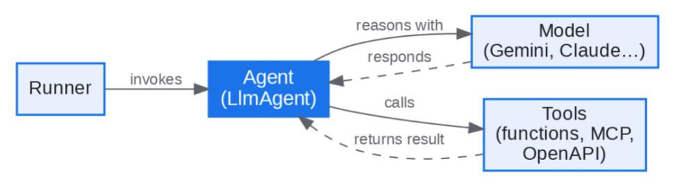
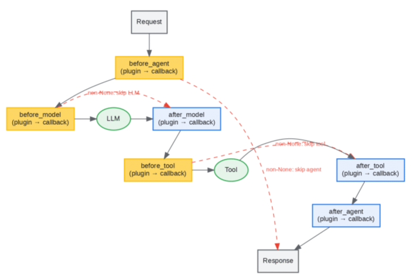
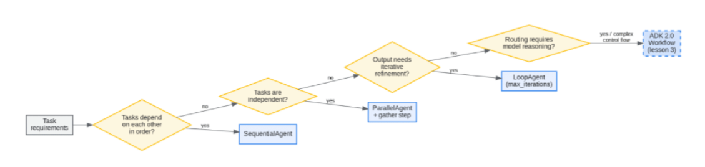
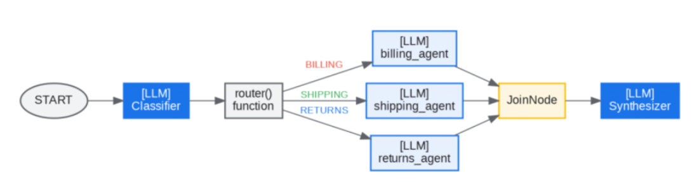
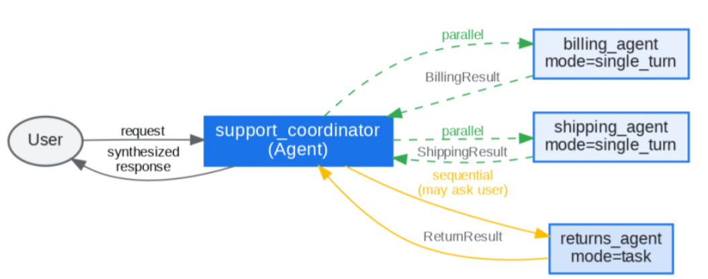
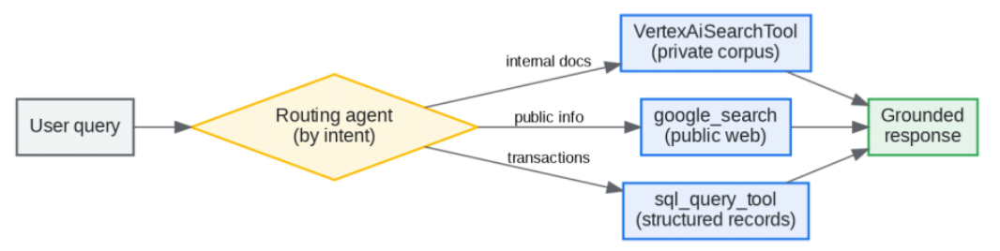
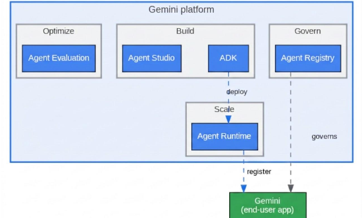
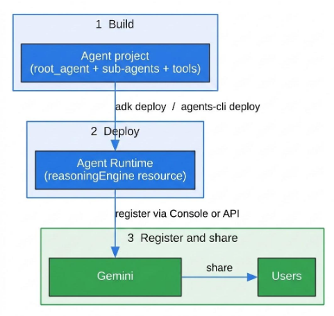

<link rel="stylesheet" href="./tabs.css">

# Build Agents with the Agent Development Kit

## Introduction

In this course, you'll learn to use the Agent Development Kit (ADK) in Gemini platform to build systems where multiple AI agents collaborate on complex tasks.

You'll start with the ADK agent model, including how ADK represents agents, tools, and runners, and how a single agent is configured and run. You'll then make tools the model can call, persist session state across agents, and instrument the execution lifecycle with callbacks and plugins.

Next, you'll orchestrate multiple agents using ADK's template workflow agents and graph-based workflows, and ground them in enterprise data through multi-source retrieval and MCP integrations.

Finally, you'll deploy a multi-agent system to Agent Runtime as a managed service and register and share it through Gemini so users across an organization can reach it.

In this course, you'll learn to:

* *Describe the ADK agent model, including Agent configuration, tools, and the runner.
* Explain how ADK builds tool schemas, how session state persists across agents, and how callbacks and plugins instrument agent behavior.
* Build multi-agent workflows using ADK's template workflow agents and ADK 2.0's graph-based and collaborative workflows.
* Ground agents in enterprise data using ADK's grounding tools, multi-source retrieval, and external MCP integrations.
* Deploy a multi-agent system to Agent Runtime and register and share it through Gemini.

## Agents, tools, and runners: The ADK model

### What ADK is and where it fits

ADK is Google's open-source framework for building, debugging, evaluating and deploying AI agents at enterprise scale. It provides a structured, production-grade layer over the model APIs. This allows you to focus on designing agent behavior, rather than wiring up boilerplate.

ADK supports Python, TypeScript, Go, Java, and Kotlin. Feature availability varies across languages, and Python is the most complete implementation. It's model-agnostic, meaning that you can point it at Gemini, Claude, Ollama, or any provider supported by LiteLLM (an open-source library that provides a unified interface to dozens of model providers). You can swap models without rewriting your agent logic.

The key distinction from calling a model API directly is orchestration. When you call a model API directly, you handle context assembly, tool dispatch, retry logic, and state management yourself. ADK handles that infrastructure, so your code expresses what an agent does, not how the runtime manages it.


<div class="md-tabs">
  <input type="radio" name="adk-capabilities" id="tab-adk-capab-1" checked>
  <label for="tab-adk-capab-1">Managed Tool Orchestration</label>
  <input type="radio" name="adk-capabilities" id="tab-adk-capab-2">
  <label for="tab-adk-capab-2">Multi-Step Workflows</label>
  <input type="radio" name="adk-capabilities" id="tab-adk-capab-3">
  <label for="tab-adk-capab-3">Multi-Agent Collaboration</label>
  <input type="radio" name="adk-capabilities" id="tab-adk-capab-4">
  <label for="tab-adk-capab-4">Production Operations</label>  
  <div class="tab-panel">  
    <p>The agent relies on external functions, requiring automatic schema generation from Python signatures, access to shared session state via <code>ToolContext</code>, or integrations with MCP and OpenAPI servers.</p>
  </div>
  <div class="tab-panel">
    <p>The system executes a sequence of decisions or transformations that don't fit in a single prompt.</p>
  </div>
  <div class="tab-panel">
    <p>Specialized agents work together on a larger problem.</p>
  </div>
  <div class="tab-panel">
    <p>The system handles observability, evaluation, and deployment at scale.</p>
  </div>
</div>

To illustrate these technical requirements, consider a production-grade customer support system configured to manage billing anomalies, order tracking, and returns. This domain exemplifies the core operational challenges of the framework through several key patterns:

<div class="md-tabs">
  <input type="radio" name="tech-challenges" id="tab-tech-challenge-1" checked>
  <label for="tab-tech-challenge-1">Specialist Agent Tooling</label>
  <input type="radio" name="tech-challenges" id="tab-tech-challenge-2">
  <label for="tab-tech-challenge-2">Multi-Step Reasoning</label>
  <input type="radio" name="tech-challenges" id="tab-tech-challenge-3">
  <label for="tab-tech-challenge-3">Orchestration &amp; Collaboration</label>
  <input type="radio" name="tech-challenges" id="tab-tech-challenge-4">
  <label for="tab-tech-challenge-4">Production Reliability</label>  
  <div class="tab-panel">  
    <p>Dedicated micro-agents utilize specialized tools and APIs to query and mutation-test backend systems.</p>
  </div>
  <div class="tab-panel">
    <p>Incoming customer requests are complex and require sequential, multi-layered reasoning steps to resolve.</p>
  </div>
  <div class="tab-panel">
    <p>Multiple specialist agents operate autonomously under the governance of a centralized coordinator agent.</p>
  </div>
  <div class="tab-panel">
    <p>The entire architecture is engineered to execute deterministically, reliably, and at scale within a production environment.</p>
  </div>
</div>

> [!Note]
> All subsequent examples and architectural patterns in this module will be contextualized within this **customer support domain**.

### ADK's key concepts and components

ADK organizes everything around four core components: **Agents**, **Models**, **Tools**, and the **Runner**. Understanding how they relate to each other is the foundation for everything else in this course.


1. **Agents:** Agents are autonomous units of work that receive a task, decide what actions to take, optionally use tools, and return a result. ADK's primary agent type is `Agent` (also called `LlmAgent`), which uses a language model as its reasoning engine.

    ADK also provides workflow agent types that orchestrate other agents without a model making the orchestration decision. `SequentialAgent` runs sub-agents one after another, `ParallelAgent` runs them concurrently, and `LoopAgent` repeats a sub-agent until a condition is met.
2. **Models:** Models are the language models that power agent reasoning. You specify a model by its identifier string, and ADK handles the API calls, token management, and response parsing. You can set a model per agent, so different agents in the same system can use different models based on cost or capability.
3. **Tools:** Tools extend what an agent can do. A tool is any Python function you pass to an agent's `tools` list. **ADK uses the function's name, docstring, and parameter types to build the tool schema**. The model reads that schema to know when and how to call the tool.

    ADK also supports advanced integrations like OpenAPI and Model Context Protocol (MCP) tools, which you will explore later in this course
4. **The runner:** The runner ties it all together. When you call `adk run` or `adk web`, ADK instantiates a Local runner. This runner manages the event loop, routes user messages to the correct agent, dispatches tool calls, and streams results back. When you are ready for production, this exact same runner sits behind the API server you deploy to **Cloud Run** or **GKE** (Google Kubernetes Engine).

The following diagram illustrates how these four components connect. The agent sits at the center. It draws on a model for reasoning, calls tools for action, and is invoked and managed by the runner.



### Configuring a simple agent

An `Agent` in ADK requires three things to work: A `name`, A `model`, and an `instruction`. Everything else is optional but shapes how the agent behaves in a multi-agent system.

Here's a minimal billing agent:

```python
from google.adk import Agent

# Placeholder function representing a tool
def lookup_account(account_id: str):
    """Retrieves the current balance and status for a given billing account.

    Args:
        account_id: The unique identifier for the customer account.
    Returns:
        dict: The account details, or an error status if not found.
    """
    return query_billing_database(account_id)

billing_agent = Agent(
    name="billing_agent",
    model="gemini-flash-latest",
    instruction="You are a billing specialist. Answer questions about account balances, payment history, and invoices.",
    tools=[lookup_account],
)
```

In this example, `lookup_account` is a Python function that queries a billing database.

* The `name` must be a unique string identifier. In a multi-agent system, the `name` is how a coordinator agent refers to this specialist when delegating tasks, so choose names that describe the agent's role.
* The `model` is the model identifier string. ADK resolves it to the correct API endpoint. Throughout this course, code examples use the `"gemini-flash-latest"` identifier string. This introduces an important operational best practice: **Future-proofing via model aliases**. Model identifier strings are intrinsically version-specific. Rather than pinning code snippets to a static version (such as `gemini-2.5-flash`), using the `"latest"` alias ensures the system automatically resolves to the current recommended Flash model.
* The `instruction` is the **most important parameter**. It's the _system prompt_ that defines the agent's persona, its scope, its constraints, and any guidance for tool use. A well-written instruction keeps the agent on task and prevents it from attempting things outside its responsibility. Keep it specific. An agent that knows exactly what it handles, and what it doesn't, behaves more reliably than one with a broad, open-ended instruction.

Three additional parameters are worth knowing for multi-agent work:

* The `description` is a concise summary of what the agent does. **In a multi-agent system, a coordinator reads the description to decide which specialist to route a task to**. If you plan to use this agent as a sub-agent, write the description as a single sentence that clearly states the agent's scope.
* The `tools` list contains the functions the agent can call. **ADK wraps each function automatically, using its docstring and type hints as the tool schema**. The model reads that schema to know when and how to invoke the tool. **Unlike the model API, you don't have to write the schema in the ADK. Just write the docstring completely and correctly. ADK handles the rest!**
* The `output_key` is an optional string. When set, **ADK writes the agent's final response into session state under that key, making it available to downstream agents in a workflow**. For example, setting `output_key="billing_response"` lets a downstream aggregator agent read the billing result without the coordinator needing to pass it explicitly.

```python
billing_agent = Agent(
    name="billing_agent",
    model="gemini-flash-latest",
    description="Answers billing and payment questions.",
    instruction="...",
    tools=[lookup_account, list_invoices],
    output_key="billing_response",
)
```

> [!Note]
> While the example above uses `output_key` to save a text response, **you can instead use the `output_schema` parameter to enforce a structured JSON output format**. However, `output_schema` is incompatible with tools on some models; check the model-specific documentation before combining them in a single agent.

### Running your first agent

ADK ships with a CLI that handles the full development loop: Scaffold, run, inspect, and iterate.

**You start a new project with `adk create my_agent`** (replace `my_agent` with your agent's name). This scaffolds a directory (named `my_agent`) with `agent.py`, `init.py`, and a `.env` file for your API key. Open `agent.py` and define your agent as `root_agent`. ADK's runner discovers your agent by looking for a module-level variable _named exactly `root_agent`_; using any other name means the runner won't find it and will error on startup.

> [!Note]
> In a single-agent example, name your sole agent `root_agent`. For a multi-agent workflow, name the _primary agent_ (sometimes called orchestrator agent) `root_agent`.

To interact with the agent in a terminal session, use `adk run my_agent`. This opens a REPL where you type messages and see responses inline, including which tools were called and what they returned.

For a richer development experience, `adk web` launches a browser interface at `http://localhost:8000`. It gives you a chat panel on the left and a trace view on the right (**NOTE:** layout could change in future versions of ADK). The trace view shows each step of the agent's reasoning: which model calls were made, which tools were invoked, what each tool returned, and how the agent arrived at its final response. It's the fastest way to validate that your instruction and tools are producing the behavior you expect.

When you're ready to expose the agent as a REST API, `adk api_server` starts an HTTP server that accepts user messages and streams agent responses, using the same runner that powers both terminal and browser modes.

**The development loop is:** Write the agent, run `adk web`, send a test message, read the trace, adjust the instruction or tools, and repeat. Most agent behavior issues (incorrect tool selection, off-topic responses, missing context) are visible in the trace view within the first few test messages.


## ADK tools, context, and state

In this lesson, you'll learn how the Agent Development Kit (ADK) converts Python functions into tools the model can call. You'll discover how those tools reach into session state and influence agent flow. You'll also learn to observe and control the agent execution lifecycle using **callbacks** and **plugins**.

Tools are building blocks, such as any Python function you pass to the tools list. This lesson covers the mechanics behind that. You'll explore what makes the model select one tool over another, and what a tool can do beyond returning a value. You'll also discover how agents share data across a multi-step workflow without a coordinator passing it explicitly, and how to instrument the whole system without touching its core logic.

### Building tools the model can use

**When you pass a Python function to an agent's tools list, ADK inspects its signature to build a JSON schema**. The model receives that schema alongside the agent's instruction and uses it to know what tools are available, when to call each one, and what arguments to pass. **Defining the schema correctly ensures reliable tool use**.

Three elements define schema quality:

1. **The function name:** The function name becomes the tool name. Use specific, descriptive function names. `lookup_account` tells the model exactly what the function does; `get_data` does not.
2. **The docstring:** The docstring **is your most important element**. It's the model's only guide to when and why to call your tool. Describe the tool's purpose, what each parameter expects, and how to interpret the return value, including error cases. If the tool returns `{"status": "error"}` when an account doesn't exist, say so explicitly. **A vague docstring produces unreliable tool selection; a precise one keeps the model on task.**
3. **Type hints:** Type hints on all parameters and the return type to sharpen the schema the model uses to construct arguments. **Omitting them produces a weaker schema and less consistent invocations**.

The following example demonstrates how a specific function name, a detailed docstring, and proper type hints come together to form a high-quality tool schema:

```python
def get_account_balance(account_id: str) -> dict:
    """Returns the current balance for the given account.

    Args:
        account_id: The unique identifier for the customer account.
    Returns:
        dict: 'balance' (float) on success, or 'error' (str) if not found.
    """
    # .... implementation omitted for brevity
```

**If your function accepts a `ToolContext` parameter (covered later), don't document it in the docstring**. ADK injects it automatically and it isn't part of the schema the model sees.

Agent instructions also encode inter-tool dependencies. The model has no implicit awareness of sequencing. It only knows what the docstrings say. **When one tool's output must feed another's input, state that dependency explicitly in the instruction.** For example: `"Use lookup_account first; if the account is active, call fetch_transactions with the returned account ID."`

**ADK also supports MCP tools and OpenAPI tools**. MCP tools connect an agent to any server implementing the Model Context Protocol and expose its capabilities as callable tools. OpenAPI tools generate one tool for each endpoint in an OpenAPI specification. Both integrate through the same tools list.

### ToolContext: State, flow, and artifacts

When a tool needs to do more than compute and return a value, add a `ToolContext` parameter to its signature. **ADK injects the object automatically at invocation time.** Because it's injected, it's invisible to the model and not part of the schema, so _don't include it in the docstring_. 

`ToolContext` provides a tool with four capabilities:

1. **State access:** `tool_context.state` is a read-write view of session state. **A tool can read data set earlier in the conversation and write values that downstream agents will pick up**. Because that state is written by your application (not by the LLM), it's trustworthy for authorization checks and policy flags the model shouldn't be able to forge.

    ```python
    def fetch_account(account_id: str, tool_context: ToolContext) -> dict:     

        """Returns account data for the authenticated user."""     

        # session_user_id is set by the app at session start, not supplied by the LLM     

        authorized_id = tool_context.state.get("session_user_id")     

        if account_id != authorized_id:         

                return {"error": "Access denied."}     

        return lookup_account(account_id)
    ```
2. **Flow control:** 
    * `tool_context.actions` lets a tool signal what should happen next.
    * Setting `tool_context.actions.transfer_to_agent = "agent_name"` hands the conversation to another agent.
    * Setting `tool_context.actions.escalate = True` passes control up to the parent agent in a multi-agent hierarchy.
    * Setting `tool_context.actions.skip_summarization = True` tells ADK to pass the tool's raw output directly to the model without summarizing it first.
    * Use this to ensure the model reasons over the full, high-fidelity result.
3. **Artifacts:** Artifacts are **named binary objects stored in the session.** Keeping large data in artifacts rather than in the return value or in state prevents the event payload from bloating the context window.

    For large data (documents, images, query result sets), use `tool_context.load_artifact(name)` and `tool_context.save_artifact(name, data)`.
4. **Authentication:** For tools that call authenticated external APIs, `tool_context.request_credential(auth_config)` initiates an authentication flow, and `tool_context.get_auth_response()` retrieves the credentials once provided.

### Session state and multi-agent coordination

**Session state is the shared scratchpad that persists across an entire conversation. It's a key-value store with string keys and serializable values** (strings, numbers, booleans, lists, dicts). Every agent, tool, and callback in a session can read and write it through ADK.

1. **State prefixes control scope**

    Four prefixes determine where a value lives and how long it lasts:

    * **Session-scoped (no prefix):** Visible to all agents in this conversation, but not in others.
    * **User-scoped (user:):** Persists across all sessions for a given user; use this for preferences and profile data.
    * **App-scoped (app:):** Shared across all users of the application; for global config or shared templates.
    * **Invocation-scoped (temp:):** shared across all agents and tools in the same invocation but cleared when the invocation ends. Use it for intermediate data you don't need to persist.

2. **Reading state in agent instructions:** ADK substitutes `{key}` references in an agent's instruction string with the matching value from session state before sending the instruction to the model.

    This is the clean way to personalize an agent's behavior from context set earlier in the conversation. Use {key?} for keys that may not exist yet.

    ```python
    support_agent = Agent(     

            name="support_agent",       

            model="gemini-flash-latest",     

            instruction="You're helping {user:name}. Their preferred language is {user:language?}.",

    )
    ```
3. **Writing state safely:**

    ADK tracks state changes as part of the event history. This is what makes persistence work across `InMemorySessionService`, `DatabaseSessionService`, and `VertexAiSessionService`. Two patterns are safe for writing:

    * `output_key` on an agent writes the agent's final text response to state automatically. It's the simplest coordination pattern for passing an agent's result to a downstream step.

    * Direct assignment through `tool_context.state` in a tool, or `callback_context.state` in a callback. ADK captures these changes in the event's state delta.

    Never write directly to `session.state` outside these managed contexts. Doing so bypasses event tracking, breaks persistence with database-backed session services, and isn't thread-safe when agents run in parallel.
4. **State as a coordination mechanism**

    When a `SequentialAgent` or `ParallelAgent` runs sub-agents, they all share the same invocation and therefore the same `temp:` state. Non-temp state is visible across the entire session. The `output_key` pattern is how specialist agents hand off results to the next step without a coordinator passing data explicitly. An upstream agent writes its result under a known key, and a downstream agent reads it from its instruction template or from a tool.

    **In a multi-agent pipeline, the state schema is an implicit contract between every agent that reads or writes it**. A `key` renamed in one agent silently breaks every other agent that depends on it. Define key names, prefixes, and value shapes in a shared constant module and import it everywhere.

### Callbacks and plugins

Callbacks and plugins let you observe and intercept agent behavior at predefined execution points without modifying the agent or tool code itself.

Callbacks are functions you register on an agent at creation time. ADK calls them at six lifecycle checkpoints, organized as three before/after pairs: Around the agent run, around each model call, and around each tool call.

Each callback receives a `context` object with the current session state and agent metadata. Return `None` to let execution proceed normally; return a value to short-circuit the next step and use your return as its result.

```python
def block_restricted(
    callback_context: CallbackContext, 
    llm_request: LlmRequest
):
    last = llm_request.contents[-1].parts[0].text if llm_request.contents else ""
    if "RESTRICTED" in last.upper():
        return LlmResponse(content=types.Content(role="model",
            parts=[types.Part(text="That request can't be processed.")]))
    return None

agent = Agent(
    name="guarded_agent",
    model="gemini-flash-latest",
    instruction="...",
    before_model_callback=block_restricted,
)
```

Each callback pair has a natural use case:

<div class="md-tabs">
  <input type="radio" name="tech-challenges" id="tab-tech-challng-1" checked>
  <label for="tab-tech-challng-1">Model Callbacks</label>
  <input type="radio" name="tech-challenges" id="tab-tech-challng-2">
  <label for="tab-tech-challng-2">Tool Callbacks</label>
  <input type="radio" name="tech-challenges" id="tab-tech-challng-3">
  <label for="tab-tech-challng-3">Agent Callbacks</label>
  <div class="tab-panel">  
    <p>The <code>before_model_callback</code> and <code>after_model_callback</code> are designed for tasks such as setting input guardrails, modifying prompts, and filtering responses.</p>
  </div>
  <div class="tab-panel">
    <p>The <code>before_tool_callback</code> and <code>after_tool_callback</code> are utilized for validating arguments and processing outputs.</p>
  </div>
  <div class="tab-panel">
    <p>The <code>before_agent_callback</code> and <code>after_agent_callback</code> manage access control and enhance responses at the agent boundary.</p>
  </div>
</div>

Plugins also receive hooks that agent callbacks don't: On every incoming user message, at run start, and when a model or tool call raises an error. The error hooks let you intercept a failure and return a synthetic response, or return None to re-raise and let the retry system handle it.

The following diagram illustrates the sequential flow through one agent execution turn, showing six callback checkpoints as blue intercept nodes. Plugin callbacks (orange) appear before each corresponding agent callback. The dashed arrows show short-circuit paths that skip the next step when a callback returns a non-None value.



Plugins extend the same model but register at the runner level. A plugin extends BasePlugin and implements whichever callback methods it needs. Once registered on the runner, its callbacks apply to every agent, tool, and model call that runner manages. Plugin callbacks run before the corresponding agent-level callbacks, and if a plugin returns a non-None value at a checkpoint, the agent-level callback is skipped.

```python
class LoggingPlugin(BasePlugin):
    def __init__(self):
        super().__init__(name="logging")

    async def before_tool_callback(self, *, tool, tool_args, tool_context):
        print(f"[{tool.name}] called with {tool_args}")

runner = InMemoryRunner(
    agent=root_agent, 
    app_name="my_app",
    plugins=[LoggingPlugin()]
)
```

* Use callbacks for logic specific to a single agent.
* Use plugins for cross-cutting concerns (logging, safety guardrails, monitoring, caching) that should apply uniformly across your whole system.

> [!Note]
>
> Plugins are initialized once and shared across all invocations. Instance variables accumulate over the full application lifetime, not per session. If a plugin holds counters or buffers, that isolation boundary matters.

## Multi-agent orchestration: Template workflows and ADK 2.0

In this lesson, you'll discover why breaking a task across multiple specialized agents reduces complexity, and how to coordinate those agents using the Agent Development Kit (ADK) orchestration tools. 

ADK gives you two sets of tools: Template workflow agents for well-defined sequential, parallel, and iterative patterns, and ADK 2.0's graph-based and collaborative workflow APIs for workflows that need conditional routing, non-linear flow, or mixed AI-and-code execution. You'll explore both toolsets, starting with multi-agent systems and moving through the complete ADK 2.0 orchestration toolkit.

### Why multi-agent systems matter

A single Agent (the model-backed agent class in ADK, internally called `LlmAgent`) is effective when a task requires only one context window and a continuous reasoning process. However, this approach becomes ineffective in three common situations:

**Context window limits**

A model can only reason over so much text at once. A customer support agent that handles billing, shipping, returns, product questions, and account management needs an enormous instruction, a large set of tools, and all the relevant history in context at the same time. As the instruction and tool list grow, the model's instruction-following reliability drops.

**Task specialization**

Different tasks have different tool requirements and different behavioral constraints. A billing agent needs access to payment systems and should follow financial compliance rules. A returns agent needs access to the logistics system and should follow the return policy. Combining both into one agent means both sets of tools are always in scope, which increases the chance of the model calling the wrong tool for the wrong task.


**Parallelism**

Some tasks are independent of each other and can run at the same time. If a system needs to check inventory availability, look up current promotions, and verify account standing before presenting an offer, those three checks don't depend on each other. Running them sequentially wastes time; a multi-agent system runs them concurrently.

The solution is to break the problem into specialized agents, each with a narrow instruction, a small tool set, and a clear scope. A workflow controls how and when they run. Now that you understand the conceptual framework, let’s look at the concrete tools ADK provides to implement these patterns.

### Template workflow agents and choosing a pattern

ADK provides three template workflow agents for the most common orchestration shapes. Each controls execution deterministically (the order and structure are fixed in code, not decided by a model at runtime), which makes behavior predictable and easy to test.

<div class="md-tabs">
  <input type="radio" name="adk-workflow-classes" id="tab-adk-workflows-1" checked>
  <label for="tab-adk-workflows-1">SequentialAgent</label>
  <input type="radio" name="adk-workflow-classes" id="tab-adk-workflows-2">
  <label for="tab-adk-workflows-2">ParallelAgent</label>
  <input type="radio" name="adk-workflow-classes" id="tab-adk-workflows-3">
  <label for="tab-adk-workflows-3">LoopAgent</label>
  <div class="tab-panel">  
    <p><code>SequentialAgent</code> runs sub-agents one after another in a fixed order. Each sub-agent completes before the next starts. All sub-agents share the same invocation context, so data written to session state by one agent is available to the next.

```python
from google.adk.agents.sequential_agent import SequentialAgent  

order_pipeline = SequentialAgent(     
      name="order_pipeline",     
      sub_agents=[validate_agent, pricing_agent, confirm_agent],

)
```
  Use <code>SequentialAgent</code> when tasks have strict dependencies: Each step needs the previous step's output and order matters.</p>
  </div>
  <div class="tab-panel">
    <p>ParallelAgent runs multiple sub-agents concurrently. Sub-agents execute independently and don't share state with each other during execution. Design them to write their results to individual state keys, and use a sequential step after to read and synthesize those results.

```python
from google.adk.agents.parallel_agent import ParallelAgent  

lookup_parallel = ParallelAgent(     

       name="account_lookup",     

       sub_agents=[inventory_agent, promotions_agent, account_agent],

)
```
Use <code>ParallelAgent</code> when tasks are independent of each other and latency matters.</p>
  </div>
  <div class="tab-panel">
    <p><code>LoopAgent</code> runs its sub-agents repeatedly until a termination condition is met.

Always set `max_iterations` as a safety ceiling: It prevents infinite loops if the exit condition is never triggered.

One of the sub-agents signals termination by calling `exit_loop()`.

```python
from google.adk.agents.loop_agent import LoopAgent  

refine_loop = LoopAgent(     
     name="response_refiner",     
     sub_agents=[draft_agent, quality_agent],     
     max_iterations=5,
)
```

Use <code>LoopAgent</code> for iterative refinement: Any pattern where "draft, evaluate, improve" repeats until a quality threshold is met.
    </p>
  </div>
</div>

The following diagram shows a decision framework for selecting the right orchestration tool. 




Four questions narrow the choice:

1. **Does the order of tasks matter?** Use `SequentialAgent`. If you also need conditional branching or non-linear flow, use ADK 2.0's Workflow.
2. **Are the tasks independent?** Use `ParallelAgent`. Plan a sequential gather step after to synthesize results.
3. **Does the output need to improve over multiple iterations?** Use `LoopAgent`. Set `max_iterations` defensively.
4. **Does routing require reasoning?** Use an `Agent` with `sub_agents`, or ADK 2.0's `Workflow` for explicit graph-based routing, covered in the next topics.

### Why ADK 2.0 matters

Template workflow agents are the right tool when your workflow fits a well-defined shape: ordered steps, concurrent independent tasks, or iterative refinement. Each handles one of those shapes cleanly, and the deterministic execution is easy to test and debug.

Some workflows don't fit those shapes. Consider a support routing workflow: classify the incoming request, then route to the right handler for billing, shipping, or returns. If the request spans multiple categories, run the relevant handlers in parallel and join their results. If a handler needs clarification before it can proceed, pause and wait. That workflow is conditional, non-linear, and mixed. It can't be expressed cleanly as a single `SequentialAgent`, `ParallelAgent`, or `LoopAgent`.

ADK 2.0 adds two capabilities built for exactly these cases:

1. **Graph-powered workflows**

    Graph-powered workflows introduce a new `Workflow` class that models execution as an explicit directed graph. Nodes are agents, functions, or tools. Edges connect them and carry routing logic.

    You can express sequential, parallel, conditional, and cyclical flows in a single graph, mixing AI-driven nodes with deterministic code nodes wherever each is appropriate.

2. **Task-based collaboration**

    Task-based collaboration introduces a `mode` parameter on sub-agents that gives you precise control over how a coordinator agent delegates to specialists.

    The three modes, `chat`, `task`, and `single_turn`, differ in whether the specialist can interact with the user, whether the coordinator gets a structured result back, and whether the delegation can run in parallel with other delegations.

Together, these two capabilities let you build workflows that are both expressive and explicit. With that high-level understanding of why ADK 2.0 is so powerful, let’s get hands-on and see how to build these graph workflows.

### Building graph workflows

A graph workflow in ADK 2.0 starts with the `Workflow` class. You give it a name and an `edges` list that defines the execution graph.

```python
from google.adk import Agent, Workflow, Event

root_agent = Workflow(
    name="support_workflow",
    edges=[
        ("START", classifier, router),
    ]
)
```

* *odes are the units of work. A node can be an `Agent` (uses a model for reasoning), a Python function (runs deterministic code), a tool, or a nested `Workflow` object. Standard Python functions are automatically treated as nodes. ADK wraps the return value in an `Event` (a structured object that carries the node's output and an optional routing signal). ADK also injects context variables if the function signature declares them, and validates inputs against Pydantic type hints if you provide them.
* Edges define the connections. The `edges` list contains tuples. A tuple like (`"START"`, `node_a`, `node_b`, `node_c`) creates a sequential chain: the workflow starts at `node_a`, passes the output to `node_b`, and then to `node_c`. `"START"` is the reserved entry point. **Unlike LangGraph, there is no `"END"` node!**
* Conditional routing works through `Event(route=...)`. A router function inspects its input and returns an Event with a route string. The edges dict maps that route string to the target node.

```python
from google.adk import Agent, Workflow, Event

classifier = Agent(
    name="classifier",
    model="gemini-flash-latest",
    instruction="Classify the customer message into exactly one of: BILLING, SHIPPING, or RETURNS.",
    output_schema=str,
)

def router(node_input: str):
    category = node_input.strip()
    return Event(route=category)

root_agent = Workflow(
    name="support_workflow",
    edges=[
        ("START", classifier, router),
        (router, {
            "BILLING":  billing_agent,
            "SHIPPING": shipping_agent,
            "RETURNS":  returns_agent,
        }),
    ]
)
```

Here, `classifier` is an `Agent` configured with `output_schema=str` that reads the customer message and outputs a category label string. router is a plain function that reads that label and emits the appropriate route. The edges dict maps each route to the correct specialist agent. The workflow executes classifier, then router, then exactly one of the three specialist agents based on the route.

* Parallel fan-out requires no route tags. The distinction from conditional routing is in what the source node returns: when a node returns a plain value (not an `Event(route=...)`), all outgoing edges from that node run concurrently as fan-out. When you list the same source node pointing to multiple targets without route strings, the workflow runs those targets concurrently.

```python
from google.adk import Workflow, JoinNode

join = JoinNode(name="join")

root_agent = Workflow(
    name="multi_category_workflow",
    edges=[
        ("START", classifier, router),
        (router, billing_agent),
        (router, shipping_agent),
        (router, returns_agent),
        (billing_agent,  join),
        (shipping_agent, join),
        (returns_agent,  join),
        (join, synthesizer),
    ]
)
```

* `JoinNode` collects the outputs of all incoming branches and passes them together to the next node. In this example, when the classifier determines the request spans multiple categories, all three agents run in parallel, their outputs are joined, and `synthesizer` assembles the final response.
* Data flows between nodes through Event objects. A node's output becomes the next node's `node_input`. For structured data, add `input_schema` and `output_schema` to an Agent using Pydantic models. Reference upstream fields in an agent's instruction string using `{ClassName.property}` syntax. ADK substitutes the matching field value from the upstream node's output at runtime. Keep large data (documents, images, query results) in ADK artifacts or an external store rather than in event payloads.

Once you've defined your execution graph, you'll need a way to manage how your agents communicate and delegate work. That’s where task-based collaboration comes in.

The following diagram illustrates a multi-category workflow where a classifier and router determine task routing. As the request can span multiple categories, the router triggers parallel execution of the billing, shipping, and returns agents. The outputs are collected by a JoinNode and sent to a synthesizer agent.



### Task-based collaboration

Graph workflows give you explicit, deterministic control over execution paths. Task-based collaboration gives you a complementary capability: An `Agent` coordinator that uses model reasoning to decide which specialists to call, and three delegation modes that control exactly what each delegation looks like.

To set up a collaborative workflow, pass `sub_agents` to the coordinator `Agent`. ADK automatically generates a task request tool for each sub-agent (for example, `request_task_billing_agent`) and makes those tools available to the coordinator's model. The coordinator reads the user's request and decides which tools to call.

```python
from google.adk import Agent

support_coordinator = Agent(
    name="support_coordinator",
    model="gemini-flash-latest",
    description="Routes customer support requests to the right specialist.",
    instruction="""You coordinate customer support requests.
Delegate billing questions to billing_agent, order tracking to shipping_agent,
and return requests to returns_agent.""",
    sub_agents=[billing_agent, shipping_agent, returns_agent],
)
```

The `mode` parameter on each sub-agent controls the delegation behavior. There are three modes:

<div class="md-tabs">
  <input type="radio" name="mode-params" id="tab-mode-params-1" checked>
  <label for="tab-mode-params-1">Chat Mode</label>
  <input type="radio" name="mode-params" id="tab-mode-params-2">
  <label for="tab-mode-params-2">Task Mode</label>
  <input type="radio" name="mode-params" id="tab-mode-params-3">
  <label for="tab-mode-params-3">Single Turn Mode</label>
  <div class="tab-panel">  
    <p>Chat mode (the default; omit `mode` to use it) transfers the entire conversation to the specialist. The specialist takes over exactly as if the user were talking to it directly. Control only returns to the coordinator through an explicit transfer call.<br/><br/>This is the right mode when the specialist needs a full, open-ended conversation with the user. It's the least structured mode and the hardest to chain into downstream processing.</p>
  </div>
  <div class="tab-panel">
    <p>Task mode is interactive delegation with a defined scope. The coordinator assigns the task, the specialist works with the user to complete it, asking clarifying questions if needed, and then automatically returns a structured result to the coordinator.<br/><br/>Task mode runs sequentially because user interaction prevents parallel execution.

```python
returns_agent = Agent(
  name="returns_agent",
  model="gemini-flash-latest",
  mode="task",
  input_schema=ReturnRequest,
  output_schema=ReturnResult,
  description="Processes customer return requests.",
  instruction="Gather the order ID and reason for return. Confirm the return policy applies. Return a structured ReturnResult.",
  tools=[lookup_order, check_return_policy, initiate_return],
)
```
   </p>
  </div>
  <div class="tab-panel">
    <p>Single-turn mode is fully autonomous delegation. The coordinator assigns work that the specialist completes with no user interaction. The specialist does its job and returns a structured result. Because there's no user interaction, multiple single-turn agents can run in parallel.

```python
billing_agent = Agent(
  name="billing_agent",     
  model="gemini-flash-latest",      
  mode="single_turn",     
  output_schema=BillingResult,     
  description="Retrieves account balance and payment history.",     
  tools=[lookup_account, list_invoices], )  

shipping_agent = Agent(     
  name="shipping_agent",     
  model="gemini-flash-latest",     
  mode="single_turn",     
  output_schema=ShippingResult,     
  description="Looks up order status and estimated delivery.",     
  tools=[track_order, get_delivery_estimate],
)
```
  </p>
  </div>
</div>

Consider a customer who asks why their account shows a charge for an order that hasn't arrived. The coordinator calls `request_task_billing_agent` and `request_task_shipping_agent` in the same turn. Because both agents use `mode="single_turn"`, ADK runs them in parallel. Both results return to the coordinator, which synthesizes a response that addresses both the payment and delivery questions at once. This parallelism applies only to single_turn agents; task-mode agents run sequentially because they may need to interact with the user.

The following diagram illustrates the delegation flow: User to coordinator, coordinator to specialists using appropriate modes, specialists returning structured results, coordinator synthesizing the response.



Three constraints govern task-based collaboration:

1. First, task-mode and single-turn sub-agents must be leaf nodes: They can't have their own `sub_agents`.
2. Second, each delegation is saved as a dedicated branch in the session, giving you a full audit trail of what each specialist did.
3. Third, context is fully isolated in both directions: The specialist sees only what the coordinator passed to it, and the coordinator sees only the tool-call record and the structured tool response, not the specialist's internal reasoning steps.

This bidirectional isolation makes each specialist independently testable and prevents one agent's reasoning from leaking into another's context.

> [!Note]
> **Summary of ADK 2.0 capabilities**
>
> Graph-based workflows capture complex execution logic (conditional, parallel, cyclical) in an explicit, readable structure. Meanwhile, task-based collaboration enables precise delegation, ensuring specialists operate with exactly the right interaction scope for each assignment. Used together, these features cover both structured pipelines and dynamic, goal-driven workloads within a single coherent framework. However, a workflow is only as trustworthy as the data its agents answer from.

## Grounding and enterprise data integration

Previously, you built agents and orchestrated them into multi-agent systems. Those systems are only as trustworthy as the data they use. In this lesson, you'll learn how to ground an agent's answers in sources you control. You'll also route each query to the right knowledge store, and connect an agent to external data through MCP.

An agent that generates fluent text is easy to build. Building an agent that answers only from verified sources and reaches the right store for each question requires deliberate design. This lesson covers the grounding tools, retrieval patterns, and integration options that get you there.

### Grounding and knowledge routing

A language model's parametric memory stops updating after training ends. It was never trained on your organization's private data. When an agent answers from memory instead of a verified source, it can produce confident responses that are outdated, wrong, or fabricated. Design your agent to retrieve from known sources for all factual claims, ensuring accuracy and reliability.

> [!Note]
>
> Grounding means anchoring every response to content retrieved at query time from a source you control.

The Agent Development Kit (ADK) provides two built-in grounding tools. The `google_search` tool connects the agent to the live public web, for current events, prices, and other data outside the model's training window.

```python
from google.adk.tools import google_search

agent = Agent(
    name="research_agent",
    model="gemini-flash-latest",
    instruction="Answer questions using Google Search. Always cite sources.",
    tools=[google_search],
)
```

`VertexAiSearchTool` connects the agent to a _private Agent Search datastore_: Your indexed internal documents, wikis, and policy files. The agent searches that corpus and cites what it found.

```python
from google.adk.tools import VertexAiSearchTool

DATASTORE_ID = "projects/PROJECT/locations/global/collections/default_collection/dataStores/DATASTORE"

agent = Agent(
    name="internal_search_agent",
    model="gemini-flash-latest",
    instruction="Answer using internal document search. Always cite sources.",
    tools=[VertexAiSearchTool(data_store_id=DATASTORE_ID)],
)
```

`VertexAiSearchTool` runs on Google Cloud and needs `GOOGLE_GENAI_USE_VERTEXAI=TRUE` along with your project and location settings. Google AI Studio is not supported. Both tools return grounding metadata that links each statement back to its source, so you can cite or audit any claim. For structured, transactional data, use a custom function tool backed by BigQuery, a relational database, or a REST API. That data has a system of record, so the agent should query it directly rather than approximate it from memory.

The design decision that ties these together is routing: Which source does the agent consult for which query? Left alone, the model blends parametric memory with retrieved content unpredictably. You prevent that in the instruction. Name the tool, name the query type, and prohibit answering from memory.

```python
instruction = """
For internal policies or documentation: use VertexAiSearchTool.
For current events or public information: use google_search.
For account, order, or transaction data: use sql_query_tool.
Do not answer a factual question from memory if a tool can supply the answer.
If no tool returns a result, say so rather than estimating.
"""
```

The following diagram shows knowledge routing: a single query directed by intent to the right retrieval path, with every path feeding one grounded response.



When one agent handles many query types, a single instruction grows unwieldy. Extract the routing logic into a dedicated routing sub-agent with a concise `description`. Route to it with `transfer_to_agent`, ADK's mechanism for passing control between agents in a pipeline. Each specialist then focuses only on retrieval from its own source. This keeps routing explicit, testable, and maintainable as the system grows.

### Structured and unstructured data integration

Enterprise pipelines draw from two kinds of knowledge.

1. **Structured data:** For example, SQL databases, CRM records, and transactional stores. Answers the "what": Precise figures, counts, and aggregates
2. **Unstructured data:** For example, PDFs, policy documents, and wikis. Answers the "why": The context and rationale behind those numbers.

Each has its own failure mode, and knowing which one threatens a path tells you what to guard against:

* **Structured retrieval risks schema hallucination:** The model generates SQL against columns or table aliases that don't exist. 
* **Unstructured retrieval risks semantic drift:** Retrieved passages are topically close but not actually relevant to the question.

For structured data, a custom function tool is the most direct path. It wraps the query logic in a testable Python function, calls BigQuery or a database, and adds explicit error handling and a `ToolContext` authorization check. When SQL queries keep hallucinating schema, ground the generation. Store your schema descriptions and approved query patterns in a searchable corpus. Before generating SQL, retrieve the relevant fragment and inject it into the prompt. This is two layers in sequence, where unstructured retrieval grounds a structured execution, not two parallel paths.

For unstructured retrieval from a private corpus, the grounding tools from the previous topic are the right path. Use `VertexAiSearchTool` for managed indexing and search. Use a custom Vector Search 2.0 function tool when you need hybrid semantic-plus-keyword search, query-time metadata filtering, or full control over ranking. It wraps the `vectorsearch` API directly.

The multi-source pattern combines all three by routing query intent to the right store.

```python
retrieval_router = Agent(
    name="retrieval_router",
    model="gemini-flash-latest",
    instruction="""
    For structured records (orders, accounts, inventory): use sql_query_tool.
    For policies or procedures: use search_documents_tool.
    For questions needing both: call both and synthesize.
    Do not answer from memory. If neither returns a result, say so.
    """,
    tools=[sql_query_tool, search_documents_tool],
)
```

When you retrieve from several knowledge bases at once, give each store its own custom tool rather than a shared configuration. A policy corpus and a product catalog each get their own function. This keeps the retrieval paths independent, separately tunable, and easy to monitor.

### Connecting external tools and data with MCP

So far, the tools you've explored have been Python functions you write. The Model Context Protocol (MCP) is an open standard that lets an agent use tools hosted by an external server, without you reimplementing each one. ADK works in both directions. It can act as an MCP client that consumes a server's tools, or as an MCP server that exposes its own tools to other clients. The client direction is the common one.

`McpToolset` is the connection. You add it to an agent's `tools` list, and it discovers the server's tools, converts them to ADK tools, and proxies calls.

```python
from google.adk.tools.mcp_tool import McpToolset
from google.adk.tools.mcp_tool.mcp_session_manager import StdioConnectionParams
from mcp import StdioServerParameters

toolset = McpToolset(
    connection_params=StdioConnectionParams(
        server_params=StdioServerParameters(
            command="npx",
            args=["-y", "@modelcontextprotocol/server-filesystem", "/data"],
        )
    ),
    tool_filter=["list_directory", "read_file"],
)
```

A server connects one of two ways.

* **StdioConnectionParams:** Runs a local process and talks over standard input and output, which **suits local development and self-contained containers**.
* **StreamableHTTPConnectionParams:** Connects to a remote server over HTTP, which suits production.

The `tool_filter` parameter is your least-privilege control, as it exposes only the operations the agent needs, even when the server offers more.

MCP is how you reach data stores that don't have a built-in ADK tool. **External vector databases such as Pinecone connect through MCP, as do Spanner, Bigtable, and MongoDB**. The choice between a custom function tool and an MCP integration is mostly operational. A custom tool gives you full control of the execution path. An MCP server lets you reuse an existing, MCP-compatible service without writing client code.

One deployment rule matters. When an agent uses MCP tools, define the agent and its `McpToolset` synchronously in `agent.py`. An async factory function works with `adk web`, but it fails in deployed environments such as Cloud Run, GKE, and Agent Runtime.

### Summary

Grounding keeps answers anchored to real sources. Knowledge routing sends each query to the right store. MCP extends an agent's reach to data and tools beyond ADK's built-ins. Together, they let a multi-agent system draw on the full breadth of enterprise data while keeping every factual claim verifiable.

## Deploying agents to Gemini

Previously, you explored how to build agents, orchestrate them into multi-agent systems, and ground them in enterprise data. An agent delivers value only when it reaches the people who need it, running reliably without your infrastructure management.

In this lesson, you'll learn how an Agent Development Kit (ADK) agent moves from source code to a managed service on Agent Runtime, and how registering it in Gemini puts it in front of users across an organization. This allows agents to run reliably at enterprise scale without manual infrastructure management. The focus is the shape of that path and the decisions along it, not a click-by-click procedure.

### The Gemini platform ecosystem

Gemini platform is Google Cloud's managed platform for building, deploying, governing, and optimizing AI agents. It consolidates capabilities that were previously spread across Gemini platform, Agent Builder, and Agent Engine into one platform. You'll still encounter the older names in existing documentation and tooling. Agent Runtime is the new name for the component previously called Agent Engine.

The platform organizes its capabilities into four pillars:

<div class="md-tabs">
  <input type="radio" name="platform-capabilities" id="tab-plat-capab-1" checked>
  <label for="tab-plat-capab-1">Build</label>
  <input type="radio" name="platform-capabilities" id="tab-plat-capab-2">
  <label for="tab-plat-capab-2">Scale</label>
  <input type="radio" name="platform-capabilities" id="tab-plat-capab-3">
  <label for="tab-plat-capab-3">Govern</label>
  <input type="radio" name="platform-capabilities" id="tab-plat-capab-4">
  <label for="tab-plat-capab-4">Optimize</label>  
  <div class="tab-panel">  
    <p>Where ADK lives. It's the code-first framework you've used throughout this course to define agent behavior.</p>
  </div>
  <div class="tab-panel">
    <p>Where Agent Runtime lives. It's the managed service that runs your deployed agent.</p>
  </div>
  <div class="tab-panel">
    <p>Includes Agent Registry, a centralized catalog of approved agents, tools, and MCP servers across an organization.</p>
  </div>
  <div class="tab-panel">
    <p>Includes evaluation, observability, and simulation tooling for improving agent quality after deployment.</p>
  </div>
</div>

Gemini is a separate product. It's the end-user web application that employees use to interact with AI agents. An agent deployed to Agent Runtime doesn't automatically appear in Gemini. You register it there explicitly, which is what this lesson covers. Registering an agent in Gemini is a separate step from adding it to Agent Registry.

The following diagram illustrates how ADK sits within the Build pillar, Agent Runtime within the Scale pillar, and Agent Registry within the Govern pillar. It also shows Gemini, which is the separate end-user application where you register agents after deployment:



### Deploying with the ADK CLI and Agents CLI

Agent Runtime is a fully managed service that handles scaling, cold starts, session persistence, and the network interface your agent needs to receive requests. Deploying to it creates a `reasoningEngine` resource. That resource is the deployable unit, and its path is the handle you later provide to Gemini.

A multi-agent system deploys as a single unit. You deploy the agent project rooted at `root_agent`, which means the coordinator and its sub-agents together, and Agent Runtime hosts the whole tree behind one `reasoningEngine` resource. The orchestration you built in earlier lessons carries over to the deployed agent unchanged, packaged the same way `adk web` discovers it locally.

**Deployment assumes a billing-enabled Google Cloud project**, the Agent Platform and Cloud Resource Manager APIs enabled, an authenticated `gcloud CLI`, and a standard ADK agent directory. The two most direct routes to Agent Runtime are CLIs. Your choice depends on the amount of infrastructure management you prefer.

Standard deployment uses the ADK CLI directly. It's the right path when you already have a project configured and want direct control over deployment parameters. You target Agent Runtime with the agent_engine subcommand:

```bash
adk deploy agent_engine \
    --project=$PROJECT_ID \
    --region=$LOCATION_ID \
    --display_name="Support Coordinator" \
    support_agent
```

A successful deployment prints a resource path (`projects/PROJECT_ID/locations/LOCATION/reasoningEngines/RESOURCE_ID`). **The trailing numeric `RESOURCE_ID` is what you keep for registration**.

Agents CLI deployment is the right path when you want a production-ready environment configured for you, with CI/CD pipelines and Infrastructure-as-Code through Terraform. You scaffold the project structure once, then deploy, and the result is the same `reasoningEngine` resource as the standard path. Whichever path you take, review any generated infrastructure against an organization's security standards before production.

The following diagram illustrates the three-step deployment flow: Building the agent with ADK, deploying it to Agent Runtime with the ADK CLI or Agents CLI, and then registering and sharing the resulting resource in Gemini:



### Configuring deployments programmatically

Both CLI paths are convenience wrappers around one underlying mechanism: a programmatic call to `client.agent_engines.create()` in the Gemini platform SDK. Use the SDK directly when you need configuration control the CLIs do not expose. That might mean choosing how your code reaches Agent Runtime, or tuning how the deployed service runs.

The call accepts several deployment sources beyond your local agent directory:

* **An in-memory agent object:** Suited to interactive development in notebooks.
* **Local source files or a Dockerfile:** No Cloud Storage bucket required, which suits CI/CD pipelines.
* **A prebuilt container image from Artifact Registry:** For teams that already build and manage their own containers.
* **A connected Git repository, through Developer Connect:** Deploys straight from a linked repo, without a local build step.

A `config` dictionary on the same call shapes how the deployed service runs. It groups into a few categories:

<div class="md-tabs">
  <input type="radio" name="deployment-categories" id="tab=deploy-categ-1" checked>
  <label for="tab=deploy-categ-1">Scaling & Resources</label>
  <input type="radio" name="deployment-categories" id="tab=deploy-categ-2">
  <label for="tab=deploy-categ-2">Identity & Secrets</label>
  <input type="radio" name="deployment-categories" id="tab=deploy-categ-3">
  <label for="tab=deploy-categ-3">Networking & Compliance</label>
  <div class="tab-panel">  
    <p>Instance count bounds, per-container CPU and memory, and request concurrency.</p>
  </div>
  <div class="tab-panel">
    <p>A dedicated agent identity or custom service account, plus environment variables backed by Secret Manager.</p>
  </div>
  <div class="tab-panel">
    <p>Private Service Connect interfaces and customer-managed encryption keys.</p>
  </div>
</div>

Here is an example of the shape of the call:

```python
remote_agent = client.agent_engines.create(
    agent=local_agent,
    config={
        "display_name": "Order Support Agent",
        "min_instances": 1,
        "max_instances": 10,
        "resource_limits": {"cpu": "4", "memory": "8Gi"},
    },
)
```

The returned `remote_agent` wraps the same kind of `reasoningEngine` resource the CLI paths produce. `remote_agent.api_resource.name` returns its resource path, the string you carry into registration.

### Registering and sharing in Gemini

Registering an agent in Gemini makes it available in the web app, where an organization's users can invoke it. Registration needs the Gemini Admin role, the Discovery Engine API enabled (it powers Gemini), an existing Gemini app, and the `reasoningEngine` resource URL from deployment.

One compatibility rule matters: The agent's deployment region must align with the app's location, so a us app expects a us-region and a global app accepts any.

You register through the console or the REST API, and both do the same thing: link the deployed resource to a display name and a description. The description is critical because the platform's model reads it to decide when to invoke the agent, the same way a coordinator reads a sub-agent's description in the multi-agent patterns from Lesson 3. The REST body shows that linkage directly:

```bash
curl -X POST ".../engines/APP_ID/assistants/default_assistant/agents" \
  -H "Authorization: Bearer $(gcloud auth print-access-token)" \
  -d '{
    "displayName": "Order Support Agent",
    "description": "Handles order status and return requests",
    "adkAgentDefinition": {
      "provisionedReasoningEngine": {
        "reasoningEngine": "projects/PROJECT/locations/LOCATION/reasoningEngines/RESOURCE_ID"
      }
    }
  }'
```

Two conditions extend this base case. An optional authorization block is needed only when the agent acts on Google Cloud resources on behalf of users. And if the agent runs in a different project from the app, you first grant the Gemini service agent the Discovery Engine Service Agent role in the agent's hosting project, so the platform can reach across the project boundary.

Registration makes the agent exist; sharing decides who can use it. An admin shares a registered agent from its user-permissions view, and the sharing model spans several member types:

* Individual users and groups by email
* Single identities or whole pools from Workforce Identity Federation
* An all-users option for the entire organization

Each assignment carries a role. Once shared, users see the agent in Gemini can invoke it from there. That completes the path: An agent you built and grounded in ADK, deployed to Agent Runtime as a managed resource, and shared with the people who rely on it.

