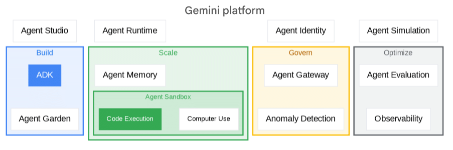
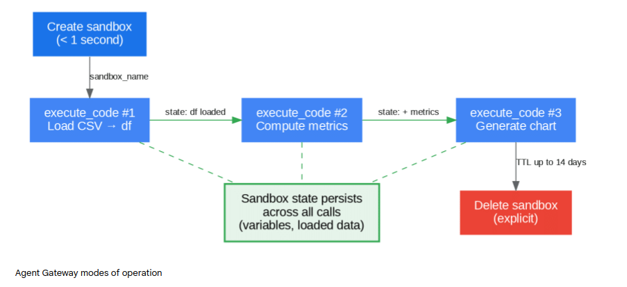
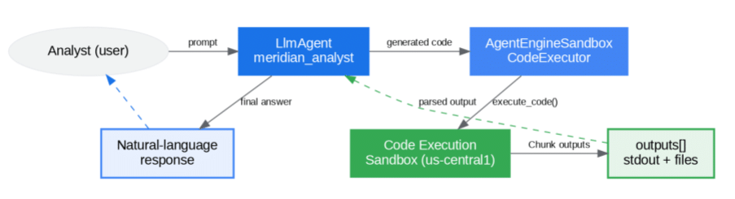

<link rel="stylesheet" href="./tabs.css">

# Build Enterprise Agents with Code Execution on Gemini platform

In this course, you'll explore the Code Execution feature of the Gemini platform, which lets AI agents safely generate and run Python code in isolated sandbox environments.

You'll learn how the Agent Sandbox fits into the broader platform architecture, how to configure and operate Code Execution sandboxes using the Agent Platform SDK, and how to integrate code execution into agent workflows with the Agent Development Kit (ADK) in Gemini platform.

The course culminates in a hands-on lab where you build an agent that analyzes data, computes metrics, and produces visualizations inside a secure, stateful sandbox.

## Gemini platform and the Agent Sandbox

In this lesson, you'll learn what the Gemini platform is and where Code Execution fits inside it. Several agent tasks, such as complex mathematical calculations or data analysis, require an agent to generate and run untrusted code. Giving an agent the ability to run arbitrary code raises an immediate question.

Where does that code actually run? You'll explore the platform's architecture and see how Agent Sandbox is designed to answer that question safely. This gives you the conceptual foundation you need for the rest of this course.

### Gemini platform

Gemini platform is Google Cloud's platform for building, scaling, governing, and optimizing AI agents. It launched in April 2026 as the evolution of Gemini platform. It consolidates model selection, agent development, and enterprise operations into one integrated platform.

The platform organizes its capabilities into the following four areas:

<div class="md-tabs">
  <input type="radio" name="platform-capabilities" id="tab-plat-capab-1" checked>
  <label for="tab-plat-capab-1">Build</label>
  <input type="radio" name="platform-capabilities" id="tab-plat-capab-2">
  <label for="tab-plat-capab-2">Scale</label>
  <input type="radio" name="platform-capabilities" id="tab-plat-capab-3">
  <label for="tab-plat-capab-3">Govern</label>
  <input type="radio" name="platform-capabilities" id="tab-plat-capab-4">
  <label for="tab-plat-capab-4">Optimize</label>  
  <div class="tab-panel">  
    <p><b>Tools for creating agents:</b> Agent Studio for low-code development, the Agent Development Kit (ADK) in Gemini platform for code-first engineering, sub-agents for multi-agent workflows, Agent Garden templates, and batch and event-driven agent support.</p>
  </div>
  <div class="tab-panel">
    <p><b>Infrastructure for running agents in production:</b> Agent Runtime for deployment, Agent Memory Bank for long-term context, Agent Sessions for tracking conversations, and Agent Sandbox for safe execution of risky operations.</p>
  </div>
  <div class="tab-panel">
    <p><b>Controls for secure, compliant agent deployments:</b> Agent Identity, Agent Registry, Agent Gateway, Agent Anomaly Detection, Agent Threat Detection, and Agent Security Dashboard.</p>
  </div>
  <div class="tab-panel">
    <p><b>Tools for improving agents over time:</b> Agent Simulation, Agent Evaluation, Agent Observability, and Agent Optimizer.</p>
  </div>
</div>

All Gemini platform services and roadmap evolutions are now delivered through the platform. If you've worked with Gemini platform before, you'll recognize the building blocks. The platform adds the Scale and Govern layers that enterprise production deployments require.

The following diagram maps these four areas and highlights where Agent Sandbox sits within Scale:



For an enterprise application, these capabilities work together: 

* The **Build tools** help engineers author a portfolio-analysis agent; Scale runs it reliably and safely.
* **Govern** ensures it meets compliance requirements, and Optimize continuously improves it.

### The Scale area: Agent Runtime and Agent Sandbox

Within the Scale capability area, two components handle the execution side of agents: **Agent Runtime and Agent Sandbox.**

They serve different purposes and operate in different trust domains.

1. **Agent Runtime** 

    **Agent Runtime** is the trusted, long-running environment where your agent's core logic executes. It delivers sub-second cold starts and supports long-running agents. This is where the agent reasons, decides what actions to take, and coordinates with tools. **Agent Memory Bank** handles long-term context retention, while **Agent Sessions** tracks conversation state. Both are distinct Scale components that work alongside Agent Runtime.

    An **Agent Engine** is the top-level container resource that owns your sandboxes. You create one before provisioning a sandbox, and it persists across the sandbox lifecycle.

2. **Agent Sandbox**

    **Agent Sandbox** is a short-lived, isolated environment that the agent or the platform spawns specifically to handle tasks that must not touch the agent's production infrastructure. Sandboxes operate in two modes:

    * **Code Execution:** A sandboxed Python (or JavaScript) interpreter for running model-generated programs, such as computations, data analysis, chart generation.

    * **Computer Use:** A sandboxed browser environment for automating web-based UI tasks, such as navigating a website or filling out a form.

These two modes serve different use cases. **_Code Execution_ is for data-oriented programs that operate on files and produce output. _Computer Use_ is for browser automation**. In this course, you focus on Code Execution. A sandbox is typically ephemeral, and it exists for a specific task, maintains state for up to 14 days, and is cleaned up when no longer needed.

> [!Note]
> **Agent Sandbox** is part of the Scale area because it's about safely expanding what an agent can do in production, rather than building or governing the agent itself.

### Agent Runtime vs. Agent Sandbox

Understanding the boundary between Agent Runtime and Agent Sandbox is the key conceptual point in this lesson. The difference comes down to trust and isolation.

* **Agent Runtime is trusted:** Your agent's orchestration logic, tool declarations, memory access, and session management all run inside the runtime. These are code you wrote and control, and they go through normal security review and deployment processes. They have appropriate access to your infrastructure.
* **Agent Sandbox is isolated:** When the agent decides to generate and execute Python code to answer a question, such as computing a calculation, processing a file, analyzing data, it sends that code to a sandbox. The sandbox has no network access, a limited filesystem, and no ability to affect the agent runtime or any other system.

This separation exists because model-generated code is different from code you wrote. It's synthesized on the fly, based on user input. It can also be shaped by the data the agent is analyzing. Running that code in the same environment as your production agent is a serious security risk, which is exactly why Agent Sandbox exists.

**Consider a customer service agent**

The agent might need to analyze customer data CSV files from various sources. The contents of those files could contain unusual formatting or inputs that cause edge cases in generated code. Running that code in a sandbox means the worst outcome is a failed execution instead of a compromised system.

### Why isolation matters for enterprise agents

Enterprise agents operate at a scale and in an environment where the consequences of a security breach are significant. Three properties of Agent Sandbox address this directly:

**a. Containment**

Code running in a sandbox cannot reach the host system's resources, filesystem, or network. A script that tries to read environment variables, reach an internal service, or install a package will simply fail. The sandbox boundary holds. This makes Code Execution safe to expose as a capability even in regulated industries.

**b. Tenant isolation**

Each sandbox is isolated from other sandboxes in the same project and from sandboxes belonging to other customers. Actions in one sandbox don't affect any other sandbox or runtime. For a multi-user platform where different analysts submit queries simultaneously, this isolation is essential.

**c. Predictabilit**

The pre-installed library set is fixed to over 125 packages, including NumPy, Pandas, Matplotlib, and scikit-learn, with no ability to install additional packages or call external services. In the next lesson, you'll explore the complete pre-installed library list and the SDK parameters that govern what's available.

> [!Note]
> The pre-installed library set of over 125 packages is current as of June 3, 2026.

What your agent can do in a sandbox is bounded and auditable. This gives security and compliance teams a clear picture of the attack surface. Together, these properties make Code Execution something you can deploy in production and defend to a security team. This is the standard enterprise software must meet.

## Code execution deep dive: Sandboxes, state, and the SDK

In this lesson, you'll learn how Code Execution sandboxes actually work, including their lifecycle, how state persists across calls, and how you operate them with the Agent Platform SDK. Previously, you reviewed why code isolation matters. Now you'll explore the mechanics that make it practical. This includes a sandbox that you can create in under a second, that remembers your variables and loaded data across multiple calls, all controlled through a clean set of Python SDK methods.

By the end of this lesson, you'll know exactly what to expect from a sandbox, and  be ready to work with one hands-on in the lab.

### The sandbox lifecycle

A code execution sandbox has a clear lifecycle. First you create it, then use it for one or many code execution calls, and eventually delete it (or let it expire on its own TTL).

<div class="md-tabs">
  <input type="radio" name="sandbox-lifecycle" id="tab-sbox-cycle-1" checked>
  <label for="tab-sbox-cycle-1">Step 1: Create</label>
  <input type="radio" name="sandbox-lifecycle" id="tab-sbox-cycle-2">
  <label for="tab-sbox-cycle-2">Step 2: Execute</label>
  <input type="radio" name="sandbox-lifecycle" id="tab-sbox-cycle-3">
  <label for="tab-sbox-cycle-3">Step 3: Delete</label>
  <div class="tab-panel">  
    <p>Creation is fast, sandboxes initialize in under a second. When you create a sandbox, you give it a display name and specify the <code>>code_execution_environment</code> in its spec. The sandbox is owned by an Agent Engine. This is the parent container resource that groups sandboxes and deployed agents together.</p>
  </div>
  <div class="tab-panel">
    <p>Execution is the core of the lifecycle. You send Python (or JavaScript) code to the sandbox using <code>execute_code</code>. The sandbox runs the code, returns the output, and, importantly, keeps its state for the next call. You can make as many <code>execute_code</code> calls as you need against the same sandbox.</p>
  </div>
  <div class="tab-panel">
    <p>Each sandbox has a configurable time-to-live (TTL)  of up to 14 days. Every <code>execute_code</code> call resets the TTL, so an active sandbox stays alive as long as you're using it. When you're done, explicitly deleting the sandbox frees the resource immediately. If you also no longer need the Agent Engine, deleting it with <code>force=True</code> cascades to all its sandboxes.</p>
  </div>
</div>

This lifecycle maps naturally to a data analysis session. You create a sandbox at the start of an analysis, execute several steps of code that build on each other (load data, clean it, compute metrics, generate a chart), then clean up when the session ends.



### State persistence and sandbox memory

One of the most important properties of a Code Execution sandbox is that it's stateful. Variables, imported libraries, and loaded data all persist from one `execute_code` call to the next within the same sandbox. This means you don't have to send all your code in a single call. You can build up a computation incrementally:

```python
# First call: load the data
response = client.agent_engines.sandboxes.execute_code(
    name=sandbox_resource_name,
    input_data={
        "code": "import pandas as pd\ndf = pd.read_csv('data.csv')"
    },
)

# Second call: compute on the loaded data - df is still in scope
response = client.agent_engines.sandboxes.execute_code(
    name=sandbox_resource_name,
    input_data={
        "code": "returns = df.pct_change().dropna()\nprint(returns.describe())"
    },
)
```

In the second call, `df` is available because the sandbox remembered it from the first call. This is what makes Code Execution useful for multi-step analytical workflows rather than just one-shot calculations.

> [!Note]
> State is scoped to a single sandbox. Two different sandboxes don't share memory. If you create a new sandbox, you start fresh.

### Machine configurations and the pre-installed library set

When you create a sandbox, you can choose its compute configuration. The default is `2 vCPU with 1.5 GB of RAM`, which is adequate for most data analysis tasks. For workloads that need more headroom, such as training a `scikit-learn` model on a large dataset, you can request the larger configuration with `4 vCPU and 4 GB of RAM`:

```python
sandbox_operation = client.agent_engines.sandboxes.create(
    name=agent_engine.api_resource.name,
    config=types.CreateAgentEngineSandboxConfig(
        display_name="data_sandbox"
    ), 
    spec={
        "code_execution_environment": {
            "code_language": "LANGUAGE_PYTHON",
            "machine_config": "MACHINE_CONFIG_VCPU4_RAM4GIB",
        }
    },
)
```

**The sandbox comes with over 125 pre-installed packages**. You can't install additional libraries, but the pre-installed set is comprehensive for data science and financial analysis work.

Key packages include:

* **Data manipulation:** NumPy 2.1.3, Pandas 2.2.3, SciPy 1.15.2
* **Machine learning:** scikit-learn 1.6.1, XGBoost 3.2.0
* **Visualization:** Matplotlib 3.10.1, Plotly 6.1.2, Seaborn 0.13.2
* **File I/O:** openpyxl, PyPDF2

**The sandbox has no network access.** Code that attempts an outbound HTTP call or DNS lookup will fail. Combined with the fixed library set, this bounds what the sandbox can do, which is exactly what makes it safe to run model-generated code.

### The SDK operations and response structure

The `vertexai` client library exposes five operations for working with sandboxes. All of them are located within the `client.agent_engines.sandboxes` namespace.

`create` provisions a new sandbox. You pass the parent Agent Engine's resource name, a display name config, and the spec:

```python
sandbox_operation = client.agent_engines.sandboxes.create(
    name=agent_engine.api_resource.name,
    config=types.CreateAgentEngineSandboxConfig(display_name="data_sandbox"),
    spec={"code_execution_environment": {}},
)
sandbox_resource_name = sandbox_operation.response.name
```

`execute_code` runs code in the sandbox. You pass the sandbox resource name and an `input_data` dict containing the code string and, optionally, a files list of file dicts (each with a name and content (bytes)) that are written to the sandbox working directory before execution:

```python
response = client.agent_engines.sandboxes.execute_code(
    name=sandbox_resource_name,
    input_data={
        "code": "print('Calculation result:', result)",
        "files": [{"name": "data.csv", "content": csv_bytes}],  # optional
    },
)
```

The response's `outputs` list contains `Chunk` objects. Each chunk has a `data` field (raw bytes), a `mime_type`, and optional metadata. Stdout and stderr arrive as `application/json` chunks; you decode the JSON to get `msg_out` and `msg_err`. Generated files (like a chart PNG) arrive as separate chunks with a `mime_type` matching the file type and a `metadata.attributes["file_name"]` field naming the file:

```python

for output in response.outputs:
    if output.mime_type == "application/json" and output.metadata is None:
        result = json.loads(output.data.decode("utf-8"))
        print(result.get("msg_out"))    # stdout
    elif output.metadata and output.metadata.attributes:
        file_name = output.metadata.attributes.get("file_name")
        if isinstance(file_name, bytes):
            file_name = file_name.decode("utf-8")
        # output.data contains the raw file bytes
```

`get`, `list`, and `delete` complete the lifecycle operations. Use `list` to retrieve all sandboxes under an Agent Engine, `get` to fetch a single sandbox by resource name, and `delete` to remove it immediately.

> [!Note]
>
> Code Execution is currently supported only in the `us-central1` region. If your project's default region differs, set the location explicitly when you initialize the client. (This information is current as of June 3, 2026.)

## Integrate code execution into agent workflows

In this lesson, you'll learn how to connect Code Execution to an ADK agent, enabling it to generate and run code autonomously from natural-language prompts. Previously, you explored the sandbox lifecycle, and called `execute_code` directly using the `vertexai` client library.

Now you'll take the next step by integrating this capability into an ADK agent. **The agent decides when to write code, runs that code in the sandbox, and uses the results to answer the user**. This transforms Code Execution from a standalone API call into a production agent capability. You'll also examine the cleanup steps required to maintain your project environment and keep your costs predictable.

### Two integration paths: Direct SDK calls and ADK orchestration

There are two ways to use Code Execution. Which one you choose depends on whether you need an agent to orchestrate the work or you're integrating Code Execution into your own application logic.

<div class="md-tabs">
  <input type="radio" name="cx-code-integration-paths" id="tab-cx-ci-paths-1" checked>
  <label for="tab-cx-ci-paths-1">Direct SDK Calls</label>
  <input type="radio" name="cx-code-integration-paths" id="tab-cx-ci-paths-2">
  <label for="tab-cx-ci-paths-2">ADK Orchestration</label>
  <div class="tab-panel">  
    <p>These are useful when you control the loop yourself. You decide when to call <code>execute_code</code>, handle the response, and pass results to the model or to your own code. This fits well if you're building a custom orchestration layer or using Code Execution with a framework other than ADK.</p>
  </div>
  <div class="tab-panel">
    <p>Delegates the loop to an <code>LlmAgent</code>, the core agent class in ADK that accepts a model, instructions, and optional tools or executors. You configure the agent with a code executor, and the agent handles the full cycle. It receives a user prompt, generates code, calls <code>execute_code</code>, interprets the result, and produces the final response.</p>
  </div>
</div>

### Choosing a code executor: Sandbox vs. built-in

ADK gives you two code executor options. The key difference is whether you use a managed, stateful sandbox or a lightweight in-process executor.

**AgentEngineSandboxCodeExecutor**

Connects the agent to a Code Execution sandbox you've already provisioned. The `sandbox_resource_name` value is the resource name returned when you created the sandbox in Lesson 2. It follows the format `projects/{project}/locations/{location}/reasoningEngines/{engine_id}/codeSessions/{session_id}`. Code runs in the sandbox and is isolated, stateful across turns, with the full pre-installed library set:

```python
from google.adk.agents import LlmAgent
from google.adk.code_executors.agent_engine_sandbox_code_executor import (
    AgentEngineSandboxCodeExecutor,
)

agent = LlmAgent(
    model="gemini-2.5-flash",
    name="financial_analyst",
    description="Analyzes portfolio data using code execution",
    instruction="You are a financial analyst. Use code to compute metrics.",
    code_executor=AgentEngineSandboxCodeExecutor(
        sandbox_resource_name=sandbox_resource_name
    ),
)
```

**BuiltInCodeExecutor**

Runs code in the same process as your agent, without a sandbox. It's easier to set up and has no region restrictions, but it doesn't provide isolation and doesn't persist state across turns. Use it for development or for low-risk use cases where isolation isn't required:

```python
from google.adk.code_executors import BuiltInCodeExecutor

agent = LlmAgent(
    model="gemini-2.5-flash",
    name="analyst",
    code_executor=BuiltInCodeExecutor(),
)
```

For production enterprise deployments, where model-generated code runs against real data, use `AgentEngineSandboxCodeExecutor`. For local development and prototyping, `BuiltInCodeExecutor` is faster to set up.

The following diagram illustrates the ADK agent integration flow. The user prompt passes through the `LlmAgent` to the `AgentEngineSandboxCodeExecutor` to invoke the Code Execution sandbox. The results are then routed back through the agent to the user.



> [!Note]
> `AgentEngineSandboxCodeExecutor` requires a sandbox in `us-central1`. This reflects where the Code Execution infrastructure is currently deployed, using a sandbox in another region results in a configuration error at runtime. Ensure your Agent Engine and sandbox are in that region before integrating the agent.

### Runner setup and multi-turn agent patterns

Once you have an agent configured with a code executor, you run it through a `Runner`. The `Runner` wires together the agent, session management, artifact storage, and memory. ADK separates these concerns into distinct service objects. The InMemory variants store data in process memory, which is suitable for development and testing, but they don't persist data across process restarts:

```python
from google.adk.runners import Runner
from google.adk.sessions import InMemorySessionService
from google.adk.artifacts import InMemoryArtifactService
from google.adk.memory import InMemoryMemoryService

session_service = InMemorySessionService()
await session_service.create_session(
    app_name="enterprise_app", user_id="user_1", session_id="session_001"
)

runner = Runner(
    agent=agent,
    app_name="enterprise_app",
    session_service=session_service,
    artifact_service=InMemoryArtifactService(),
    memory_service=InMemoryMemoryService(),
)
```

> [!Note]
> When moving from prototype to production, the standard architectural pattern is to swap InMemoryMemoryService for a persistent, vector-backed implementation like VertexAiMemoryBankService, which handles semantic search and cloud storage natively.

You send a message to the runner using run_async, which yields events as the agent works. Events arrive in sequence (such as the agent generating text, calling tools and running code) and the final event carries the agent's synthesized answer. You can use is_final_response() to identify this final event:

```python
async for event in runner.run_async(
    user_id="analyst_1",
    session_id="session_001",
    new_message=genai_types.Content(
        role="user",
        parts=[genai_types.Part(text="Analyze this dataset and compute the mean values.")],
    ),
):
    if event.is_final_response():
        print(event.content.parts[0].text)
```

In a multi-turn conversation, the sandbox's state persists. If the agent loaded your CSV in the first turn, it can compute metrics on that data in the second turn without reloading it. The agent's decision automatically manages this entire cycle.

It receives the user message, determines if code is needed, generates Python, passes it to the executor, captures the result back as context, and incorporates it into its response. The session service tracks the conversation context while the sandbox tracks the execution state.

### Cleaning up resources

Agent Engine sandboxes and Agent Engines themselves are billable resources. Building in explicit cleanup ensures you don't leave resources running after a session ends.

Delete a sandbox directly when you know you're done with it:

```python
client.agent_engines.sandboxes.delete(name=sandbox_resource_name)
```

If you want to remove the Agent Engine and all the sandboxes under it in one step, use force=True:

```python
agent_engine.delete(force=True)
```

Wrap your agent session in a `try/finally` block so cleanup runs even if the session raises an exception. In a production system, you might also implement a periodic cleanup job that lists sandboxes and deletes any that have been idle longer than your session timeout.

In a typical enterprise application, sandboxes are provisioned at the start of a user session and cleaned up when the session closes. Cleanup happens explicitly by the application, or by the sandbox TTL if the application exits unexpectedly.