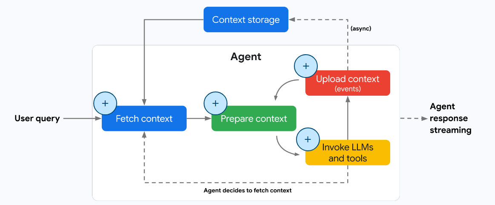
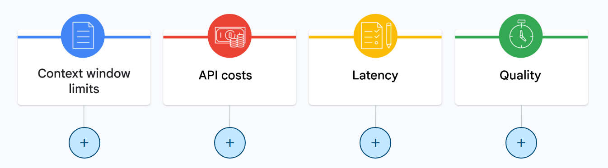
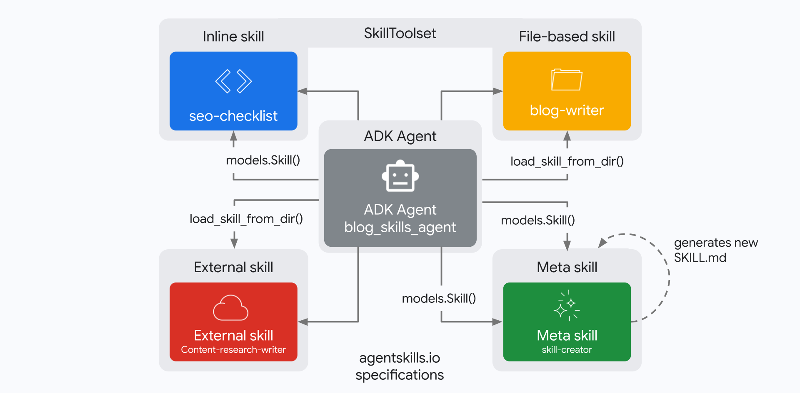
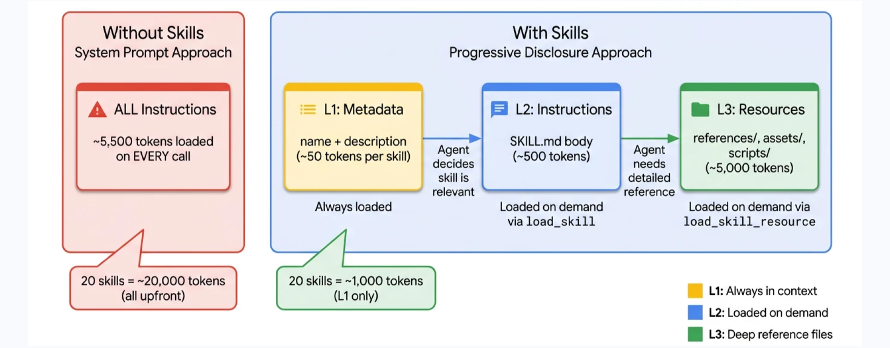
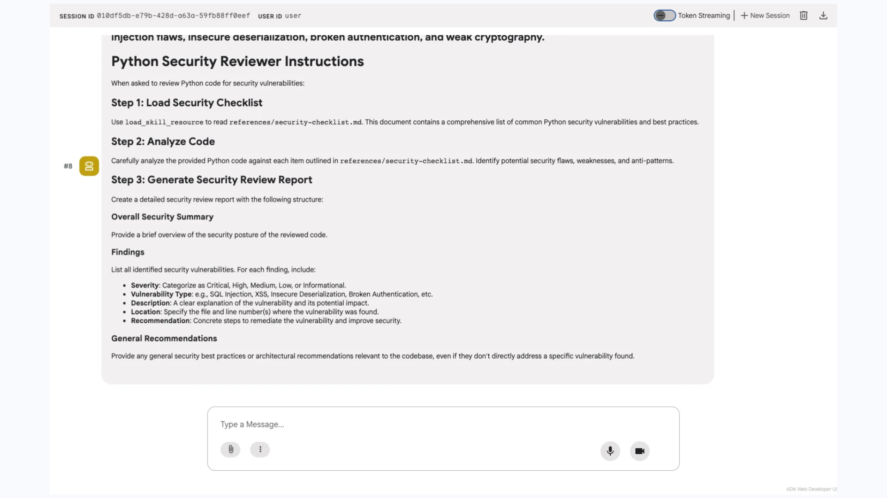
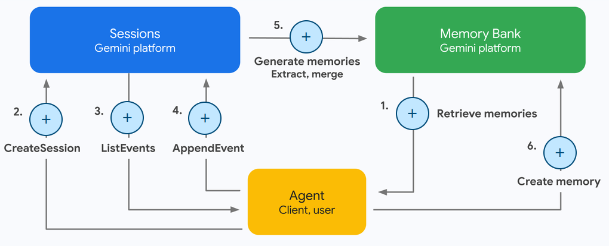
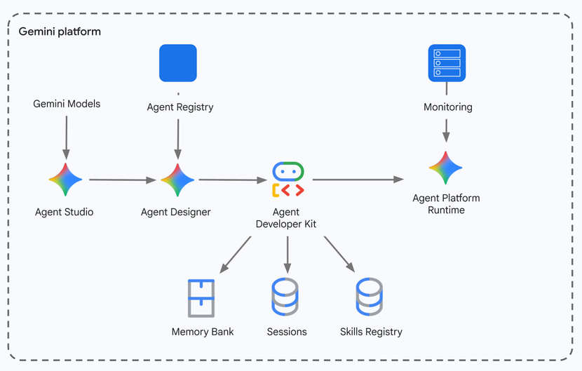
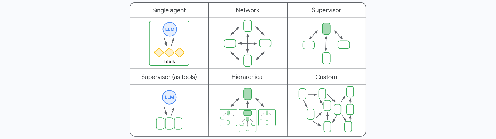

<link rel="stylesheet" href="./tabs.css">

# Craft ADK Agents with Persistent Memories

Large Language Models (LLMs) are inherently stateless, meaning their awareness is confined to the limited "context window" of a single API call. This makes building intelligent AI agents difficult. They require continuous access to operating instructions, factual data, and immediate conversational context to function effectively.

**So what’s the solution?**

Stateful and personal AI - starting with context engineering. To create stateful agents that remember, learn, and personalize interactions, developers must build this context for every single conversational turn. This process—context engineering—evolves beyond static prompt engineering by dynamically assembling a state-aware prompt using user data, conversation history, and external knowledge.

Throughout this course, you’ll explore the critical role of context engineering to empower you to create powerful, personalized, and persistent AI experiences. You’ll also dive into the two core components that make this possible:

1. **Sessions:** The immediate container for the entire conversation, holding the chronological history of the dialog and the agent's turn-by-turn working memory.
2. **Memory:** The mechanism for long term persistence, which captures and consolidated key information across multiple sessions to provide a continuous and personalized experience for the user.

In this course, you’ll learn how to:

* Explain the critical role of context engineering in building stateful agents.
* Distinguish between sessions and memory and explain how they collaborate to enable personalized and persistent AI experiences.
* Design and implement architectural strategies for managing context, conversation history, and long-term knowledge in production-grade agents.

## Introduction to persistence in agents

Building intelligent AI agents requires moving beyond static system instructions. Large Language Models (LLMs) process each interaction independently. To make them truly stateful, you must provide a carefully curated package of history, facts, and immediate conversational context.

In this chapter, you'll explore context engineering—the process of dynamically assembling this information to create a state-aware prompt. You'll examine the continuous lifecycle of context management. You'll also discover how to balance the need for rich Al memory against the practical constraints of API costs, quality, and latency. Finally, you’ll explore the underlying Agent Runtime infrastructure that makes data persistence possible in a production environment.

### Define context engineering

Large Language Models (LLMs) are inherently stateless. Outside of their training data, their reasoning and awareness are confined to the information provided within the "context window" of a single API call. This presents a fundamental problem: AI agents must be equipped with operating instructions, factual data, and immediate conversational information to understand their current task.

To build intelligent agents that can remember, learn, and personalize interactions, you must construct this context for every single turn of a conversation. This dynamic assembly and management of information is known as context engineering.

#### Compare prompt and context engineering

Context engineering represents a necessary evolution from traditional prompt engineering. To understand the difference, consider how they handle information:

1. **Prompt Engineering:** Focuses on crafting optimal, often static, system instructions.
2. **Context Engineering:** Addresses the entire payload, dynamically constructing a state-aware prompt based on the user, conversion history, and external data.

**Ultimately, context engineering involves strategically selecting, summarizing, and injecting different types of information to maximize relevance while minimizing noise**. Because external systems—such as RAG databases, session stores, and memory managers—hold much of this context, your agent framework must constantly orchestrate these systems to retrieve and assemble the final prompt.

**The goal of context engineering is to ensure the model has no more and no less than the most relevant information to complete its task**.

#### Analyze the anatomy of context

To achieve this "perfect recipe," it's helpful to understand exactly what ingredients go into the context window. context engineering governs the assembly of a complex payload that can include a variety of components, which can be broken down into three categories:

**Context to guide reasoning**

This category defines the agent’s fundamental reasoning patterns and available actions, dictating its behavior: 
* **System instructions:** High-level directives defining the agent's persona, capabilities, and constraints. 
* **Tool definitions:** Schemas for APIs or functions the agent can use to interact with the outside world. 
* **Few-shot examples:** Curated examples that guide the model's reasoning process via in-context learning. 

**Evidential and factual data**

This is the substantive data the agent reasons over, including pre-existing knowledge and dynamically retrieved information for the specific task; it serves as the 'evidence' for the agent's response: 

* **Long-term memory:** Persisted knowledge about the user or topic, gathered across multiple sessions. 
External knowledge: Information retrieved from databases or documents, often using  Retrieval-Augmented Generation (RAG). 
* **Tool outputs:** The data or results returned by a tool. 
Sub-agent outputs: The conclusions or results returned by specialized agents that have been delegated a specific subtask.
* **Artifacts:** Non-textual data (e.g., files, images) associated with the user or session. 

**Working context**

This final category grounds the agent in the current interaction, defining the immediate task: 

* **Conversation history:** The turn-by-turn record of the current interaction. 
* **State or scratchpad:** Temporary, in-progress information or calculations the agent uses  for its immediate reasoning process. 
* **User's prompt:** The immediate query to be addressed. 

#### Why not just include everything in the context window?

One of the biggest challenges in building a context-aware agent is dealing with an ever-growing conversation history. Although modern models can handle massive transcripts, sending the entire history every time creates two significant drawbacks:

| | |
| :-- | :-- |
| **1. Increased cost and latency** <br/>Processing a massive context window takes more time and costs more money. |  **2. "Context rot"** <br/>As the prompt gets longer, the model's ability to pay attention to the most critical information diminishes. |

Context engineering directly addresses this by dynamically compressing the history. By using techniques like summarizing older messages, or pruning irrelevant details, you preserve vital information while managing the overall token count.

#### Examine the context management lifecycle

To build the right context and keep the conversation history manageable, an agent follows a structured cycle during every single turn of a conversation:



1. **Fetch context:** The agent begins by retrieving context—such as user memories, RAG documents, and recent conversation events. For dynamic context retrieval, the agent will use the user query and other metadata to identify what information to retrieve.
2. **Prepare context:** The agent framework dynamically constructs the full prompt for the LLM call. Although individual API calls may be asynchronous, preparing the context is a  blocking, "hot-path" process. The agent cannot proceed until the context is ready. 
3. **Invoke LLM and tools:** The agent iteratively calls the LLM and any necessary tools until a final response for the user is generated. Tool and model output is appended to the context.
4. **Upload context:** New information gathered during the turn is uploaded to persistent  storage. This is often a "background" process, allowing the agent to complete execution while memory consolidation or other post-processing occurs asynchronously. 

#### Work with persistence in ADK

In this course, you’ll focus on Agent Development Kit (ADK) in Gemini platform, the framework designed to empower developers to quickly build, manage, evaluate and deploy AI-powered agents. At the center of the content management lifecycle in ADK there are three fundamental components:

1. **Session:** manages the turn-by-turn state of a _single_ conversation.
2. **Memory:** provides mechanism for long-term persistence, capturing and consolidating key information across multiple sessions.
3. **Skills:** enables agents to load domain expertise on demand.

Skills superpower an agent with capabilities that can be loaded on demand. These skills can evolve and change, and the agent can develop new skills as it learns. The session serves as the temporary scratchpad for a single conversation, while the agent's memory is the meticulously organized filing cabinet, allowing it to recall key information during future interactions.

#### Work with persistence in Gemini platform

Gemini platform is a unified platform to build, deploy, govern, and optimize enterprise-grade AI agents and model-based solutions. ADK natively integrates with Gemini platform, but you can build agents without using ADK, and still benefit from Gemini platform solutions. Regarding persistence, Gemini platform includes:

1. **Session on Gemini Platform:** a managed service designed to store, query and manage history of interactions between a user and agents.
2. **Memory Bank on Gemini Platform:** a managed service that dynamically generates, persists, and provides long-term memories based on conversations between the user and your agent.
3. **Skills Registry on Gemini Platform:** a secure, private, and low-latency repository for managing agent skills.


#### Summary

Because LLMs are inherently stateless, they start completely fresh with every API call. To build intelligent, continuous experiences, you can rely on context engineering—dynamically assembling system instructions, factual data, and conversation history into an optimized prompt for every turn to prevent context rot.

### Evaluate the cost implications of agent context

As you design agents that use sessions and memory to store data across the context management lifecycle, you must also address a practical constraint: the cost of holding onto all that information.

In a simplistic architecture, a session is an immutable log of the conversation between the user and agent. However, as the conversation scales, the conversation’s token usage increases. Modern LLMs can handle long contexts, but limitations exist, especially for latency-sensitive applications:



1. **Context Window Limits:** Every LLM has a maximum amount of text (context window) it can process at once. If the conversation history exceeds this limit, the API call will fail. 
2. **API Costs:** Most LLM providers charge based on the number of tokens you send and receive. Shorter histories mean fewer tokens and lower costs per turn.
3. **Latency:** Sending more text to the model takes longer to process, resulting in a slower response time for the user. Compaction keeps the agent feeling quick and responsive. 
4. **Quality:** As the number of tokens increases, performance can get worse due to additional noise in the context and autoregressive errors. 

#### Balance cost, speed, and quality

To visualize this balancing act between cost, speed, and quality, consider a familiar scenario. 

**Illustration of suitcase**
| | |
| :-- | :-- |
| | Managing a long conversation with an agent can be compared to a savvy traveler packing a suitcase for a long trip. The suitcase represents the agent’s limited context window, and the clothes and items are the pieces of information from the conversation. If you simply try to stuff everything in, the suitcase becomes too heavy and disorganized, making it difficult to find what you need quickly—like how an overloaded context window increases processing costs and slows down response times. <br/><br/> However, if you pack too little, you risk leaving behind essential items like a passport or a warm coat, compromising the entire trip—like how an agent could lose critical context, leading to irrelevant or incorrect answers. Both the traveler and the agent operate under a similar constraint: success hinges not on how much you can carry, but on carrying only what you need. 

To ensure the agent carries only what it needs, developers rely on three primary strategies:

1. **Apply progressive disclosure**

    This architectural pattern allows agents to load context precisely when it is needed, rather than cramming thousands of tokens into a monolithic system prompt. For example, at the beginning of the conversation, the agent is given only the rules and data it needs for Step 1. Once Step 1 is successfully completed, the system (or a supervisor agent) "discloses" the instructions and data for Step 2.

2. **Implement memory compaction**

    One approach is to use compaction strategies to shrink long conversation histories, condensing dialogue to fit within the model's context window, reducing API costs and latency. As a conversation gets longer, the history sent to the model with each turn can become too large. Compaction strategies solve this by intelligently trimming the history while trying to preserve the most important context.

3. **Use contextual memory**

    A different approach is to use memory contextually. Instead of passing all the conversational history at the start of the conversation with an agent, you can look up specific information at query time. To do so, you can use tools that access external data stores. You can form these from previous conversations with users or from external data sources.

    Although it’s not conversational memory, the agent can have access to external knowledge retrieved. Your organization might have databases, wikis, or shared drives with specific information to make available to the user. You might want to disclose such information on-demand when a customer has a relevant query, rather than loading all that information in the initial context.


#### Summary

Although giving your AI agent infinite memory might seem ideal, it quickly leads to high API costs, slow responses, and degraded reasoning. To build efficient agents, you must optimize your context window—using compaction to trim active conversation histories, and relying on contextual retrieval to fetch external data only when it is strictly necessary.

### Add Skills to Agents

#### Define Agent Skills

Agent Skills are a lightweight, open format for extending AI agent capabilities with specialized knowledge and workflows.

At its core, **a skill is a folder containing a `SKILL.md` file**. This file includes metadata (name and description, at minimum) and instructions that tell an agent how to perform a specific task. Skills can also bundle scripts, reference materials, templates, and other resources.

```bash
my-skill/
├── SKILL.md      # Required: metadata + instructions
├── scripts/      # Optional: executable code (folder)
├── references/   # Optional: documentation (folder)
├── assets/       # Optional: templates, resources (folder)
└── ...           # Any additional files or directories
```

#### Evaluate the benefits of Agent Skills

Agents are increasingly capable, but often don’t have the context they need to do real work reliably. Skills solve this by packaging procedural knowledge and context that is specific to the company, team, and user into portable, version-controlled folders that agents load on demand. This gives agents the following:

1. **Domain Expertise**

    Specialized knowledge, such as legal review process, data analysis pipelines, and presentation formatting captured as reuseable instructions and resources.

2. **Repeatable Workfows**

    Multi-step tasks turned into consistent, auditable procedures.

3. **Cross-product reuse**

    Skill built once and used across any skills compatible Agent.

#### Implement Agent Skills

Agent Development Kit (ADK)'s [SkillToolset](https://google.github.io/adk-docs/skills/) enables agents to load domain expertise on demand. The SkillToolset achieves this through progressive disclosure. This architectural pattern allows agents to load context precisely when it is needed, rather than cramming thousands of tokens into a monolithic system prompt. Each pattern builds on the previous one, culminating in an agent architecture capable of dynamically expanding its own capabilities.



* **Inline Skill:** An inline checklist - a basic, hardcoded skill implementation.
* **File-based skill:** Loading external instructions and resources.
* **External skill:** The external import. Utilizing community-driven skill repositories.
* **Meta skill:** The skill factory. A self-extending pattern where the agent writes new skills on demand.

#### Analyze the problem with monolithic prompts

Most AI agents get their domain knowledge directly from the system prompt. Developers often concatenate compliance rules, style guides, API references, and troubleshooting procedures into one massive instruction string.

This works fine when an agent only has two or three capabilities. However, when you scale up to ten or more tasks, concatenating all of those instructions into the system prompt costs thousands of tokens on every LLM call. This happens regardless of whether the user's specific query actually requires that knowledge.

The [Agent Skills specification](https://agentskills.io/specification) solves this through progressive disclosure. It breaks knowledge loading into three distinct levels: L1 metadata, L2 instructions, and L3 Resources.



1. **L1 Metadata (~100 tokens per skill)**

    This includes just the skill name and description. It is loaded at startup for all skills and acts as a menu the agent scans to decide what is relevant.

2. **L2 Instructions (<5,000 tokens)**

    This is the full skill body. It is loaded via the API only when the agent explicitly activates a specific skill.

3. **L3 Resources (as needed)**

    These are external reference files like style guides or API specs. They are loaded only when the skill's instructions require them.

By using this architecture, an agent with 10 skills starts each call with roughly 1,000 tokens of L1 metadata instead of 10,000 tokens in a monolithic prompt. This translates to roughly a 90% reduction in baseline context usage.

ADK implements this through the `SkillToolset` class, which auto-generates three tools: 

* `list_skills` (L1)
* `load_skill` (L2)
* `load_skill_resource` (L3)

#### Implement progressive disclosure

To implement progressive disclosure in your agent, the SkillToolset supports four distinct patterns. These patterns range from simple, static rules to advanced, self-extending architectures. As you move from the first pattern to the fourth, your agent gains increasing autonomy over its own knowledge base.

**Pattern 1: Inline skills (the sticky note)**

The simplest pattern: a Python object with name, description, and instructions, defined directly in your agent code. This is best for small, stable rules that rarely change.

```python
# ADK Pseudocode: Pattern 1: Inline Skill
from google.adk.skills import models

seo_skill = models.Skill(
    frontmatter=models.Frontmatter(
        name="seo-checklist",
        description="SEO optimization checklist for blog posts. Covers title tags, meta descriptions, heading structure, and readability.",
    ),
    instructions=(
        "When optimizing a blog post for SEO, check each item:\n"
        "1. Title: 50-60 chars, primary keyword near the start\n"
        "2. Meta description: 150-160 chars, includes a call-to-action\n"
        "3. Headings: H2/H3 hierarchy, keywords in 2-3 headings\n"
        "4. First paragraph: Primary keyword in first 100 words\n"
        "5. Images: Alt text with keywords, compressed, descriptive names\n"
        "Review the content against each item and suggest improvements."
    ),
)
```

The `frontmatter` fields become L1 metadata, which the LLM sees in every call. The `instructions` become L2, loaded only when the agent decides this skill is relevant. When asked "Review my blog post for SEO," the agent loads this skill and applies each item systematically.

**Pattern 2: File-based skills (the reference binder)**

Inline skills work well for simple checklists. But if your skill needs reference documents (a style guide, an API spec), you need a directory.

A file-based skill lives in its own directory with a `SKILL.md` file and optional subdirectories for references, assets, and scripts. The `SKILL.md` starts with YAML frontmatter, followed by Markdown instructions.

```bash
skills/blog-writer/ 
├── SKILL.md       # L2: Instructions 
└── references/ 
      └── style-guide.md # L3: Loaded on demand
```

This design splits knowledge across two layers. The `SKILL.md` instructions (L2) tell the agent what steps to follow. The `references/style-guide.md` file (L3) provides the detailed domain knowledge for each step. The agent loads the reference only when its instructions dictate it via the `load_skill_resource` tool.

```python
# ADK Pseudocode: Pattern 2: File-Based Skill
from google.adk.skills import load_skill_from_dir

blog_writer_skill = load_skill_from_dir(
    pathlib.Path(__file__).parent / "skills" / "blog-writer"
)
```

File-based skills make knowledge reusable. Any agent that follows the [agentskills.io spec](https://agentskills.io/specification) can load the same directory. But in this scenario, you still write the `SKILL.md` yourself.

**Pattern 3: External skills (the import)**

External skills work exactly like file-based skills. The only difference is where the directory came from. Instead of writing your own `SKILL.md`, you download one from a community repository like [awesome-claude-skills](https://github.com/ComposioHQ/awesome-claude-skills) and load it with the same `load_skill_from_dir` call.

```python
# ADK Pseudocode: Pattern 3: External Skill (same API, different source)
from google.adk.skills import load_skill_from_dir

content_researcher_skill = load_skill_from_dir( 
    pathlib.Path(__file__).parent / "skills" / "content-research-writer" 
)
```

The code is identical to Pattern 2. The `agentskills.io` spec defines a universal directory format, so `load_skill_from_dir` doesn't care whether you wrote the `SKILL.md` or downloaded it. Google publishes official ADK development skills as part of Agents CLI, installable with `uvx google-agents-cli` setup.

**Pattern 4: The skill factory (meta skills)**

The first three patterns cover skills that already exist: ones you write, or ones you find. Pattern 4 closes the loop. In this pattern, the agent writes its own skills.

A meta skill is a skill whose purpose is to generate new `SKILL.md` files. An agent equipped with a meta skill becomes self-extending. It can expand its own capabilities without human intervention by writing and loading new skill definitions at runtime.

The skill creator is an inline skill whose instructions explain how to write valid `SKILL.md` files. The key is the resources field. It embeds the `agentskills.io` spec specification itself and a working example as L3 references. When asked to create a new skill, the agent reads these references and generates a spec-compliant `SKILL.md`.

```python
# ADK Pseudocode: Pattern 4: Meta Skill (The Skill Factory)
from google.adk.skills import models

skill_creator = models.Skill(
    frontmatter=models.Frontmatter(
        name="skill-creator",
        description=(
            "Creates new ADK-compatible skill definitions from requirements."
            " Generates complete SKILL.md files following the Agent Skills"
            " specification at agentskills.io."
        ),
    ),
    instructions=(
        "When asked to create a new skill, generate a complete SKILL.md file.\n\n"
        "Read `references/skill-spec.md` for the format specification.\n"
        "Read `references/example-skill.md` for a working example.\n\n"
        "Follow these rules:\n"
        "1. Name must be kebab-case, max 64 characters\n"
        "2. Description must be under 1024 characters\n"
        "3. Instructions should be clear, step-by-step\n"
        "4. Reference files in references/ for detailed domain knowledge\n"
        "5. Keep SKILL.md under 500 lines, put details in references/\n"
        "6. Output the complete file content the user can save directly\n"
    ),
    resources=models.Resources(
        references={
            "skill-spec.md": "# Agent Skills Specification (agentskills.io)...",
            "example-skill.md": "# Example: Code Review Skill...",
        }
    ),
)
```

The resources field is where the `models.Resources` class becomes essential. The references embed the `agentskills.io` spec as `skill-spec.md` and a working code-review skill as `example-skill.md`. When the agent calls `load_skill_resource("skill-creator", "references/skill-spec.md")`, it gets the full specification that governs how valid skills are structured.

**Best practice for generated skills:** Although auto-generating skills is a powerful workflow, it’s recommended using a human-in-the-loop to review the final SKILL.md. As a standard practice for any skill you build, you should test its effectiveness. You can easily do this by building robust evaluations with ADK to ensure that your skill works exactly as intended before deployment.

#### Use the skill factory

**Ask the agent:** _"I need a new skill for reviewing Python code for security vulnerabilities."_

The agent loads the skill creator, reads the spec and example via `load_skill_resource`, and generates a complete Python security review skill with valid kebab-case naming, structured instructions covering input validation, authentication, and cryptography, and a severity-based reporting format.




The generated skill follows the same `agentskills.io` spec, so it works not just in ADK but in any compatible agent: [Gemini CLI](https://github.com/google-gemini/gemini-cli), [Claude Code](https://docs.anthropic.com/en/docs/claude-code), [Cursor](https://www.cursor.com/), and [40+ other products](https://agentskills.io/clients) that have adopted the format.

#### Assemble the skill toolset


With all four skills defined, packaging them into a `SkillToolset` and handing it to the agent takes a few lines:

```python
# ADK Pseudocode: Assemble the Skill Factory

skill_toolset = SkillToolset(
    skills=[seo_skill, blog_writer_skill, content_researcher_skill, skill_creator]
)

root_agent = Agent(
    model="gemini-2.5-flash",
    name="blog_skills_agent",
    description="A blog-writing agent powered by reusable skills.",
    instruction=(
        "You are a blog-writing assistant with specialized skills.\n"
        "Load relevant skills to get detailed instructions.\n"
        "Use load_skill_resource to access reference materials.\n"
        "Follow each skill's step-by-step instructions.\n"
        "Always explain which skill you're using and why."
    ),
    tools=[skill_toolset],
)
```

The first three skills in the list handle SEO, writing, and research. The fourth, `skill_creator`, is the factory. Ask this agent _"Create a skill for writing technical blog introductions"_ and it generates a new `SKILL.md` on the spot:

```yaml
# Generated by skill-creator
---
name: blog-intro-writer
description: Writes compelling technical blog introductions. Hooks the reader
  with a problem statement, establishes relevance, and previews what they will learn.
---

When writing a blog introduction, follow this structure:
1. Open with a specific problem the reader recognizes
2. State why it matters now (new release, scaling pain, common mistake)
3. Preview what the post covers in one sentence
4. Keep it under 100 words
```

The agent used the `seo-checklist` and `blog-writer` skills for existing tasks. When it needed a capability it didn't have, it wrote one. That new skill follows the same agentskills.io spec, so you can save it to `skills/blog-intro-writer/SKILL.md` and load it with `load_skill_from_dir` in your next session.

#### Review best practices

As you begin transitioning from monolithic prompts to a dynamic skill architecture, keep these best practices in mind to ensure your agent remains performant, maintainable, and secure:

1. **Descriptions are your API Docs**

    The `description` field is what the LLM sees at L1 to decide whether to load a skill. "SEO optimization checklist for blog posts" tells the agent exactly when to activate. "A helpful skill" does not.

2. **Start with inline, graduate to file**

    Don't over-engineer. If your skill fits in 10 lines of instructions, keep it inline. Move to a file-based skill when you need reference documents or want to reuse across agents.

3. **Review Generated skills as dependencies**

    A meta skill's output becomes your agent's behavior. Treat generated SKILL.md files like a code review. Read before you deploy.

#### Manage Agent Runtime Skill Registry

Once you have designed your agent's skills and meta-skills, you need a robust environment to manage them. Skill Registry serves as a secure, private, and low-latency repository for managing agent skills. Each skill is a self-contained package, including structural instructions, executable code, and documentation, designed to extend an agent's capabilities.

By centralizing these skills, Skill Registry empowers agents to dynamically discover and load the most relevant capabilities based on user intent, thereby optimizing performance and ensuring a secure execution environment. Skill Registry introduces two top-level, standard API entities to manage lifecycle and versioning:

* **Skill:** A mutable top-level entity containing metadata (such as display name, creation and update timestamps, and labels), the default revision, and the skill's content.
* **Skill revision:** An immutable snapshot of a specific skill version. It includes a name, a description, and an immutable reference to the parent skill resource.

You can perform a variety of actions in Skills Registry such as create, get, list, retrieve, and delete skills. Here are two of examples:

**Create a skill**

To create a new skill, use the `CreateSkill` method. This operation is a long-running operation.

```python
import agentplatform

client = agentplatform.Client(project="PROJECT_ID", location="LOCATION")

skill = client.skills.create(
    skill_id="SKILL_ID",
    display_name="DISPLAY_NAME",
    description="DESCRIPTION",
    config={
        # Local directory path (automatically compressed) or pre-zipped file path (.zip)
        "local_path": "SKILL_PATH",
    },
)
print(skill.name)
```

**Retrieve skills**

Use the `RetrieveSkills` method to find skills using semantic search. For example, you can search for skills by describing the task you want to accomplish, such as `find skills to manage cloud resources`.

```python
import agentplatform

client = agentplatform.Client(project="PROJECT_ID", location="LOCATION")

response = client.skills.retrieve(
    query="QUERY",
    config={"top_k": TOP_K},
)
for retrieved_skill in response.retrieved_skills:
    print(retrieved_skill.skill_name, retrieved_skill.description)
```

#### Summary

To effectively scale agent capabilities without overloading monolithic system prompts, you must implement progressive disclosure. The ADK SkillToolset achieves this by breaking knowledge loading into three distinct levels: L1 metadata, L2 instructions, and L3 resources, ensuring context is consumed only when specifically required. By mastering the transition from inline and file-based skills to dynamic meta-skills, and managing the entire lifecycle through the Agent Runtime Skill Registry, you build a self-extending architecture that is modular, performant, and ready for production deployment.

### Manage Data Persistence in Gemini Platform

To achieve true statefulness in production, your agents rely on the Gemini platform infrastructure to maintain continuity across interactions. This is accomplished through three core components that manage history, long-term facts, and reusable capabilities:


Click each tab to reveal content

<div class="md-tabs">
  <input type="radio" name="gemini-plat-capab" id="tab-gemini-plat-capab-1" checked>
  <label for="tab-gemini-plat-capab-1">Agent Plaform Sessions</label>
  <input type="radio" name="gemini-plat-capab" id="tab-gemini-plat-capab-2">
  <label for="tab-gemini-plat-capab-2">Agent Platform Memory Bank</label>
  <input type="radio" name="gemini-plat-capab" id="tab-gemini-plat-capab-3">
  <label for="tab-gemini-plat-capab-3">Skill Registry on Gemini Platform</label>
  <div class="tab-panel">  
    <p>Agent Platform Sessions maintains the history of interactions between a user and agents. Sessions provide definitive sources for long-term memory and conversation context.<br/>You have several options to use Agent Platform Sessions:
    <ul>
    <li><b>Agent Development Kit:</b> Once you deploy your Agent Development Kit (ADK) agent to Gemini platform, session management is handled automatically.</li>
    <li><b>API calls:</b> You can make direct API calls to sessions on Gemini platform if you don't want to use ADK.</li></ul></p>
  </div>
  <div class="tab-panel">
    <p>Memory Bank on Gemini platform lets you dynamically generate long-term memories based on conversations between the user and your agent. These memories are personalized information that persists across multiple sessions, enabling your agent to adapt and personalize responses for context and continuity.<br/>Memory Bank includes the following features:
    <ul>
    <li><b>Memory generation:</b> Create, refine, and manage memories using a large language model (LLM).</li>
    <li><b>Managed storage and retrieval:</b> Benefit from a fully managed, persistent, and accessible memory store.</li></ul></p>
  </div>
  <div class="tab-panel">
    <p>Skill Registry serves as a secure, private, and low-latency repository for managing agent skills. Each skill is a self-contained package, including structural instructions, executable code, and documentation, designed to extend an agent's capabilities.<br/><br/>By centralizing these skills, Skill Registry empowers agents to dynamically discover and load the most relevant capabilities based on user intent, thereby optimizing performance and ensuring a secure execution environment.</p>
  </div>
</div>

#### Generate memories from stored sessions

Memory Bank on Gemini platform can be used natively with Sessions to generate memories from stored sessions using the following process:



1. **Retrieve Memories:** As the user interacts, the agent retrieves saved memories. It can use simple retrieval for all memories, or similarity search for relevant ones, and insert them into the active prompt.
2. **CreateSession:** Create a new session at the start of a conversation to scope the agent's history, storing messages as `SessionEvents`. A user ID is required so extracted memories can be mapped to the user.
3. **ListEvents:** As the user interacts with the agent, the agent retrieves the active conversation history from the session.
4. **AppendEvent:** As the user interacts, events (user messages, agent responses, and tool actions) are uploaded to the session. This persists the history and creates a record used to generate memories.
5. **Generate Memories, Extract merge:** At a specified interval (e.g., end of a turn), the agent triggers memory generation. Facts are automatically extracted from the conversation history, making them available for current and future sessions.
6. **CreateMemory:** The agent writes memories directly to the Memory Bank. Use this "memory-as-a-tool" approach when you want the agent to have more control over exactly what facts are extracted and saved.

#### Run ADK agents in Agent Runtime

By now, you should be familiar with the concepts of sessions and memory, along with the strategies needed to optimize them. Now, it is time to explore Agent Runtime—the infrastructure where this data actually lives and how it is managed in a production environment.

At its core, Agent Runtime is a set of services that enables developers to deploy, manage, and scale AI agents in production. By managing the complex infrastructure required to scale agents in production, it allows you to focus on creating applications.

To support your development cycle, Agent Runtime offers the following services that you can use individually or in combination:

<div class="md-tabs">
  <input type="radio" name="agent-runtime-services" id="tab-agent-runtime-svc-1" checked>
  <label for="tab-agent-runtime-services-1">Managed Deployment and Scaling</label>
  <input type="radio" name="agent-runtime-services" id="tab-agent-runtime-svc-2">
  <label for="tab-agent-runtime-services-2">Custom Container Images</label>
  <input type="radio" name="agent-runtime-services" id="tab-agent-runtime-svc-3">
  <label for="tab-agent-runtime-services-3">Integrated Resources Allocation</label>
  <div class="tab-panel">  
    <p>Deploy and scale agents with a managed runtime and end-to-end management capabilities.</p>
  </div>
  <div class="tab-panel">
    <p>Customize the agent's container image with build-time installation scripts for system dependencies.</p>
  </div>
  <div class="tab-panel">
    <p>Leverage storage and compute resources associated with the Agent Runtime</p>
  </div>
</div>

#### Examine the agent deployment workflow

Here is the standard workflow for building an agent on Agent Runtime: 

1. Set up your Google project and install the latest version of the Agent Platform SDK for Python.
2. Develop an agent that can be deployed on Agent Runtime.
3. Deploy the agent on the Agent Runtime managed runtime.
4. Query the agent by sending an API request.
5. Manage and delete agents that you have deployed to Agent Runtime.

#### Manage agent state

As shown in the architecture diagram, data persistence within this runtime environment relies heavily on 3 platform features: Memory Bank, Sessions, Skills Registry.




#### Summary

To scale stateful agents in a production environment, you rely on Agent Runtime to manage the underlying infrastructure. By leveraging Sessions to track immediate conversation history and Memory Bank to extract and store long-term facts, you create a continuous loop that allows your agent to learn, adapt, and personalize responses across multiple interactions.

## Maintain the history of agent interactions with sessions

Building stateful AI agents requires effectively managing information across multiple interactions. Because production environments are inherently stateless, you must persistently store conversation data and reconstruct the necessary context for every turn.

In this chapter, you’ll explore the fundamentals of session management, which serves as the definitive container for active chat threads. You’ll examine how to structure events—the chronological sequence of interactions—and how to utilize session state as a dynamic scratchpad for tracking user preferences and task progress. You’ll also discover how different architectural patterns for multi-agent systems dictate communication, and learn how to leverage dedicated services to handle the lifecycle of these sessions, from creation to persistent storage and cleanup.

### Define Sessions

A foundational element of context engineering is the session. The session encapsulates the immediate dialogue history and working memory for a single, continuous conversation. Each session is a self-contained record that is tied to a specific user. 


The session allows the agent to maintain context and provide coherent responses within the bounds of a single conversation. A user can have multiple sessions, but each one functions as a distinct, disconnected log of a specific interaction.

Every session contains two key components: the chronological history (events), and the agent's working memory (state).

|||
|:--|:--|
|**Events**<br/><small>These are building blocks of the conversation. Common types of events include user input (a message from the user), agent responses, tool calls (the agent's decision to use an external tool or API), or tool outputs (the data returned from the tool call, which the agent uses to continue reasoning)</small> | **State**<br/><small>Beyond chat history, a session often includes a state - a structured "working memory" or scratchpad. This holds temporary structured data relevant to the current conversation, like what items are in a shopping cart</small> |

#### Structure events for the API

To illustrate how this translates into code, the structure of the events is analogous to the list of content objects passed to the Gemini API. This means they share a similar format: each item represents one turn—or one event—in the conversation.

Specifically, an event is broken down into:

* **Role:** Defines who is speaking ("user" or "model").
* **Parts:** Defines the actual content of the message (text, images, tool calls, etc.).

Here is an example of how a conversation with multiple turns is formatted using these components:

```python
contents = [ 
 { 
   "role": "user", 
   "parts": [ {"text": "What is the capital of France?"} ] 
 }, { 
   "role": "model", 
   "parts": [ {"text": "The capital of France is Paris."} ] 
 } 
] 
response = client.models.generate_content( 
 model="gemini-2.5-flash", 
 contents=contents 
)
```

To make a conversation with multiple turns work, the full contents list must be sent every single time. This happens because a production agent's execution environment is typically stateless, meaning it retains no information after a request is completed. Consequently, its conversation history must be saved to persistent storage to maintain a continuous user experience.

While in-memory  storage is suitable for development, production applications should leverage robust databases to reliably store and manage sessions. For example, you can store conversation history in managed solutions like Sessions on Gemini platform.
Divider

#### Summary

A session acts as the definitive container for a single conversation, comprising the chronological event history and the agent's working memory (state). Because production environments are inherently stateless, you must persistently store this session data and pass the full conversation history to the model with every turn to maintain a continuous user experience.

### Design sessions for multi-agent systems

In a multi-agent system, multiple agents collaborate. Each agent focuses on a smaller, specialized task. For these agents to work together effectively, they must share information.  

The system's architecture defines the communication patterns the agents use to share information. A central component of this architecture is how the system handles session history—the persistent log of all interactions.



#### Differentiate session history and context

Before exploring the architectural patterns for managing this history, it's crucial to distinguish it from the context sent to an LLM.

|||
|:--|:--|
| **Session history**<br/><small>Think of this as the permanent, unabridged transcript of the entire conversation.</small> | **Context**<br/><small>This is the carefully crafted information payload sent to the LLM for a single turn.</small> |

An agent might construct this context by selecting only a relevant excerpt from the history or by adding special formatting, like a guiding preamble, to steer the model's response. Remember that this section focuses on what information is passed across agents, not necessarily what context is sent to the LLM.

#### Evaluate approaches to session history

Agent frameworks handle session history for multi-agent systems using one of two primary approaches. The choice between these two patterns depends on the nature of the task and the desired collaboration style between your agents.

1. Shared unified history

    In this model, all agents in the system read from and write all events to the same, single conversation history. Every agent's message, tool call, and observation is appended to one central log in chronological order.

    |||
    |:--|:--|
    |**Best For**<br><small>Tightly coupled collaborative tasks requiring a single source of truth, such as a multi-step problem solving process where one agent's output is the direct input for the next</small>| **Processing the log** <br/><small>Even with a shared history, a sub-agent might process the log before passing it to the LLM. For instance, it could filter for a subset of relevant events or add labels to identify which agent generated each event</small>|

If you use the Agent Development Kit's (ADK) LLM-driven delegation to hand off to sub-agents, all of the intermediary events of the sub-agent are written to the same session as the root agent:

Here is an example of what this looks like in practice:

```python
from google.adk.agents import LlmAgent 

# The sub-agent has access to Session and writes events to it. 
sub_agent_1 = LlmAgent(...) 

# Optionally, the sub-agent can save the final response text (or structured  output) to the specified state key.  
sub_agent_2 = LlmAgent( 
 ..., 
 output_key="..." 
) 

# Parent agent. 
root_agent = LlmAgent( 
 ..., 
 sub_agents=[sub_agent_1, sub_agent_2] 
)
```

2. Separate individual histories

    In the separate, individual histories model, each agent maintains its own private conversation history and functions like a black box to other agents. All internal processes—such as intermediary thoughts, tool use, and reasoning steps—are kept within the agent's private log and are not visible to others.

    |||
    |:--|:--|
    |**Communication**<br><small>Occurs only through explicit messages, where an agent shares its final output, not its process</small>| **Implementation** <br/><small>The interaction is typically implemented either using agent as tools (where one agent invokes another as though it were a standard tool, passing inputs and receiving a final, self-contained output) or the Agent-to-Agent (A2A) Protocol (where agents use a structured protocol for direct communication)</small>|

#### Summary

When designing a multi-agent system, your session architecture dictates how your agents collaborate. Choose a shared history for tightly coupled tasks where agents need full visibility into the chronological conversation log, or opt for separate histories when agents should act as independent "black boxes" that communicate only through final outputs.


