<link rel="stylesheet" href="./tabs.css">

# Evaluate Agents on Gemini platform

In this course, you will learn to evaluate, diagnose, and optimize AI agents on the Gemini platform. You begin where most teams begin: the agent runs, but you have no eval cases, no test data, and no production traffic to grade it with. From there you follow the Quality Flywheel, the evaluate-analyze-optimize loop at the center of the platform. You instrument the agent so it emits the telemetry the platform reads, generate eval cases by simulation, choose the metrics that grade them, run offline evaluations, monitor live traffic and alert on quality drift, then cluster failures and optimize. A final module covers build-time evaluation with the Agent Development Kit (ADK) in Gemini platform, which runs on your machine before you deploy.

One example runs through every module: a Google Cloud Support agent that triages customer issues. You drive it through one full lap of the Quality Flywheel, from a recurring bug to a verified fix. By the end, you can evaluate agents on the platform and run a lap of the flywheel on your own agent.

## Core Concepts and Vocabulary

### What agent evaluation is, and why it’s different

| | |
| :-- | :-- |
| **Traditional Model Evaluation:** <br/> Grades a single response based on quality, focusing on one prompt and one answer. | **Agent Evaluation:** <br/> Assesses multi-step agent behavior, including tool selection, parameter passing, and conversation flow.|

That distinction matters because a final answer can read well even when the path to it was wrong. The agent may have called the wrong tool, passed a bad parameter, or drifted from the user's goal over several turns. The Gemini platform is built around recorded behavior, so it grades what the agent actually did, not only what it last said.

To make this concrete, the course follows one running example: a Google Cloud Support agent that triages customer issues. You meet it at day zero, with no eval cases, no test data, and no production traces. That is where most teams start.

| Concept | Description |
| :--- | :--- |
| **Agent Evaluation** | Agent evaluation involves _assessing a multi-step, tool-using agent’s performance across multiple turns, rather than focusing on a single model response_. This approach ensures a comprehensive understanding of the agent's capabilities and areas for improvement. |
| **Eval Case** | An eval case represents a _test scenario that the agent executes_. It always begins with a starting prompt to initiate the process. Graded cases include a reference answer and expected tool calls, while ungraded cases only provide the prompt. |
| **Trace** | A trace is an immutable record of a single agent invocation, capturing the model inputs, tool calls, and responses in sequential order. This detailed log provides transparency and accountability for each interaction. |
| **Session** | A session encompasses a complete multi-turn conversation between a user and the agent, which may include several traces. It provides a broader perspective on the agent's performance over extended interactions. |
| **Metric** | A metric is a rule designed to evaluate specific aspects of the agent's behavior, returning a score based on its performance. Single-turn metrics assess individual prompts and responses, while multi-turn metrics evaluate entire conversations. |
| **Experiment** | An experiment involves conducting an offline evaluation run and generating a report, which can be launched and reviewed in the Experiments tab. This process allows for controlled testing of the agent's capabilities. |
| **Online Monitor** | An online monitor is a scheduled job that evaluates a sample of live production traffic. It scores the agent's performance in real-time, ensuring ongoing quality assurance. |
| **Issue Cluster/Failure Cluster** | An issue cluster, or failure cluster, groups failures that share a common cause. Addressing the root cause of these clusters prevents repetitive triaging of individual cases. |
| **Quality Flywheel** | The Quality Flywheel represents the iterative process of evaluating, analyzing, and optimizing the agent's performance. Each iteration, known as a Quality Flywheel Lap, builds upon the previous one to drive continuous improvement.|
| **Deployed Agent** | A deployed agent refers to an ADK agent hosted on the Agent Runtime on the Gemini platform. This deployment enables the agent to operate in real-world scenarios effectively. | 
| **Evaluation Suite** | The evaluation suite is a comprehensive toolset used to measure the agent's performance across various tasks. It provides a structured framework for assessing and improving the agent's capabilities.|

> [!Note]
> The terms used here are specific to Gemini platform. Other platforms could use different names.

### The Quality Flywheel ties it together

The Quality Flywheel is the evaluate, analyze, and optimize loop this course follows. You evaluate the agent, analyze the results to find clusters of failures, then optimize its instructions and tools to fix them. This optimization strategy is a form of hill climbing. What makes it a flywheel is that it provides iterative feedback. Each pass around it, a Quality Flywheel Lap, aims to improve the next. Quality rises over time, and you catch drift before it reaches users.

| | |
| :-- | :-- |
| 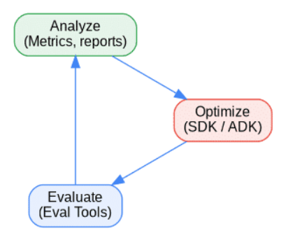 | **You don’t run a Quality Flywheel Lap in this module.**<br/>Here you just get an overview of all the steps it entails. Each later module then maps to a clear stage of it: generating cases, defining metrics, running evaluations, monitoring production, and optimizing. |

### Tour the console: where everything lives

In this lesson, you’ll tour the areas of the Google Cloud console where agent evaluation lives, so the screens are familiar before you use them. You’ll see where your agent deployment sits, the Evaluation page and its tabs, and where your agent’s recorded data shows up.

#### The console layout and where evaluation lives

You reach everything in this course from the [Gemini Platform](https://docs.cloud.google.com/gemini-enterprise-agent-platform/optimize/evaluation/agent-evaluation) control plane, under `Gemini platform > Agents` in the **Google Cloud console**. 

Your agent runs as a deployment, so you select Deployments and open the Google Cloud Support agent. A deployment is your home base. Its tabs include Dashboard, Revisions, and Traces, and you return here throughout the course.

Evaluation work splits across two places. Knowing which is which saves confusion later.

| | |
| :-- | :-- |
| ***The per-deployment Dashboard*** tab carries an Evaluation subsection that charts quality trends once monitors run.| The separate `Gemini platform > Agents > Evaluation` page, which the next topic covers, is where you start and manage evaluation runs. |

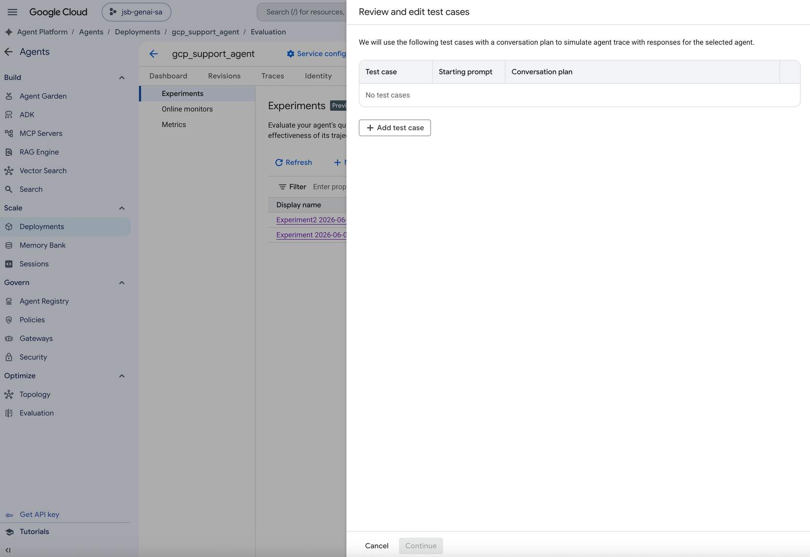


#### The Evaluation page and its tabs

The Gemini platform > Agents > Evaluation page is the control center for evaluation, and it carries three tabs. Each owns one kind of work, so the tab you’re on tells you what you can do.

<div class="md-tabs">
  <input type="radio" name="platform-capabilities" id="tab-plat-capab-1" checked>
  <label for="tab-plat-capab-1">Experiments</label>
  <input type="radio" name="platform-capabilities" id="tab-plat-capab-2">
  <label for="tab-plat-capab-2">Metrics</label>
  <input type="radio" name="platform-capabilities" id="tab-plat-capab-3">
  <label for="tab-plat-capab-3">Online Monitors</label>
  <div class="tab-panel">  
    <p><a href="https://docs.cloud.google.com/gemini-enterprise-agent-platform/optimize/evaluation/evaluate-offline">Experiments</a> start offline evaluation runs and read their reports.</p>
  </div>
  <div class="tab-panel">
    <p><a href="https://docs.cloud.google.com/gemini-enterprise-agent-platform/optimize/evaluation/manage-metrics">Metrics</a> define and reuse the grading rules an evaluation applies.</p>
  </div>
  <div class="tab-panel">
    <p><a href="https://docs.cloud.google.com/gemini-enterprise-agent-platform/optimize/evaluation/evaluate-online">Online monitors</a> score a sample of live production traffic on a schedule.</p>
  </div>
</div>

You’ll spend most of the course on these three tabs. You generate and run experiments, register metrics, and stand up monitors. For now, just locate them, so when a later module says “open the Metrics tab,” you know exactly where you are.

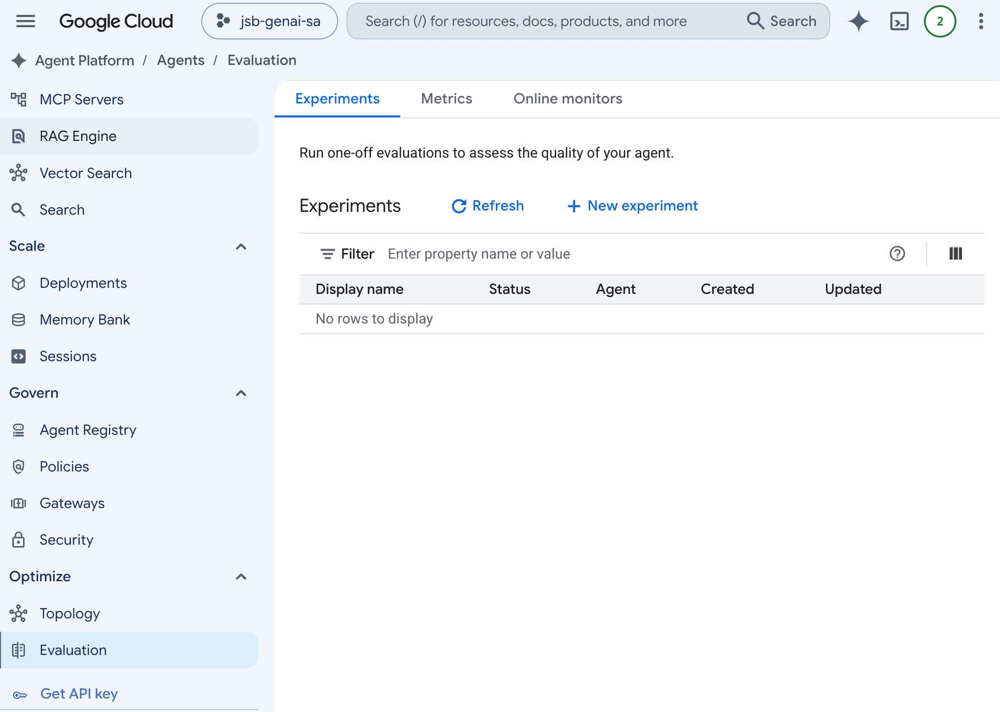

#### Where your agent’s data lives

Evaluation grades recorded traces and sessions, so it helps to know where they show up. The deployment’s Dashboard summarizes activity at a glance, with details of sessions and agent invocations. Those counts are the first sign your agent is producing data. When they are zero, there is nothing to evaluate yet.

The Traces tab holds the conversations themselves. It shows the traces and sessions the evaluator reads, and it is where you open a single conversation to inspect it turn by turn. Capturing this data is the subject of Module 2, and reading it in depth comes in Modules 5 and 7. For now, your agent’s raw data lives on the Traces tab, and its trends live on the Dashboard.

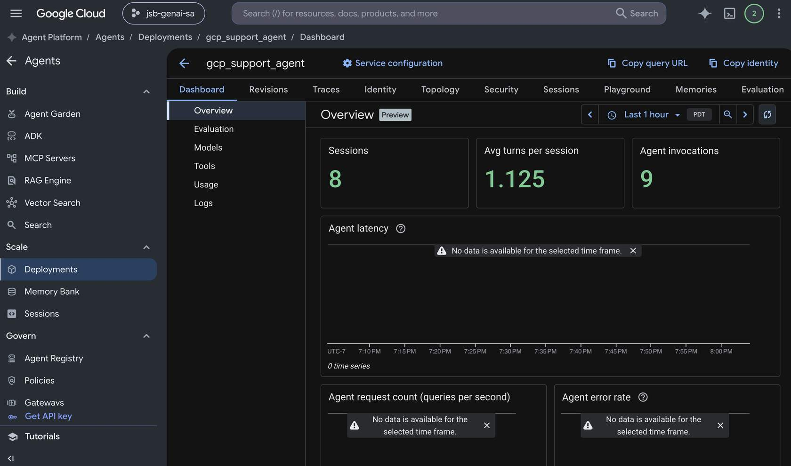

### How the pieces fit: approaches, engine, and the course map

In this lesson, you’ll connect the pieces. You’ll see the multiple evaluation options available in Gemini platform for agents. You will also see how every stage of the Quality Flywheel maps onto the modules ahead. By the end, you’ll hold one mental model of the whole course.

#### Offline evaluation versus online monitoring

Gemini platform gives you two ways to evaluate the agent.

| | Approaches |
| :-- | :-- |
| 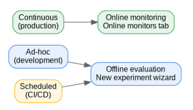 | **Offline evaluation** scores data you already have, such as captured traces, sessions, or simulated sessions. You run it from the New experiment wizard on the Evaluation page.<br/><br/>**Online monitoring** scores a sample of live production traffic on a recurring schedule. You run it from the Online monitors tab. Offline evaluation is the focus of Module 5. Online monitoring is Module 6.

Within offline evaluation, the cadence shifts with the lifecycle stage. You run ad-hoc checks while developing new agent logic. Then you schedule the same evaluation in a continuous integration and delivery (CI/CD) pipeline for regression testing. Both cadences go through the one New experiment wizard.

Use offline while you build and test, and online once the agent serves real users.

| **Gemini platform feature** | **What it scores** | **Where you run it** | **When you use it** |
| :--- | :--- | :--- | :--- |
| Offline evaluation | Data you already have: traces, sessions, or simulated sessions | New experiment wizard | Ad-hoc during development, or scheduled in a CI/CD pipeline |
| Online monitoring | A sample of live production traffic | Online monitors tab | On a schedule, in production |

#### The console and the SDK reach the same eval engine

Agent evaluation has two entry points to the same underlying eval engine. One is the Google Cloud console wizard, a guided flow with prompts and built-in dashboards. The other is the Agent Platform SDK client, the scriptable path for repeatable runs in a CI/CD pipeline.

This course works in the console, so that is what the lessons show, and the SDK runs the same evaluations through code. Because both reach the same engine, what gets measured does not change between them.

## Instrument your agent and capture telemetry

Evaluation can only grade what the agent recorded. Before you generate a case, define a metric, or read an evaluation result, the agent has to emit telemetry the platform can read. That telemetry is a structured record of every prompt, response, and tool call.

In this module, you’ll learn how that record is organized as traces and sessions, the OpenTelemetry contract Gemini platform needs to evaluate an agent, and how to read a trace to find the turn where the agent went wrong. The rest of the course depends on this foundation. An empty evaluation result almost always means a telemetry gap.

You’ll work with this course’s running example, a Google Cloud Support agent that triages customer issues with five tools. You instrument it so its behavior becomes evaluable data.

### Traces, sessions, and the prerequisites for evaluable data

A trace is a factual, immutable record of one agent invocation, a single turn. It captures the model inputs, the responses, and the tool calls, in order. A session covers the entire multi-turn conversation between a user and the agent. The difference is scope. A trace is one invocation. A session is the whole conversation, which can contain several traces. A trace is itself built from spans, each one a single timed step such as a model call or a tool call.

That distinction decides what you can measure. You evaluate a trace when the behavior you care about lives in one path, such as whether a single tool call was correct. You evaluate a session when the behavior only emerges across turns, such as whether the agent kept context or recovered from a wrong assumption. Modules 5 and 6 make this same choice. Here you learn what each one holds, so the choice is obvious later.

**In this lesson, you’ll learn the two units of recorded agent behavior, the trace and the session.** You’ll see what must be in place before the platform can capture them, and why telemetry is the foundation every later module builds on. **Get this layer right and every evaluation downstream has something to grade. Get it wrong and the console reports nothing.**

#### Trace versus session

A session is the whole conversation. Each trace within it is one agent invocation (one turn).

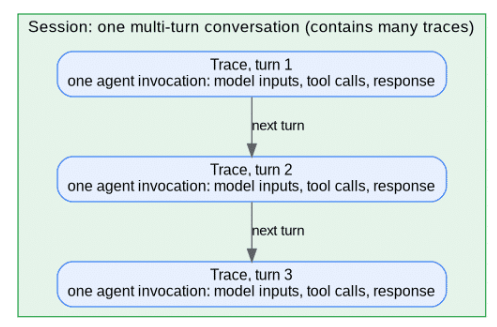

#### Prerequisites for capturing evaluable data

Before any trace exists, three things have to be in place:

* **The agent must run on a deployed *Agent Runtime* with Cloud Trace enabled**, because Cloud Trace is where the platform reads the agent’s spans.
* **You need a Cloud Storage bucket for evaluation output**. You provide the path once, and the console pre-fills it for later runs.
* If you evaluate through the Agent Platform SDK, configure the environment variables, install `gcloud`, and authenticate to your Google Cloud Project.

These are setup steps you do once per agent, not once per evaluation. The Google Cloud Support agent in this course is deployed to Agent Runtime with telemetry turned on. That is what makes its traces visible to the evaluation tools.

#### Telemetry is the foundation

Every evaluation feature in this course reads recorded telemetry, not the agent’s live traces. Scenario generation simulates against a registered agent, offline evaluation grades captured traces, and issue clustering reads the verdicts computed over traces. Even online monitoring works by sampling recorded traces on a schedule, not by intercepting the live agent traces. If telemetry is disabled, the Quality Flywheel will be unable to work.

That is why an empty result is a diagnostic signal, not a clean bill of health. When the deployment is instrumented, its Dashboard shows the telemetry as sessions, turns, and agent invocations. When an evaluation run returns no scores, suspect a telemetry gap first. The rest of this module teaches you to solve this issue.


Instrumented telemetry appears on the deployment Dashboard as sessions, turns, and invocations.


### The Telemetry Contract

In this lesson, you’ll learn exactly what the platform needs an instrumented agent to emit, how to turn that capture on with a few environment variables, and how to keep large or multimodal content out of your trace spans.

The contract is very specific. One missed attribute can prevent a metric from getting the signal it needs.

#### What the platform needs you to emit

Gemini platform evaluates an agent by reading specific **OpenTelemetry** signals. The requirements are identical for [offline evaluation](https://docs.cloud.google.com/gemini-enterprise-agent-platform/optimize/evaluation/evaluate-offline) and [online monitoring](https://docs.cloud.google.com/gemini-enterprise-agent-platform/optimize/evaluation/evaluate-online).

The agent must emit two things:

1. The invoke agent span must carry `gen_ai.agent.name`, `gen_ai.agent.description`, and `gen_ai.conversation.id`. These identify the agent and tie a trace to its conversation.
2. The inference events, recorded as `gen_ai.client.inference.operation.details`, must capture `gen_ai.input.messages`, `gen_ai.output.messages`, `gen_ai.system_instructions`, and `gen_ai.tool.definitions`.

**Each attribute above is required.**

* The input and output messages are what a response-quality metric grades.
* The tool definitions are what a tool-use metric checks against.
* The conversation id is what groups single traces into a session.

A missing attribute does not fail loudly. It quietly removes the signal that a metric needs, so the score comes back empty.

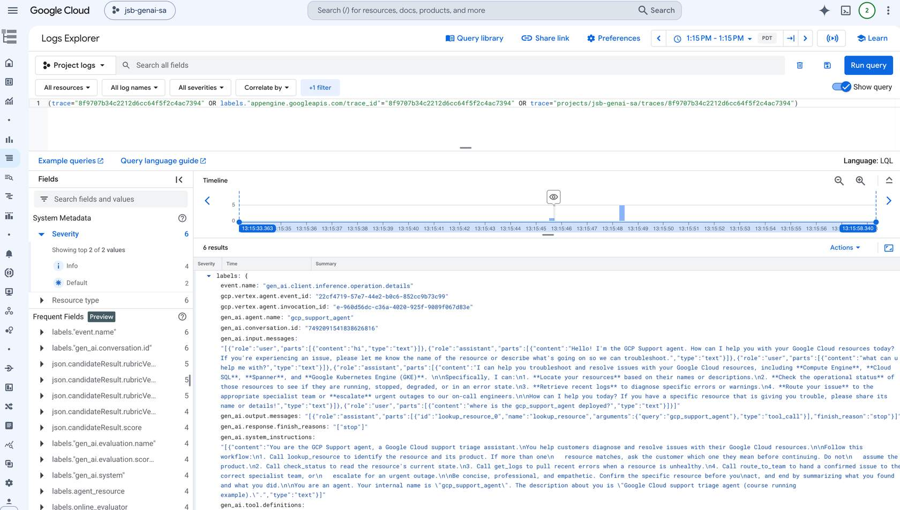

In Logs Explorer, a captured `gen_ai.client.inference.operation.details` event carries the input and output messages, system instructions, and tool definitions a metric reads.

#### Turning on capture

By default an agent does not record message content, so you opt in. If you build on the Agent Development Kit, you enable the required capture with two environment variables on the deployed agent:

```bash
OTEL_SEMCONV_STABILITY_OPT_IN='gen_ai_latest_experimental'
OTEL_INSTRUMENTATION_GENAI_CAPTURE_MESSAGE_CONTENT='EVENT_ONLY'
```

> [!Note] 
> The environment-variable snippets in this lesson are shown for orientation. The companion lab walks through deploying the agent with them end to end.

The console reminds you when this is missing. The New experiment wizard warns that the agent must be deployed with `OTEL_INSTRUMENTATION_GENAI_CAPTURE_MESSAGE_CONTENT`, or tool evaluation fails.

On Agent Runtime, you also enable telemetry on the runtime itself with `GOOGLE_CLOUD_AGENT_ENGINE_ENABLE_TELEMETRY='true'`, so the spans reach Cloud Trace in the first place.

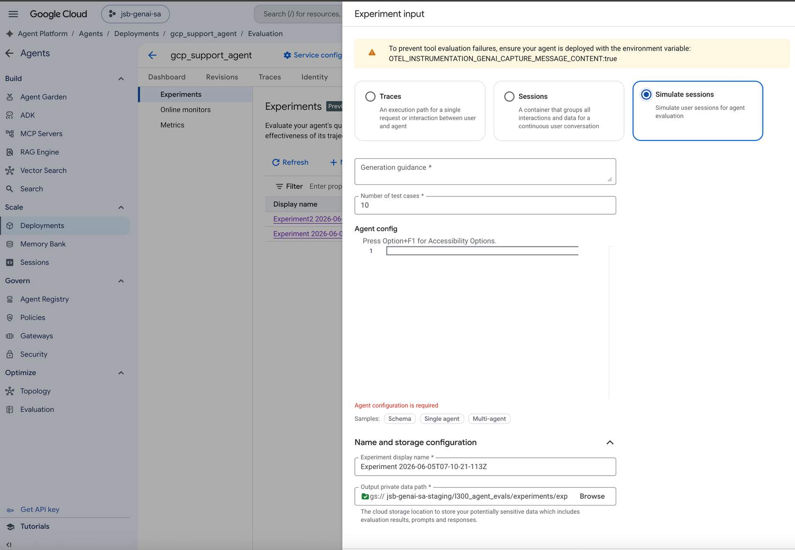

The console flags a missing telemetry variable before a run, since tool evaluation fails without it.

> [!Note] 
> Deploy with the pairing shown above, `OTEL_SEMCONV_STABILITY_OPT_IN='gen_ai_latest_experimental'` and `OTEL_INSTRUMENTATION_GENAI_CAPTURE_MESSAGE_CONTENT='EVENT_ONLY'`.
>
> The wizard’s banner shows the flag as a shorthand :true. The experimental opt-in plus EVENT_ONLY is what makes the agent emit the gen_ai content the evaluator reads. It is how the Google Cloud Support agent in this course is deployed.

#### Recording large and multimodal content

Embedding images or large documents directly in trace spans bloats them and can hit span size limits. When the agent handles multimodal data, record the inputs and outputs in a Cloud Storage bucket instead, so the spans keep references rather than payloads.

You enable the offload with three more environment variables:

```bash
OTEL_INSTRUMENTATION_GENAI_UPLOAD_FORMAT='jsonl'
OTEL_INSTRUMENTATION_GENAI_COMPLETION_HOOK='upload'
OTEL_INSTRUMENTATION_GENAI_UPLOAD_BASE_PATH='gs://STORAGE_BUCKET_NAME/PATH'
```

This keeps traces small but preserves the full content the evaluator needs, stored in the bucket you point it at. For a text-only agent, the two capture variables from the previous topic are enough, and you can skip the upload settings.

### Read a trace to debug agent behavior

In this lesson, you’ll learn to treat the trace as the ground truth for what the agent actually did, recognize what a specific failure looks like inside a session, and backtrack from a wrong answer to the turn that caused it. This is the skill every triage step in later modules depends on.

#### The trace as ground truth

When you need to know what the agent did, rather than what it should have done, you read the trace. Because it records the actual model inputs, responses, and tool calls in order, it is the single authoritative account of a run. Scores and rationales summarize it, but the trace is the evidence beneath them. Reading it is how you confirm whether a low score reflects a real behavior problem or a noisy judge.

You open a trace from the agent’s Traces tab, or from a session in Session view to see the full multi-turn conversation. Each turn shows the prompt the agent received, the tools it called with their arguments, and the response it produced. Together these let you replay the agent’s reasoning one step at a time.

#### What a wrong-product turn looks like

Consider the course’s canonical failure. A user says “my instance is down.” The Google Cloud Support agent assumes Compute Engine and troubleshoots it for three turns, when the resource is actually a Cloud SQL instance. In the trace, the failure is visible at the moment it happens. The agent calls `lookup_resource` and `get_logs` against a Compute Engine assumption it never confirmed, instead of asking which product the user means.

| | | |
| :-- | :-- | :-- |
| **Turn 1**<br/>**User:** my instance is down<br/>**Agent:** [calls lookup_resource(type="compute")]  <- assumes the product | **Turn 2**<br/>**Agent:** [calls get_logs(service="compute")] here are the Compute Engine logs | **Turn 3**<br/>**Agent:** your VM looks healthy, try restarting it   <- wrong: it is a Cloud SQL instance |

The trace makes the difference between symptom and cause concrete. The wrong final answer is the symptom. The unconfirmed product assumption several turns earlier is the cause. Reading the turns in order separates the two, instead of guessing from the final response alone.

#### Backtrack to the root turn

A failing answer is rarely where the agent first went wrong. You walk the trace backward, from the bad response to the earliest turn that forced it. You start at the failing turn, then read upstream until you reach the decision that started the wrong path, the root turn. For the support agent, that is the turn where it committed to Compute Engine without disambiguating.

Once you track down the root turn, you turn a vague “the agent gave a wrong answer” into an actionable insight. The root turn names what to change. Here, the agent should ask a clarifying question before it acts.

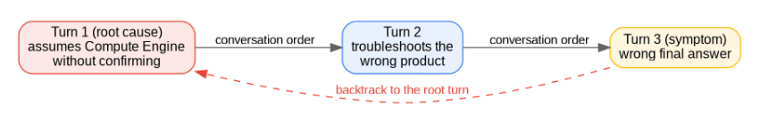

## Generate eval cases with scenario generation and the User Simulator

Most agents start with nothing to measure their quality against. You have a working agent, but no eval cases, no labeled examples, and no production traffic. Gemini platform closes that gap with simulation, so you don’t have to hand-write test cases or wait for real users.

In this module, you’ll learn how to generate eval cases from the agent itself with scenario generation(opens in a new tab), turn them into simulated sessions with the User Simulator, and understand what a simulated run actually executes against your agent. You’ll work with this course’s running example, a Google Cloud Support agent that triages customer issues with five tools.

### Generate eval cases with scenario generation

Writing test cases by hand doesn’t scale, and leveraging production traffic is not always feasible. In this lesson, you’ll learn how to generate test cases directly from the agent’s own definition,, and what a generated eval case actually contains.

#### Bootstrap a suite with scenario generation

[Scenario generation](https://docs.cloud.google.com/gemini-enterprise-agent-platform/optimize/evaluation/evaluate-simulated) can help you generate synthetic eval cases. It reads the agent’s instructions and tool definitions, then writes candidate cases that exercise what the agent is built to do. Your first suite reflects the agent’s real capabilities, not only the scenarios you happen to think of.

You start it from the Simulate sessions option in a new experiment. The Traces and Sessions options instead grade data you already have. Its key input is the generation guidance, a short description of the behaviors and edge cases you want covered. Scenario generation then returns a table of candidate cases to review.

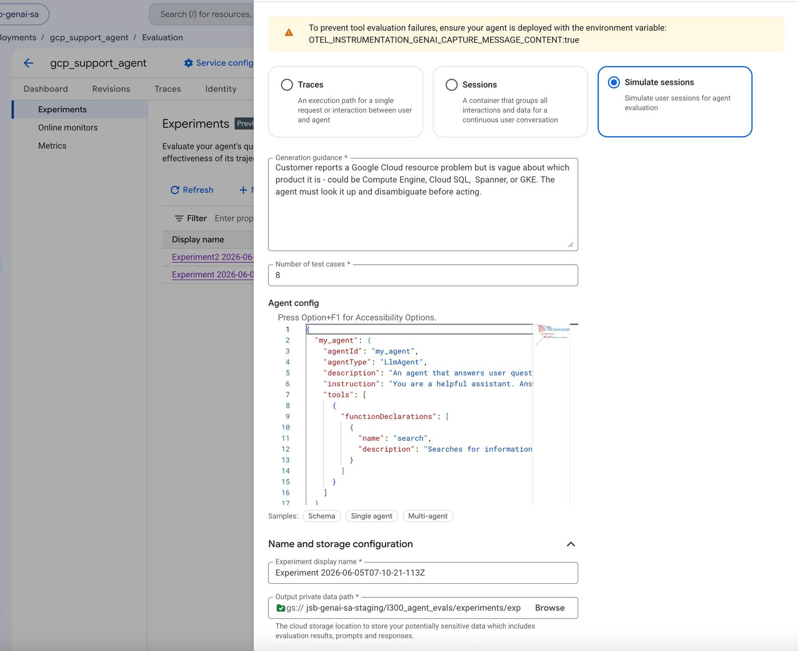


#### Why a simulation run targets a registered agent version

A simulation run needs a fixed target, so that results are reproducible and two runs are comparable. That target is an agent version in the [Agent Registry](https://docs.cloud.google.com/gemini-enterprise-agent-platform/govern/agent-registry). It is the instructions, tools, and model frozen together as an immutable snapshot.

You need at least one registered agent version before simulation runs, since the evaluation targets that snapshot. Changing the agent later creates a new version. That new version lets you compare it to an earlier version on the same cases.

#### What a generated eval case contains

Each generated case is a specification, not a finished test. It pairs a starting prompt with a conversation plan.

The starting prompt is the first message the agent sees. The conversation plan is a hidden instruction that tells the simulated user how to behave for the rest of the conversation. The agent reacts to the starting prompt, and the conversation plan keeps a multi-turn case playing out consistently.

The generated cases can be viewed in a table, where you can edit a prompt, adjust a conversation plan, or add your own cases manually. This is how you can target specific behaviors, such as an ambiguous request or a hard follow-up.

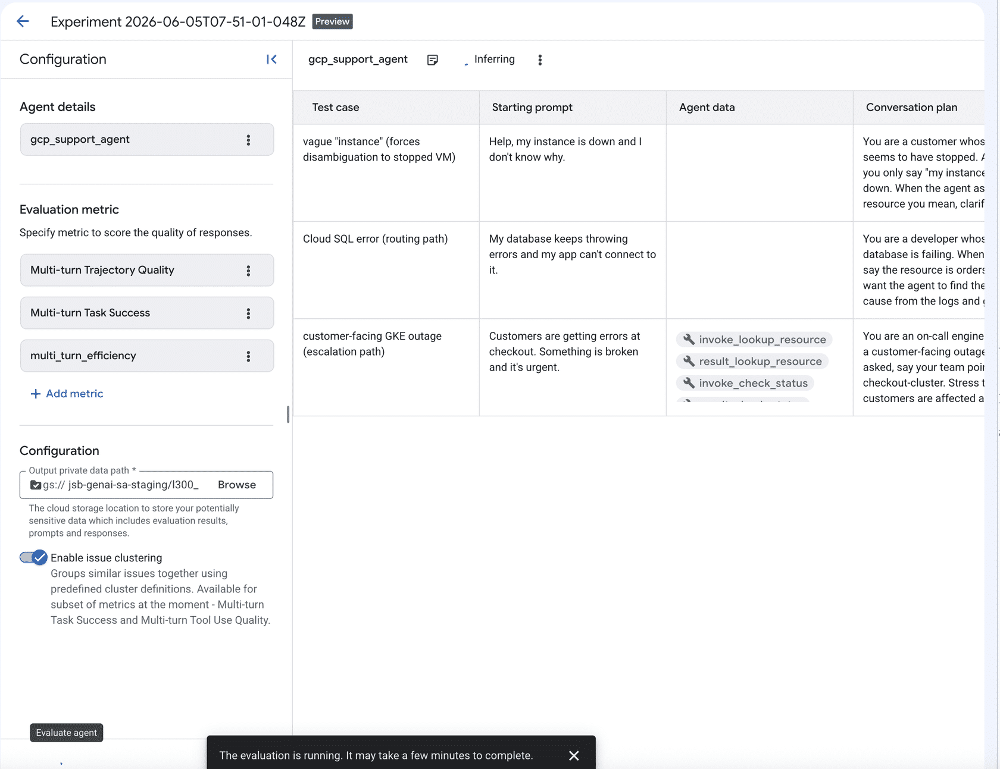

### Run the User Simulator

A generated case describes a conversation but does not run it. In this lesson, you’ll learn how to run the User Simulator to turn cases into simulated sessions, and exactly what that run executes.

#### Run the User Simulator to produce sessions

The [User Simulator](https://docs.cloud.google.com/gemini-enterprise-agent-platform/optimize/evaluation/evaluate-simulated) acts as a user on every turn and follows each case’s conversation plan. It sends a message, reads the agent’s response, and continues until the conversation resolves or hits a turn limit. The output is a session, the recorded multi-turn conversation. It is made of the per-turn traces, each with the model inputs, responses, and tool calls. 

A few settings help you control the run:

* **Max turn:** Caps how many turns a conversation can take, so a case can’t run on indefinitely. _Tip:_ Defaults to 5, but can be increased.
* **Model name:** The model that generates the next simulated user message.
* **Model configuration:** Settings for the simulator model

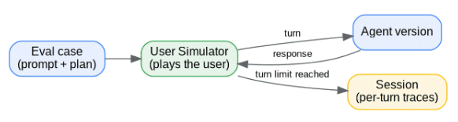

#### What a simulated run actually executes

A simulated run has two parts, and only one of them is simulated. The User Simulator plays the user and generates each turn based on the conversation plan. The simulation uses a live production agent. The platform executes the registered agent version, so every tool the agent decides to call actually runs. The session you score later is the record of that real execution. That is what makes the scores meaningful.

Because simulated users interact with the live production agent, the tools can impact other production systems. Gemini platform has no built-in tool sandbox for this, so you should control it in your own agent. Run simulations against an agent version whose tools are safe for evaluation. Or point those tools at non-production backends in your tool configuration. That way, generating eval data will not cause any unexpected side effects.

## Defining and registering grading metrics

This module shows how to choose, apply, and author the metrics that grade your agent. A trace records what happened; a metric is the rule that turns that record into a score. Choosing the right metrics is what makes the rest of the Quality Flywheel produce scores you can act on.

You’ll work in the Metric Registry, on the Metrics tab of the Evaluation page. This is the single place where every metric is stored for reuse. You start with the predefined metrics Google manages for you, and learn to match a metric to a grading goal. Then you author your own custom metric for a criterion the managed set doesn’t cover. You choose between a judge-based and a code-based metric, and publish your new metric.

### Choosing and applying predefined metrics

You do not write grading rules from scratch. Gemini platform ships predefined metrics that cover the dimensions most agents need. This lesson shows where they live, how single-turn and multi-turn metrics differ, and how you add metrics to an evaluation. First, a mental model that makes the rest of the module clear.

#### Finding predefined metrics in the Metric Registry

Two terms underpin everything in this module. A rubric is a single pass-or-fail criterion, like one unit test on a response. A metric is a score aggregated across one or more rubrics. The Metric Registry, on the Metrics tab, is the central place where every metric lives, so you define a metric once and reuse it across offline evaluations and online monitors.

The predefined metrics are the built-in metrics Google manages, so you can start grading without writing a rubric. The registry lists them alongside any custom metrics you add, and opening a metric shows what it scores.

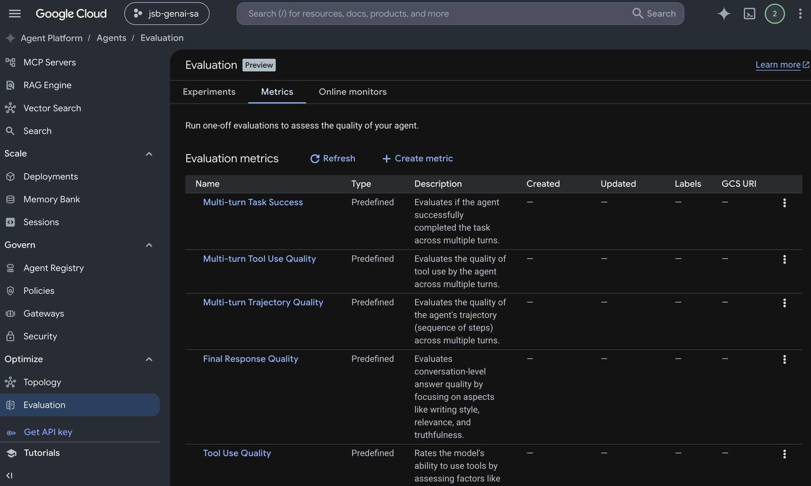


#### Picking the right predefined metric

There are two types of predefined metrics.

* **Single-turn metric** grades one prompt-response turn in isolation.
* **A multi-turn metric** synthesizes behavior across the whole conversation.

Match the scope to the behavior you are grading: a problem that only reads as wrong across a full session slips past a single-turn metric.

| **Scope** | **Predefined metric** | **What it grades** |
| :--- | :--- | :--- |
| Single-turn | Agent Final Response Quality | The quality of one final response |
| Single-turn | Agent Hallucination | Whether one response is grounded |
| Single-turn | Agent Tool Use Quality | Whether a tool call in one turn was correct |
| Single-turn | Safety | Whether one response is safe |
| Multi-turn | Agent Multi-turn Task Success | Whether the conversation reached its goal |
| Multi-turn | Agent Multi-turn Tool Use Quality | Tool use across the whole conversation |
| Multi-turn | Agent Multi-turn Trajectory Quality | The path the agent took across turns |

To grade one final response, use a single-turn metric. To grade whether a full conversation reached its goal, use Agent Multi-turn Task Success.

> [!Tip]
> A failure that compounds across turns shows up in a multi-turn metric, not a single-turn one.

#### Selecting metrics for an evaluation

When you set up an evaluation, you choose which metrics it uses to grade your captured traces or sessions.

When you start a [New experiment](https://docs.cloud.google.com/gemini-enterprise-agent-platform/optimize/evaluation/evaluate-offline), four core metrics are added by default: Agent Final Response Quality, Agent Hallucination, Agent Tool Use Quality, and Safety. Together they cover response quality, grounding, tool correctness, and safety, a reasonable default for any first run. You add or remove metrics as the goal requires.

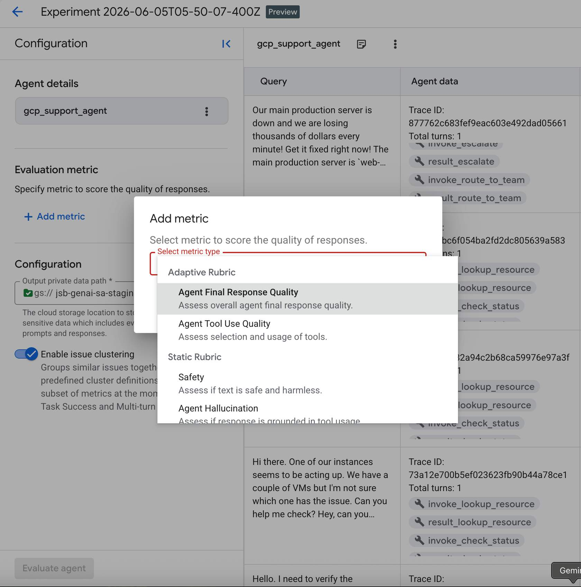

### Authoring and reusing custom metrics
The predefined metrics cover common dimensions, but your agent may need a check they do not provide, such as a tone rule for support replies. This lesson shows how to author a custom metric in the console, how to choose between a judge-based and a code-based metric, and how the registry makes it reusable.

Authoring a custom metric in the console

When no predefined metric covers your criterion, you author your own. A tone check is a common example: support replies should stay calm and professional under pressure, and no predefined metric grades that. You author the metric in the console, without any coding.

You start in the New metric dialog on the Metrics tab and choose Custom LLM metric or Custom code metric. For an LLM metric, the Sample buttons seed a starter rubric: an instruction, a set of named criteria such as Clarity or Excitement, and a rating-score ladder. You then edit that rubric to fit your goal.


In the New metric dialog, the Sample button seeds the rubric for a Custom LLM metric.

Choosing a judge-based versus a code-based custom metric

A custom LLM metric uses a judge model to grade against a rubric, which suits subjective criteria. A custom code metric runs a deterministic Python check, which suits objective, repeatable conditions.

Choose by asking whether the criterion is a judgement call or a definite pass-or-fail rule. Both register through the same New metric dialog and live in the same registry, so you can mix them in one evaluation.

Custom LLM metric

Custom code metric

Grades with

A judge model against a rubric

A deterministic Python check

Best for

Subjective criteria, judgement calls

Objective, repeatable conditions

Example

Scoring tone against a rubric

Confirming a tool returned a structured result

Tip: When a criterion has one correct answer you could verify in code, choose a custom code metric. Reserve the judge model for criteria that genuinely need judgment.

Define once, reuse everywhere

The point of the registry is reuse.

A metric you register once applies to both offline evaluations and online monitors, so you do not redefine criteria per run.


One registered metric feeds both offline evaluations and online monitors, so you define it once.


Once a custom metric is in the registry, every evaluation and monitor can use it.

To create a variant of an existing metric, use More options > Duplicate and edit the copy, rather than changing a metric that other runs may depend on.


